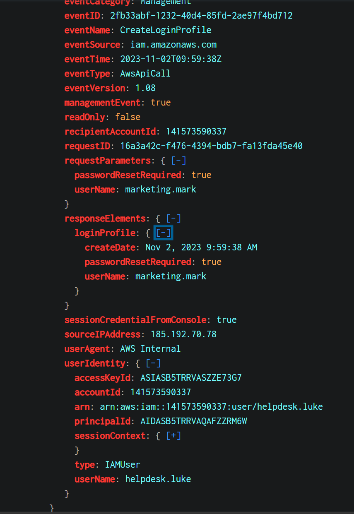
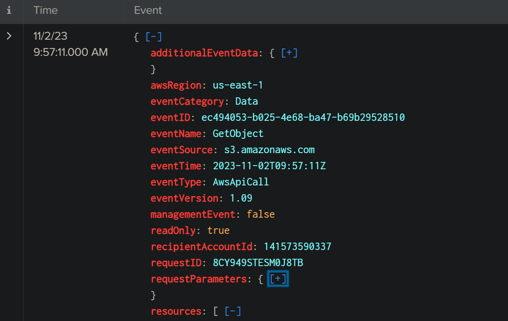
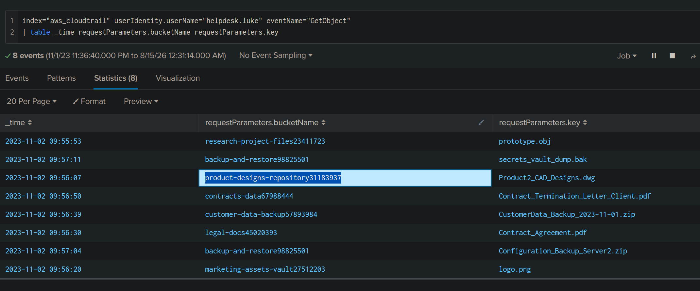
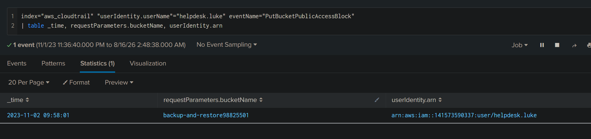
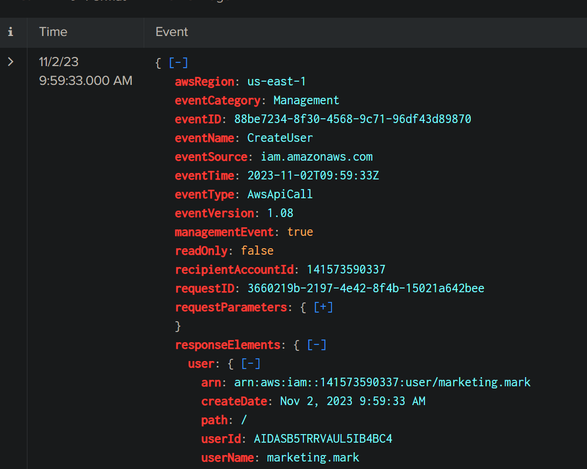
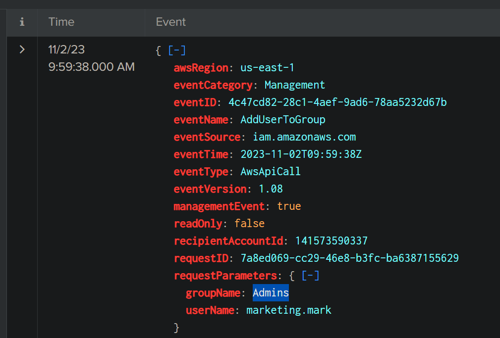

# AWSRaid (CyberDefenders AWS CloudTrail / Splunk Lab)

_A hands-on SOC analyst project focused on AWS CloudTrail analysis, suspicious IAM activity, S3 access, public-access configuration changes, persistence, and privilege escalation using Splunk._

---

## Table of Contents

- [Project Summary](#project-summary)
- [Skills Demonstrated](#skills-demonstrated)
- [Investigation Process](#investigation-process)
  - [Stage 1: Identify the Compromised User](#stage-1-identify-the-compromised-user)
  - [Stage 2: Identify the First S3 Object Access](#stage-2-identify-the-first-s3-object-access)
  - [Stage 3: Identify the Bucket Containing the DWG File](#stage-3-identify-the-bucket-containing-the-dwg-file)
  - [Stage 4: Identify the Bucket with Public-Access Configuration Changes](#stage-4-identify-the-bucket-with-public-access-configuration-changes)
  - [Stage 5: Identify the Persistence Account](#stage-5-identify-the-persistence-account)
  - [Stage 6: Identify the Privileged Group](#stage-6-identify-the-privileged-group)
- [Attack Timeline](#attack-timeline)
- [Key Findings](#key-findings)
- [Indicators of Compromise / Investigation Artifacts](#indicators-of-compromise--investigation-artifacts)
- [Lessons Learned](#lessons-learned)
- [What I’d Improve Next Time](#what-id-improve-next-time)
- [References](#references)

---

## Project Summary

> **What is this project?**
>
> I completed the CyberDefenders **AWSRaid** lab, an AWS cloud-forensics scenario involving unauthorized access, suspicious S3 activity, configuration changes, and persistence. Using Splunk, I analyzed AWS CloudTrail events to identify the compromised IAM user, trace the attacker’s first access to an S3 object, identify sensitive buckets, review a public-access configuration change, and confirm the creation of a new privileged account.

This investigation was completed with hints and guidance when needed because I was still learning AWS terminology and CloudTrail event names. I validated each answer by examining the relevant CloudTrail fields in Splunk.

---

## Skills Demonstrated

- Splunk Search Processing Language (SPL)
- AWS CloudTrail log analysis
- Identifying IAM users in CloudTrail events
- Distinguishing the actor from the target of an AWS API request
- Investigating S3 object access
- Reading `requestParameters` and `responseElements`
- Identifying suspicious IAM account creation
- Identifying group membership changes
- Building an attack timeline from cloud audit logs
- Recognizing persistence and privilege-escalation behavior
- Documenting findings for a SOC investigation

---

## Investigation Process

### Stage 1: Identify the Compromised User

- **Problem:** Determine which IAM user account was compromised and used by the attacker.
- **Actions:**
  - Reviewed usernames present in CloudTrail data.
  - Compared activity across users.
  - Investigated suspicious IAM events.
  - Examined `userIdentity.userName` to determine which account performed the actions.
- **Useful SPL:**

```spl
index="aws_cloudtrail"
| stats count by userIdentity.userName
| sort - count
```

To review suspicious IAM activity:

```spl
index="aws_cloudtrail" eventName="CreateLoginProfile"
| table _time userIdentity.userName requestParameters.userName sourceIPAddress
```

- **Evidence:**

```text
Actor / Compromised User: helpdesk.luke
Source IP observed:        185.192.70.78
```

A key lesson was the difference between these fields:

```text
userIdentity.userName
= the account that performed the AWS action

requestParameters.userName
= the user account targeted by the request
```

- **Result:** Identified the compromised account as:

```text
helpdesk.luke
```

>  

---

### Stage 2: Identify the First S3 Object Access

- **Problem:** Determine the timestamp of the attacker’s first access to an S3 object.
- **Actions:**
  - Filtered CloudTrail events for the compromised user.
  - Searched for the S3 `GetObject` event.
  - Sorted events from oldest to newest.
- **Useful SPL:**

```spl
index="aws_cloudtrail"
userIdentity.userName="helpdesk.luke"
eventName="GetObject"
| sort 0 _time
| table _time userIdentity.userName eventName sourceIPAddress requestParameters.bucketName requestParameters.key
```

An alternative query to return only the earliest access:

```spl
index="aws_cloudtrail"
userIdentity.userName="helpdesk.luke"
eventName="GetObject"
| stats earliest(_time) AS first_access
| convert ctime(first_access)
```

- **Analysis:**
  - In Amazon S3, a **bucket** is a storage container.
  - An **object** is a file stored inside a bucket.
  - `GetObject` represents retrieving/accessing an S3 object.
- **Result:** The first S3 object access occurred at:

```text
2023-11-02 09:55
```

> 

---

### Stage 3: Identify the Bucket Containing the DWG File

- **Problem:** Determine which S3 bucket contained a `.dwg` file accessed by the attacker.
- **Actions:**
  - Filtered `GetObject` events for the compromised user.
  - Displayed the bucket name and object key.
  - Located the object whose key ended in `.dwg`.
- **Useful SPL:**

```spl
index="aws_cloudtrail"
userIdentity.userName="helpdesk.luke"
eventName="GetObject"
| table _time requestParameters.bucketName requestParameters.key
```

- **Evidence:**

```text
Bucket: product-designs-repository31183937
Object: Product2_CAD_Designs.dwg
```

- **Result:** The bucket containing the DWG file was:

```text
product-designs-repository31183937
```

> 

---

### Stage 4: Identify the Bucket with Public-Access Configuration Changes

- **Problem:** Determine which S3 bucket had its public-access configuration changed by the attacker.
- **Actions:**
  - Searched CloudTrail for the S3 public-access-block configuration event.
  - Filtered activity to the compromised user.
  - Reviewed the affected bucket name.
- **Useful SPL:**

```spl
index="aws_cloudtrail"
userIdentity.userName="helpdesk.luke"
eventName="PutBucketPublicAccessBlock"
| table _time requestParameters.bucketName userIdentity.arn
```

- **Evidence:**

```text
Event:  PutBucketPublicAccessBlock
Bucket: backup-and-restore98825501
Actor:  helpdesk.luke
```

- **Result:** The affected bucket was:

```text
backup-and-restore98825501
```

> 

---

### Stage 5: Identify the Persistence Account

- **Problem:** Determine which new IAM user account the attacker created for persistence.
- **Actions:**
  - Searched for the `CreateUser` event performed by the compromised account.
  - Reviewed the created user in `requestParameters` / `responseElements`.
- **Useful SPL:**

```spl
index="aws_cloudtrail"
userIdentity.userName="helpdesk.luke"
eventName="CreateUser"
| table _time userIdentity.userName requestParameters.userName responseElements.user.userName sourceIPAddress
```

- **Evidence:**

```text
Actor:        helpdesk.luke
Event:        CreateUser
Created User: marketing.mark
```

- **Analysis:**
  - `userIdentity.userName` identifies the actor.
  - `requestParameters.userName` or `responseElements.user.userName` identifies the newly created IAM account.
  - Creating a secondary account can provide an attacker with another method of access if the originally compromised account is disabled.
- **Result:** The attacker-created account was:

```text
marketing.mark
```

> 

---

### Stage 6: Identify the Privileged Group

- **Problem:** Determine which IAM group the attacker added the newly created account to.
- **Actions:**
  - Searched for the `AddUserToGroup` event.
  - Inspected `requestParameters.groupName` and `requestParameters.userName`.
- **Useful SPL:**

```spl
index="aws_cloudtrail"
userIdentity.userName="helpdesk.luke"
eventName="AddUserToGroup"
| table _time requestParameters.userName requestParameters.groupName userIdentity.userName 
```

- **Evidence:**

```text
Actor:      helpdesk.luke
User Added: marketing.mark
Group:      Admins
```

- **Result:** The account was added to:

```text
Admins
```

> 

---

## Attack Timeline

| Time / Stage | Activity |
|---|---|
| Initial Compromise | `helpdesk.luke` is used by the attacker |
| 2023-11-02 09:55 | First observed S3 `GetObject` access by the attacker |
| Data Access | Attacker accesses multiple S3 objects, including `Product2_CAD_Designs.dwg` |
| S3 Configuration Change | `backup-and-restore98825501` has its public-access-block configuration changed |
| Persistence | Attacker creates the IAM user `marketing.mark` |
| Privilege Escalation | `marketing.mark` is added to the `Admins` group |

---

## Key Findings

| Finding | Value |
|---|---|
| Compromised IAM User | `helpdesk.luke` |
| Suspicious Source IP Observed | `185.192.70.78` |
| First S3 Object Access | `2023-11-02 09:55` |
| DWG Object | `Product2_CAD_Designs.dwg` |
| DWG Bucket | `product-designs-repository31183937` |
| Bucket with Public-Access Configuration Change | `backup-and-restore98825501` |
| Persistence Account | `marketing.mark` |
| Privileged Group | `Admins` |

---

## Indicators of Compromise / Investigation Artifacts

```text
helpdesk.luke
marketing.mark
185.192.70.78
product-designs-repository31183937
backup-and-restore98825501
Product2_CAD_Designs.dwg
```

CloudTrail events important to this investigation:

```text
GetObject
PutBucketPublicAccessBlock
CreateUser
CreateLoginProfile
AddUserToGroup
```

---

## Lessons Learned

- In Amazon S3, a bucket is a storage container and an object is a file stored inside it.
- `userIdentity.userName` is useful for identifying **who performed an action**.
- `requestParameters` often contains the **target or input** supplied to an AWS API call.
- `responseElements` can contain information about the object or IAM resource created by the request.
- `GetObject` is an important S3 event when investigating file access.
- IAM events such as `CreateUser` and `AddUserToGroup` can reveal persistence and privilege-escalation activity.
- High event volume alone does not prove compromise; suspicious behavior must be validated by reviewing the actual events.


---

## What I’d Improve Next Time

- Learn the basic AWS services most relevant to SOC work: IAM, S3, EC2, CloudTrail, and access keys.
- Become more familiar with common CloudTrail event names before starting another AWS-focused lab.
- Practice writing SPL queries without relying on hints, then compare the results with the guided solution.
- Revisit this lab after more AWS study and attempt to reproduce the investigation from the raw logs.

---

## References

- [CyberDefenders – AWSRaid Lab](https://cyberdefenders.org/blueteam-ctf-challenges/awsraid/)
- [AWS CloudTrail – `userIdentity` element](https://docs.aws.amazon.com/awscloudtrail/latest/userguide/cloudtrail-event-reference-user-identity.html)
- [Amazon S3 API – `GetObject`](https://docs.aws.amazon.com/AmazonS3/latest/API/API_GetObject.html)
- [Splunk – SPL Search Reference](https://help.splunk.com/en/splunk-cloud-platform/search/search-reference)
