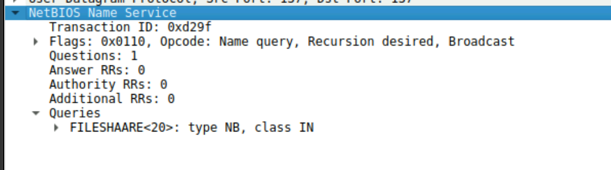
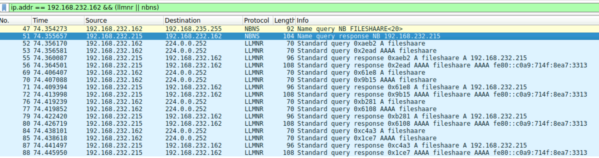
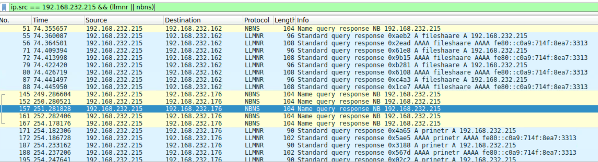
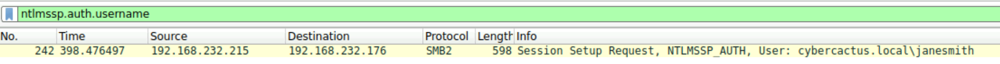
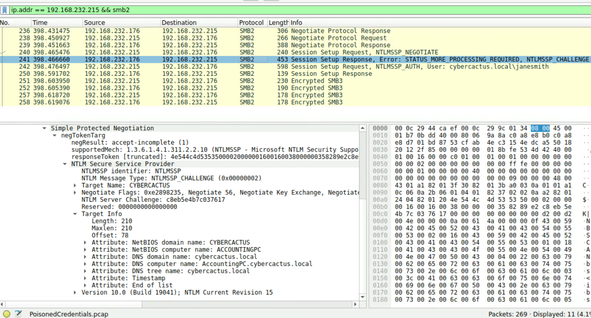

# PoisonedCredentials (CyberDefenders Network Forensics / Wireshark Lab)

_A hands-on SOC investigation of LLMNR/NBT-NS name-resolution poisoning, NTLM authentication, and suspicious SMB access using Wireshark._

---

## Table of Contents

- [Project Summary](#project-summary)
- [Incident Overview](#incident-overview)
- [Skills Demonstrated](#skills-demonstrated)
- [Investigation Process](#investigation-process)
  - [Stage 1: Identify the Mistyped Name Query](#stage-1-identify-the-mistyped-name-query)
  - [Stage 2: Identify the Rogue Responder](#stage-2-identify-the-rogue-responder)
  - [Stage 3: Identify the Second Affected Machine](#stage-3-identify-the-second-affected-machine)
  - [Stage 4: Identify the Compromised Account](#stage-4-identify-the-compromised-account)
  - [Stage 5: Identify the SMB Target Hostname](#stage-5-identify-the-smb-target-hostname)
- [Attack Timeline](#attack-timeline)
- [Key Findings](#key-findings)
- [Indicators and Investigation Artifacts](#indicators-and-investigation-artifacts)
- [MITRE ATT&CK Mapping](#mitre-attck-mapping)
- [Remediation Recommendations](#remediation-recommendations)
- [Lessons Learned](#lessons-learned)
- [What I Would Improve Next Time](#what-i-would-improve-next-time)
- [References](#references)

---

## Project Summary

> **What is this project?**
>
> I completed the CyberDefenders **PoisonedCredentials** lab, a network-forensics scenario involving LLMNR and NBT-NS poisoning. Using Wireshark, I traced mistyped local name queries, identified the rogue machine that returned poisoned responses, found the affected endpoints, examined NTLM authentication data, and determined which host the attacker accessed over SMB.

This was my first investigation involving LLMNR and NBT-NS. I used hints for the NTLM username and SMB hostname stages while learning where those values appear inside Wireshark's packet-details pane. I then validated both findings directly in the packet capture.

---

## Incident Overview

When normal name resolution fails, Windows systems may use local fallback protocols such as LLMNR or NBT-NS. A rogue system can answer a request for a nonexistent or mistyped hostname and falsely claim ownership of that name. The victim may then communicate with the rogue system and expose NTLM authentication material that can potentially be captured or relayed.

The investigation established the following high-level sequence:

```text
Mistyped hostname query
        ↓
Rogue LLMNR/NBT-NS response
        ↓
Victim communicates with the claimed host
        ↓
Compromised NTLM account is used for SMB access
```

---

## Skills Demonstrated

- Wireshark display-filter construction
- LLMNR and NBT-NS traffic analysis
- Distinguishing name queries from poisoned responses
- Identifying attacker and victim IP addresses
- Interpreting IPv4 multicast and broadcast traffic
- SMB2/SMB3 session analysis
- Extracting a username from an `NTLMSSP_AUTH` message
- Extracting a server hostname from NTLM Target Info
- Correlating packets into an attack timeline
- Documenting network-forensics findings for a SOC investigation

---

## Investigation Process

### Stage 1: Identify the Mistyped Name Query

- **Objective:** Determine which mistyped hostname was requested by `192.168.232.162`.
- **Actions:**
  - Filtered traffic originating from the specified endpoint.
  - Limited the results to LLMNR and NBT-NS.
  - Reviewed the packet-list **Info** column and the protocol **Queries** field.
- **Useful Wireshark filter:**

```wireshark
ip.addr == 192.168.232.162 && (llmnr || nbns)
```

- **Evidence:**

```text
Source:      192.168.232.162
Destination: 224.0.0.252
Protocol:    LLMNR
Query:       fileshaare
```

The intended hostname was likely `fileshare`; the submitted query contained an additional `a`.

- **Result:** The mistyped query was:

```text
fileshaare
```

> 

---

### Stage 2: Identify the Rogue Responder

- **Objective:** Identify the machine returning poisoned answers to legitimate name-resolution requests.
- **Actions:**
  - Examined responses immediately following the `fileshaare` queries.
  - Compared the response source with the IP address advertised in the LLMNR and NBT-NS answers.
  - Confirmed that the same system repeatedly claimed ownership of requested names.
- **Useful Wireshark filter:**

```wireshark
ip.addr == 192.168.232.162 && (llmnr || nbns)
```

- **Evidence:**

```text
Rogue response source: 192.168.232.215
Claimed IPv4 address:   192.168.232.215
First response target:  192.168.232.162
Claimed name:           fileshaare
```
 
- **Result:** The rogue machine was:

```text
192.168.232.215
```

> 

---

### Stage 3: Identify the Second Affected Machine

- **Objective:** Determine which additional endpoint received poisoned responses from the rogue machine.
- **Actions:**
  - Kept the rogue responder as the source in the display filter.
  - Reviewed the unique destination IP addresses.
  - Identified another endpoint receiving responses for the mistyped name `prinetr`, likely intended to be `printer`.
- **Useful Wireshark filter:**

```wireshark
ip.src == 192.168.232.215 && (llmnr || nbns)
```

- **Evidence:**

```text
Rogue source:      192.168.232.215
Second destination: 192.168.232.176
Queried name:       prinetr
```

- **Result:** The second affected machine was:

```text
192.168.232.176
```

Receiving a poisoned response establishes that the endpoint was targeted by the poisoning activity. It does not, by itself, prove successful authentication; the subsequent SMB/NTLM exchange provides additional evidence.


---

### Stage 4: Identify the Compromised Account

- **Objective:** Determine the username associated with the account used during the attacker's SMB activity.
- **Actions:**
  - Filtered for packets containing an NTLM authentication username.
  - Opened the SMB2 Session Setup Request containing `NTLMSSP_AUTH`.
  - Reviewed the domain and username extracted by Wireshark.
- **Useful Wireshark filter:**

```wireshark
ntlmssp.auth.username
```

- **Packet-details path:**

```text
SMB2
└── Session Setup Request
    └── Security Blob
        └── NTLM Secure Service Provider
            └── NTLMSSP_AUTH
                └── User name: janesmith
```

- **Evidence:**

```text
Domain:   cybercactus.local
Username: janesmith
Account:  cybercactus.local\janesmith
Source:   192.168.232.215
Target:   192.168.232.176
```

- **Result:** The compromised account username was:

```text
janesmith
```

> 

---

### Stage 5: Identify the SMB Target Hostname

- **Objective:** Determine the hostname of the machine the attacker accessed through SMB.
- **Actions:**
  - Filtered SMB traffic involving the rogue endpoint.
  - Selected the **Session Setup Response** containing the `NTLMSSP_CHALLENGE` message.
  - Expanded the NTLM **Target Info** attributes.
  - Read the NetBIOS and DNS computer names supplied by the SMB server.
- **Useful Wireshark filter:**

```wireshark
ip.addr == 192.168.232.215 && smb2
```

- **Packet-details path:**

```text
SMB2
└── Session Setup Response
    └── Security Blob
        └── NTLM Secure Service Provider
            └── NTLMSSP_CHALLENGE
                └── Target Info
                    ├── NetBIOS computer name: ACCOUNTINGPC
                    └── DNS computer name: AccountingPC.cybercactus.local
```

- **Evidence:**

```text
SMB server IP:        192.168.232.176
NetBIOS computer name: ACCOUNTINGPC
DNS computer name:     AccountingPC.cybercactus.local
```

The later successful Session Setup response followed by encrypted SMB3 packets supports that an SMB session was established.

- **Result:** The accessed machine's hostname was:

```text
ACCOUNTINGPC
```

> 

---
 
## Attack Timeline

| Stage | Activity | Evidence |
|---|---|---|
| Initial trigger | `192.168.232.162` requests the mistyped name `fileshaare` | LLMNR query to `224.0.0.252` |
| Poisoning | `192.168.232.215` claims ownership of `fileshaare` | LLMNR/NBT-NS responses advertise `.215` |
| Additional targeting | `192.168.232.176` receives poisoned responses for `prinetr` | Responses sent from `.215` to `.176` |
| Credential use | The account `cybercactus.local\janesmith` appears in NTLM authentication | SMB2 `NTLMSSP_AUTH` message |
| SMB access | `.215` authenticates to the SMB service on `.176` | Session Setup exchange and encrypted SMB3 traffic |
| Host identification | The SMB server identifies itself as `ACCOUNTINGPC` | NTLM challenge Target Info |

---

## Key Findings

| Finding | Value |
|---|---|
| First affected endpoint | `192.168.232.162` |
| First mistyped query | `fileshaare` |
| Rogue responder | `192.168.232.215` |
| Second affected endpoint | `192.168.232.176` |
| Second mistyped query observed | `prinetr` |
| Compromised username | `janesmith` |
| Account domain | `cybercactus.local` |
| SMB target IP | `192.168.232.176` |
| SMB target hostname | `ACCOUNTINGPC` |
| SMB target FQDN | `AccountingPC.cybercactus.local` |

---

## Indicators and Investigation Artifacts

```text
192.168.232.162
192.168.232.176
192.168.232.215
fileshaare
prinetr
cybercactus.local\janesmith
ACCOUNTINGPC
AccountingPC.cybercactus.local
```

Protocols and ports important to this investigation:

| Protocol | Purpose | Common port |
|---|---|---:|
| LLMNR | Local multicast name resolution | UDP 5355 |
| NBT-NS | Legacy NetBIOS name resolution | UDP 137 |
| SMB | Windows file and resource sharing | TCP 445 |
| NTLMSSP | NTLM authentication carried inside protocols such as SMB | Encapsulated in SMB in this capture |

---

## MITRE ATT&CK Mapping

| Technique | Relevance |
|---|---|
| [T1557.001 – LLMNR/NBT-NS Poisoning and SMB Relay](https://attack.mitre.org/techniques/T1557/001/) | The rogue system answered local name-resolution requests and positioned itself to collect or relay authentication material. |

The packet capture demonstrates name-resolution poisoning and subsequent NTLM/SMB activity. It does not independently establish the exact offensive tool used, so a specific tool such as Responder should not be asserted without additional evidence.

---

## Remediation Recommendations

- Disable LLMNR through managed policy where the environment does not require it.
- Disable NetBIOS over TCP/IP on systems where legacy NetBIOS name resolution is unnecessary.
- Maintain reliable DNS records and naming practices to reduce fallback name-resolution requests.
- Restrict SMB traffic between workstation network segments and allow it only where required.
- Reset and investigate the `janesmith` account and review its authentication history.
- Isolate and investigate `192.168.232.215` as the identified rogue responder.


---

## Lessons Learned

- LLMNR and NBT-NS are fallback name-resolution protocols that can be abused when DNS resolution fails.
- A query usually reveals the victim's requested name, while the response reveals the system claiming to own that name.
- Using `ip.src` is more precise than `ip.addr` when the investigation requires one traffic direction.
- `ntlmssp.auth.username` quickly locates NTLM authentication messages containing usernames.
- The SMB server's hostname can be buried inside the Target Info attributes of an `NTLMSSP_CHALLENGE` packet.
- A poisoned response shows that a host was targeted, while later authentication and session traffic provides stronger evidence of impact.

---

## What I Would Improve Next Time

- Attempt the investigation once without hints after reviewing LLMNR, NBT-NS, NTLM, and SMB packet structures.
- Build a small list of reusable Wireshark filters for common SOC network investigations.
- Add custom Wireshark columns for fields such as `ntlmssp.auth.username` to speed up analysis.
- Practice distinguishing credential capture, credential relay, and later use of compromised credentials without assuming more than the packet evidence proves.

---

## References

- [PoisonedCredentials Lab](https://cyberdefenders.org/blueteam-ctf-challenges/poisonedcredentials/)
- [Microsoft Open Specifications – LLMNR Profile](https://learn.microsoft.com/en-us/openspecs/windows_protocols/ms-llmnrp/6806998e-034d-4c39-8398-5af8bfd52d7e)
- [MITRE ATT&CK – T1557.001: LLMNR/NBT-NS Poisoning and SMB Relay](https://attack.mitre.org/techniques/T1557/001/)

