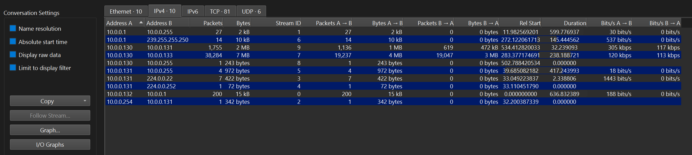
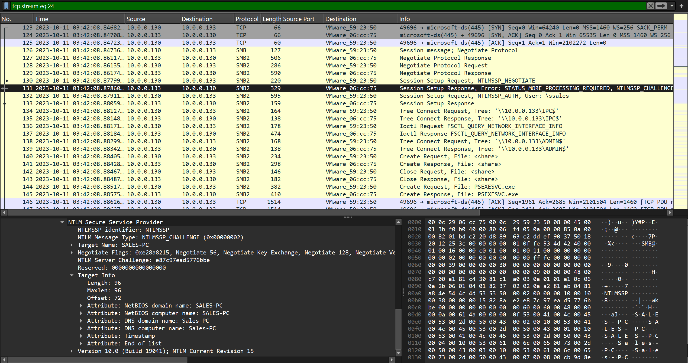
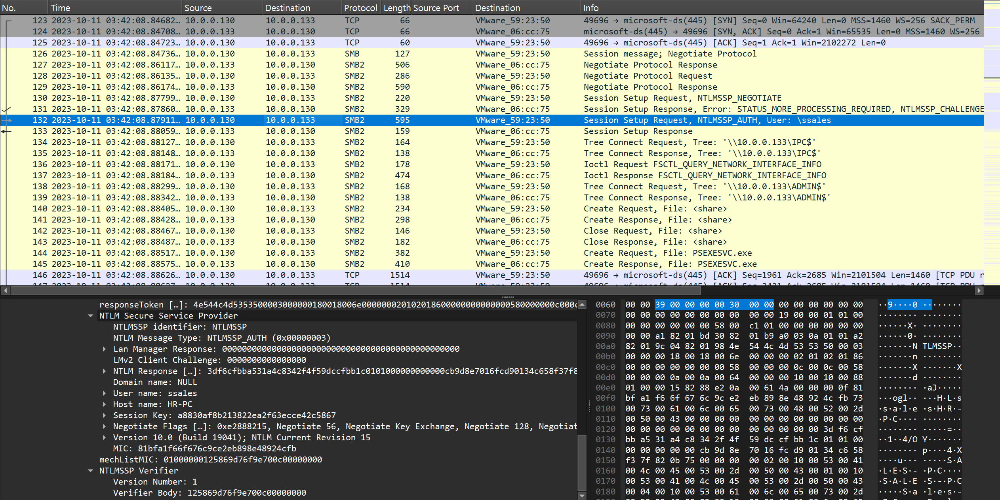
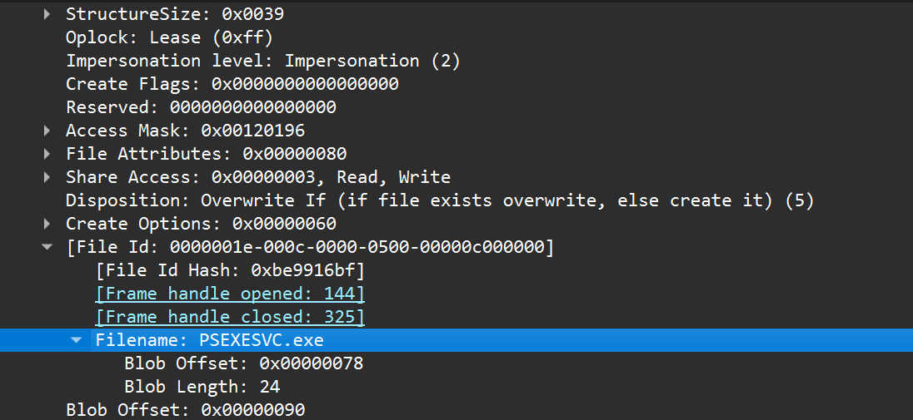
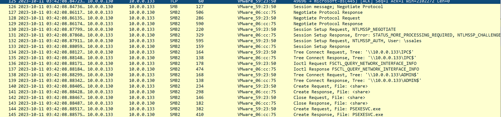
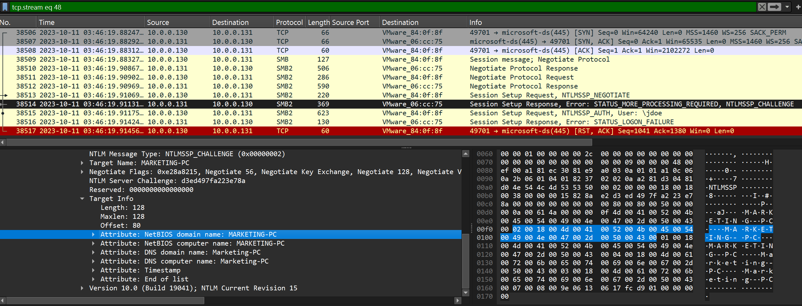

# PsExec Hunt (CyberDefenders Network Forensics / Wireshark Lab)

_A hands-on SOC investigation of PsExec-based lateral movement, SMB administrative shares, NTLM authentication, and remote service execution using Wireshark._

---

## Table of Contents

- [Project Summary](#project-summary)
- [Incident Overview](#incident-overview)
- [Skills Demonstrated](#skills-demonstrated)
- [Investigation Process](#investigation-process)
  - [Stage 1: Identify the Attacker's Source Machine](#stage-1-identify-the-attackers-source-machine)
  - [Stage 2: Identify the First Pivoted Host](#stage-2-identify-the-first-pivoted-host)
  - [Stage 3: Identify the Account Used for Authentication](#stage-3-identify-the-account-used-for-authentication)
  - [Stage 4: Identify the PsExec Service Executable](#stage-4-identify-the-psexec-service-executable)
  - [Stage 5: Identify the Share Used to Install the Service](#stage-5-identify-the-share-used-to-install-the-service)
  - [Stage 6: Identify the Share Used for Communication](#stage-6-identify-the-share-used-for-communication)
  - [Stage 7: Identify the Second Pivot Target](#stage-7-identify-the-second-pivot-target)
- [Attack Timeline](#attack-timeline)
- [Key Findings](#key-findings)
- [Indicators and Investigation Artifacts](#indicators-and-investigation-artifacts)
- [MITRE ATT&CK Mapping](#mitre-attck-mapping)
- [Remediation Recommendations](#remediation-recommendations)
- [Lessons Learned](#lessons-learned)
- [What I Would Improve Next Time](#what-i-would-improve-next-time)
- [References](#references)

---

## Project Summary

> **What is this project?**
>
> I completed the CyberDefenders **PsExec Hunt** lab, a network-forensics scenario involving suspected lateral movement through SMB and PsExec. Using Wireshark, I traced the source of the activity, identified the first and second targeted systems, examined NTLM authentication, confirmed the account used by the attacker, and followed SMB traffic showing the deployment and use of the PsExec service executable.

This lab was difficult at first because I had only a basic understanding of SMB. While working through the investigation, I reviewed the SMB and NTLM authentication flow in more detail. Once I understood how SMB negotiation, NTLM authentication, administrative shares, and service execution fit together, the packet capture became much easier to interpret.

I also reviewed walkthrough guidance while troubleshooting the hostname-identification stage, then returned to the PCAP and validated the answer directly from the NTLM challenge data in Wireshark.

---

## Incident Overview

PsExec is a legitimate remote administration utility that can also be abused for lateral movement. In a typical remote execution workflow, the initiating system authenticates to a target over SMB, connects to administrative shares, copies a service executable to the remote host, creates or starts the service, and communicates with that service remotely.

The investigation established the following high-level sequence:

```text
Attacker-controlled source host
        ↓
SMB connection to first target
        ↓
NTLM authentication
        ↓
Access to IPC$ and ADMIN$
        ↓
PSEXESVC.exe created on target
        ↓
PsExec remote execution / communication
        ↓
Additional SMB authentication attempt to second host
```

---

## Skills Demonstrated

- Wireshark TCP stream analysis
- SMB/SMB2 traffic analysis
- Understanding SMB negotiation and session setup
- Interpreting NTLMSSP challenge and authentication messages
- Identifying usernames from `NTLMSSP_AUTH`
- Extracting hostnames from NTLM Target Info
- Identifying Windows administrative shares
- Recognizing PsExec artifacts such as `PSEXESVC.exe`
- Distinguishing service installation from IPC communication
- Tracing lateral movement between multiple hosts
- Recognizing failed NTLM authentication attempts
- Correlating packet evidence into an attack timeline
- Documenting network-forensics findings for a SOC investigation

---

## Investigation Process

### Stage 1: Identify the Attacker's Source Machine

- **Objective:** Identify the machine from which the attacker initiated the observed lateral movement activity.
- **Actions:**
  - Reviewed IPv4 and TCP conversations in Wireshark.
  - Compared systems participating in SMB traffic.
  - Identified the host initiating an SMB connection to another internal system.
  - Followed the TCP stream to confirm that the same source proceeded into SMB negotiation and authentication.

- **Useful Wireshark filters:**

```wireshark
smb2
```

```wireshark
ip.src == 10.0.0.130
```

- **Evidence:**

```text
Source:      10.0.0.130
Destination: 10.0.0.133
Service:     TCP/445 (SMB)
Activity:    SMB negotiation and NTLM session setup initiated by 10.0.0.130
```

Traffic volume alone was not enough to prove that this host was the attacker-controlled source. The stronger evidence was that `10.0.0.130` initiated the SMB session and then performed the administrative actions associated with PsExec.

- **Result:**

```text
10.0.0.130
```

> 

---

### Stage 2: Identify the First Pivoted Host

- **Objective:** Determine the hostname of the first machine targeted by the attacker.
- **Actions:**
  - Followed the first suspicious SMB TCP stream from `10.0.0.130`.
  - Selected the **Session Setup Response** containing `NTLMSSP_CHALLENGE`.
  - Expanded the NTLM **Target Info** attributes.
  - Read the NetBIOS and DNS computer names sent by the target.

- **Useful Wireshark filter:**

```wireshark
tcp.stream eq 24
```

The exact stream number may differ in another capture, so it is safer to identify the correct SMB connection first and then use **Follow TCP Stream**.

- **Packet-details path:**

```text
SMB2
└── Session Setup Response
    └── Security Blob
        └── NTLM Secure Service Provider
            └── NTLMSSP_CHALLENGE
                └── Target Info
                    ├── NetBIOS computer name: SALES-PC
                    └── DNS computer name: Sales-PC
```

- **Evidence:**

```text
Target IP:              10.0.0.133
NetBIOS computer name:  SALES-PC
DNS computer name:      Sales-PC
```

- **Result:**

```text
SALES-PC
```

> 

---

### Stage 3: Identify the Account Used for Authentication

- **Objective:** Determine which username the attacker used to authenticate to the target system.
- **Actions:**
  - Located the SMB2 Session Setup Request containing `NTLMSSP_AUTH`.
  - Expanded the NTLM authentication fields.
  - Read the username supplied in the authentication message.

- **Useful Wireshark filter:**

```wireshark
ntlmssp.auth.username
```

- **Packet-details path:**

```text
SMB2
└── Session Setup Request
    └── Security Blob
        └── NTLM Secure Service Provider
            └── NTLMSSP_AUTH
                ├── User name: ssales
                └── Host name: HR-PC
```

- **Evidence:**

```text
Username: ssales
Authentication protocol: NTLM
```

The `Host name: HR-PC` field belongs to the NTLM authentication metadata and should not be confused with the target hostname from the NTLM challenge. The target system was identified separately from the challenge's Target Info.

- **Result:**

```text
ssales
```

> 

---

### Stage 4: Identify the PsExec Service Executable

- **Objective:** Determine the name of the service executable deployed to the target machine.
- **Actions:**
  - Continued following the same SMB stream after authentication.
  - Reviewed SMB2 file creation activity.
  - Located the create request for the PsExec service binary.

- **Evidence:**

```text
Create Request
Filename: PSEXESVC.exe
```

PsExec commonly deploys a service executable to the remote system as part of its remote execution workflow.

- **Result:**

```text
PSEXESVC.exe
```

> 

---

### Stage 5: Identify the Share Used to Install the Service

- **Objective:** Identify the Windows network share used to place the PsExec service executable on the target.
- **Actions:**
  - Reviewed the Tree Connect requests preceding the `PSEXESVC.exe` file creation.
  - Observed a connection to the target's administrative share.
  - Correlated the share access with the later file creation request.

- **Evidence:**

```text
Tree Connect Request: \\10.0.0.133\ADMIN$
Create Request:       PSEXESVC.exe
```

`ADMIN$` is a hidden Windows administrative share commonly used for remote administration. In this attack sequence, the share was used as part of the PsExec service deployment.

- **Result:**

```text
ADMIN$
```

> 

---

### Stage 6: Identify the Share Used for Communication

- **Objective:** Determine which network share PsExec used for communication between the initiating host and the remote system.
- **Actions:**
  - Reviewed the earlier Tree Connect requests in the same SMB session.
  - Identified access to the target's `IPC$` share.

- **Evidence:**

```text
Tree Connect Request: \\10.0.0.133\IPC$
```

A useful investigation shortcut is:

```text
ADMIN$  → remote administrative/file access
IPC$    → inter-process communication, named pipes, and RPC-related activity
```

This is a simplified mental model, but it is useful when analyzing PsExec behavior in SMB traffic.

- **Result:**

```text
IPC$
```

> 

---

### Stage 7: Identify the Second Pivot Target

- **Objective:** Determine the hostname of another machine the attacker targeted for further lateral movement.
- **Actions:**
  - Identified another SMB TCP stream involving `10.0.0.130` and a different destination.
  - Followed the SMB authentication exchange.
  - Opened the `NTLMSSP_CHALLENGE` packet.
  - Expanded the Target Info fields and read the target hostname.
  - Observed the authentication result after the challenge-response exchange.

- **Useful Wireshark filter:**

```wireshark
tcp.stream eq 48
```

Again, the stream number is capture-specific; the important method is to identify the relevant SMB conversation and follow that stream.

- **Packet-details path:**

```text
SMB2
└── Session Setup Response
    └── Security Blob
        └── NTLM Secure Service Provider
            └── NTLMSSP_CHALLENGE
                └── Target Info
                    ├── NetBIOS computer name: MARKETING-PC
                    └── DNS computer name: Marketing-PC
```

- **Evidence:**

```text
Source:       10.0.0.130
Target IP:    10.0.0.131
Target host:  MARKETING-PC
Result:       STATUS_LOGON_FAILURE
```

The failed logon is important: it shows that the attacker targeted `MARKETING-PC`, but this specific authentication attempt did not succeed.

- **Result:**

```text
MARKETING-PC
```

> 

---

## Attack Timeline

| Stage | Activity | Evidence |
|---|---|---|
| Initial lateral movement | `10.0.0.130` initiates SMB traffic to `10.0.0.133` | TCP/445 connection followed by SMB negotiation |
| First target identified | `10.0.0.133` identifies itself as `SALES-PC` | NTLMSSP challenge Target Info |
| Authentication | Account `ssales` is used during SMB session setup | NTLMSSP_AUTH |
| Administrative access | Attacker connects to `IPC$` and `ADMIN$` | SMB Tree Connect requests |
| Service deployment | `PSEXESVC.exe` is created on the target | SMB2 Create Request |
| PsExec communication | `IPC$` is used for remote communication | SMB Tree Connect to IPC$ |
| Further targeting | `10.0.0.130` initiates SMB authentication to `10.0.0.131` | Second SMB stream |
| Second target identified | `10.0.0.131` identifies itself as `MARKETING-PC` | NTLMSSP challenge Target Info |
| Second authentication result | Authentication to `MARKETING-PC` fails | `STATUS_LOGON_FAILURE` |

---

## Key Findings

| Finding | Value |
|---|---|
| Attacker/source IP | `10.0.0.130` |
| First target IP | `10.0.0.133` |
| First target hostname | `SALES-PC` |
| Username used for authentication | `ssales` |
| PsExec service executable | `PSEXESVC.exe` |
| Share used for service installation | `ADMIN$` |
| Share used for PsExec communication | `IPC$` |
| Second target IP | `10.0.0.131` |
| Second target hostname | `MARKETING-PC` |
| Second authentication result | `STATUS_LOGON_FAILURE` |

---

## Indicators and Investigation Artifacts

```text
10.0.0.130
10.0.0.133
10.0.0.131
SALES-PC
MARKETING-PC
ssales
PSEXESVC.exe
ADMIN$
IPC$
STATUS_LOGON_FAILURE
```

Protocols and services important to this investigation:

| Protocol / Service | Purpose | Common port |
|---|---|---:|
| TCP | Transport for SMB | — |
| SMB / SMB2 | Windows file and resource sharing | TCP 445 |
| NTLMSSP | NTLM authentication carried inside SMB | Encapsulated in SMB |
| IPC$ | Windows inter-process communication share | Accessed through SMB |
| ADMIN$ | Windows administrative share | Accessed through SMB |

---

## MITRE ATT&CK Mapping

| Technique | Relevance |
|---|---|
| **T1021.002 – SMB/Windows Admin Shares** | The attacker used SMB and Windows administrative shares to move laterally to another system. |
| **T1569.002 – Service Execution** | PsExec uses a remotely created service to execute commands on the target system. |
| **T1078 – Valid Accounts** | The observed SMB authentication used the account `ssales`; if that credential was compromised, use of a valid account would be relevant. |

The packet capture directly supports SMB administrative-share activity and PsExec service deployment. The `Valid Accounts` mapping should be treated as contextual unless there is separate evidence showing how the attacker obtained the `ssales` credential.

---

## Remediation Recommendations

- Restrict SMB access between workstation network segments and allow TCP/445 only where operationally required.
- Monitor access to `ADMIN$`, `C$`, and `IPC$`, especially between workstations.
- Review authentication activity for the `ssales` account across other systems.
- Review failed authentication attempts to `MARKETING-PC` and determine whether additional attempts occurred.

---

## Lessons Learned

- SMB negotiation only establishes how the client and server will communicate; it does not prove malicious activity by itself.
- `NTLMSSP_CHALLENGE` messages can reveal the target system's hostname inside the Target Info attributes.
- `NTLMSSP_AUTH` messages can reveal the username used for authentication.
- The direction of the packets matters: the challenge is sent by the server, while the authentication message is sent by the client.
- High traffic volume is not enough to identify an attacker; the sequence of actions provides stronger evidence.
- `ADMIN$` and `IPC$` serve different purposes in PsExec activity.
- `PSEXESVC.exe` is a strong PsExec artifact when correlated with SMB administrative-share access.
- Following the correct TCP stream can make a complicated SMB investigation much easier.
- A `STATUS_LOGON_FAILURE` shows that a target was contacted and authentication was attempted, but it does not establish a successful pivot.

---

## What I Would Improve Next Time

- Review the SMB and NTLM flow before starting the packet investigation.
- Identify and label important TCP streams early in the investigation.
- Distinguish clearly between the client workstation name in `NTLMSSP_AUTH` and the server hostname in `NTLMSSP_CHALLENGE`.
- Avoid relying on packet volume as evidence when protocol behavior provides a stronger conclusion.

---

## References

- [CyberDefenders – PsExec Hunt Lab](https://cyberdefenders.org/blueteam-ctf-challenges/psexec-hunt/)
- [MITRE ATT&CK – T1021.002: SMB/Windows Admin Shares](https://attack.mitre.org/techniques/T1021/002/)
- [Microsoft Learn – PsExec](https://learn.microsoft.com/en-us/sysinternals/downloads/psexec)
