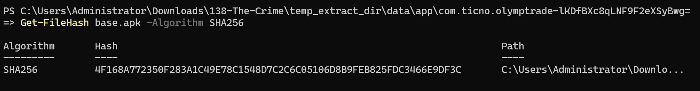
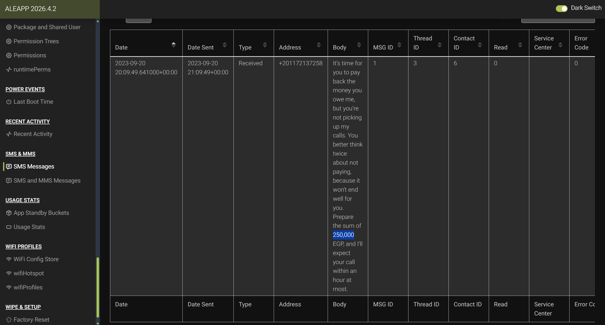
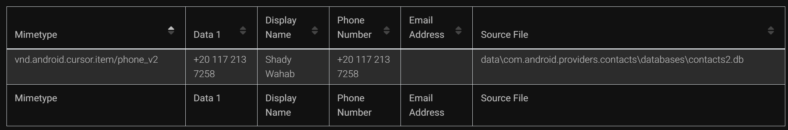
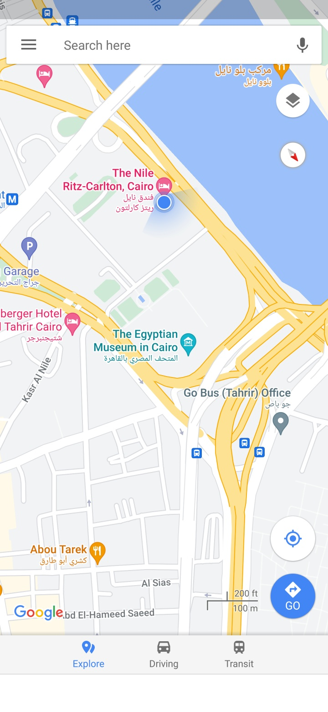
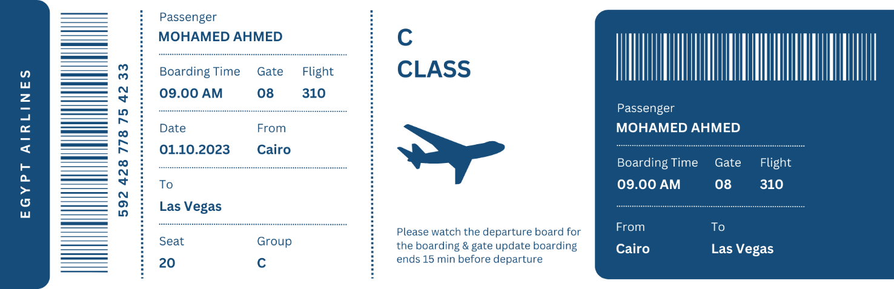
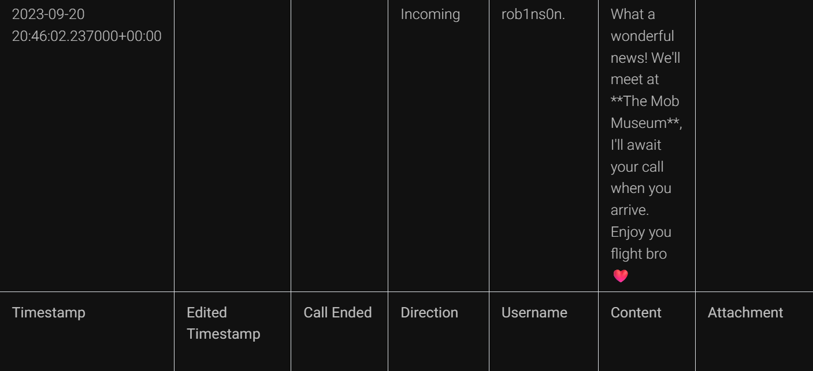

# The Crime (CyberDefenders Endpoint Forensics / Android Forensics Lab)

_A hands-on Android forensics investigation using ALEAPP and PowerShell to identify an installed trading app, recover debt-related messages, connect a phone number to a contact, and reconstruct the victim's recent activity and travel plans._

---

## Table of Contents

- [Project Summary](#project-summary)
- [Incident Overview](#incident-overview)
- [Skills Demonstrated](#skills-demonstrated)
- [Investigation Process](#investigation-process)
  - [Stage 1: Identify the Trading Application SHA256](#stage-1-identify-the-trading-application-sha256)
  - [Stage 2: Identify the Debt Amount](#stage-2-identify-the-debt-amount)
  - [Stage 3: Identify the Person Owed Money](#stage-3-identify-the-person-owed-money)
  - [Stage 4: Identify the Victim's Location](#stage-4-identify-the-victims-location)
  - [Stage 5: Identify the Flight Destination](#stage-5-identify-the-flight-destination)
  - [Stage 6: Identify the Planned Meeting Location](#stage-6-identify-the-planned-meeting-location)
- [Key Findings](#key-findings)
- [Indicators and Investigation Artifacts](#indicators-and-investigation-artifacts)
- [Lessons Learned](#lessons-learned)
- [What I Would Improve Next Time](#what-i-would-improve-next-time)
- [References](#references)

---

## Project Summary

> **What is this project?**
>
> I completed the CyberDefenders **The Crime** lab, an Android endpoint-forensics challenge where I had to examine artifacts from a victim's phone and answer questions about his financial activity, contacts, location, travel plans, and messages.

For this lab, I mainly used **ALEAPP** to parse the Android filesystem and **PowerShell** to calculate the SHA256 hash of an APK. ALEAPP made the investigation much easier because it organized artifacts such as SMS messages, contacts, recent activity, cached Google Photos images, and Discord conversations into a readable report.

At first, I tried to look through the raw Android folders manually, but there were too many files and directories. I learned that it was much better to use ALEAPP first, then follow the evidence from one artifact to another.

---

## Incident Overview

The scenario involved a murder investigation where the victim's Android phone was collected as evidence. Based on witness and family statements, I had to look for information about the victim's trading activity, debt, recent location, planned travel, and a meeting arranged through Discord.

The investigation started by identifying the trading application used by the victim. The Android package found in the evidence was related to **Olymp Trade**, and I calculated the SHA256 of its `base.apk` file with PowerShell.

Later, SMS and contact artifacts showed that the victim owed **250,000 EGP** to **Shady Wahab**. Recent Activity contained Google Maps information showing that the victim had been at **The Nile Ritz-Carlton**. A cached Google Photos image contained a boarding pass showing a planned trip from Cairo to **Las Vegas**, and Discord messages showed that the victim planned to meet someone at **The Mob Museum**.

The high-level investigation flow was:

```text
Android filesystem extraction
        ↓
Parse evidence with ALEAPP
        ↓
Review app, SMS, contact, recent activity, photo cache, and Discord artifacts
        ↓
Correlate information between different artifacts
        ↓
Confirm findings with timestamps, phone numbers, images, and hashes
```

---

## Skills Demonstrated

- Using ALEAPP to parse an Android filesystem extraction
- Navigating Android forensic artifacts without manually opening every file
- Identifying an installed application and its APK
- Calculating a SHA256 hash with PowerShell
- Reviewing SMS messages for useful evidence
- Pivoting from a phone number to a contact name
- Reviewing cached Google Photos images
- Extracting travel information from a stored boarding pass image
- Reviewing Discord conversation artifacts
- Correlating evidence across multiple Android artifact types

---

## Investigation Process

### Stage 1: Identify the Trading Application SHA256

- **Objective:** Identify the SHA256 hash of the trading application mainly used by the victim.
- **Actions:**
  - Reviewed the Android application folders and ALEAPP output.
  - Identified the package related to **Olymp Trade**.
  - Located the application's `base.apk` file.
  - Used PowerShell `Get-FileHash` with the SHA256 algorithm.
- **Evidence:**

```text
Package:
com.ticno.olymptrade

File:
base.apk

SHA256:
4F168A772350F283A1C49E78C1548D7C2C6C05106D8B9FEB825FDC3466E9DF3C
```

The hash was calculated directly from the APK stored in the Android evidence instead of looking up a hash online.

- **Result:**

```text
4F168A772350F283A1C49E78C1548D7C2C6C05106D8B9FEB825FDC3466E9DF3C
```

> 

---

### Stage 2: Identify the Debt Amount

- **Objective:** Determine how much money the victim owed the person who had been calling him.
- **Actions:**
  - Reviewed SMS artifacts in the ALEAPP report.
  - Found an incoming message related to repayment.
  - Read the message body and identified the amount requested by the sender.
- **Evidence:**

```text
Message:
"It's time for you to pay back the money you owe me...
Prepare the sum of 250,000 EGP..."
```

The message directly connected the sender with the debt mentioned in the witness statement.

- **Result:**

```text
250,000 EGP
```

> 

---

### Stage 3: Identify the Person Owed Money

- **Objective:** Identify the name of the person to whom the victim owed money.
- **Actions:**
  - Took the phone number from the debt-related SMS.
  - Searched for the same number in the contact artifacts.
  - Matched the phone number to a display name.
- **Evidence:**

```text
Phone number:
+20 117 213 7258

Display name:
Shady Wahab
```

This was a useful example of using one artifact as a pivot into another. The SMS gave me the number, and the contacts database gave me the name.

- **Result:**

```text
Shady Wahab
```

> 

---

### Stage 4: Identify the Victim's Location

- **Objective:** Determine where the victim was located on September 20, 2023.
- **Actions:**
  - Reviewed the **Recent Activity** section in ALEAPP.
  - Found activity related to Google Maps.
  - Opened the preserved map image/activity information.
  - Used the blue location marker and visible map label to identify the place.
- **Evidence:**

```text
Date:
2023-09-20

Location:
The Nile Ritz-Carlton
```

The Google Maps artifact showed the phone's location at The Nile Ritz-Carlton in Cairo.

- **Result:**

```text
The Nile Ritz-Carlton
```

> 

---

### Stage 5: Identify the Flight Destination

- **Objective:** Identify where the victim planned to travel after his hotel stay.
- **Actions:**
  - Reviewed the **Google Photos - Cache** artifacts in ALEAPP.
  - Found a cached image of a boarding pass.
  - Read the destination shown on the ticket.
- **Evidence:**

```text
Passenger:
MOHAMED AHMED

From:
Cairo

To:
Las Vegas

Date:
01.10.2023
```

The cached image was enough to recover the victim's planned destination.

- **Result:**

```text
Las Vegas
```

> 

---

### Stage 6: Identify the Planned Meeting Location

- **Objective:** Determine where the victim planned to meet a friend after arriving.
- **Actions:**
  - Reviewed the Discord conversation artifacts in ALEAPP.
  - Found an incoming message discussing the victim's arrival.
  - Read the message and identified the planned meeting place.
- **Evidence:**

```text
Username:
rob1ns0n.

Message:
"What a wonderful news! We'll meet at The Mob Museum,
I'll await your call when you arrive."
```

The Discord message directly named the planned meeting location.

- **Result:**

```text
The Mob Museum
```

> 

---

## Key Findings

| Finding | Value |
|---|---|
| Trading application | Olymp Trade |
| Trading app package | `com.ticno.olymptrade` |
| Trading app SHA256 | `4F168A772350F283A1C49E78C1548D7C2C6C05106D8B9FEB825FDC3466E9DF3C` |
| Debt amount | `250,000 EGP` |
| Person owed money | `Shady Wahab` |
| Location on September 20, 2023 | `The Nile Ritz-Carlton` |
| Planned travel destination | `Las Vegas` |
| Planned meeting location | `The Mob Museum` |

---

## Indicators and Investigation Artifacts

Important artifacts from the lab:

```text
Trading app package:
com.ticno.olymptrade

Trading app SHA256:
4F168A772350F283A1C49E78C1548D7C2C6C05106D8B9FEB825FDC3466E9DF3C

Debt amount:
250,000 EGP

Phone number:
+20 117 213 7258

Contact:
Shady Wahab

Location:
The Nile Ritz-Carlton

Flight destination:
Las Vegas

Discord meeting location:
The Mob Museum
```

Files, records, and artifact types that were important to the investigation:

| Artifact | Relevance |
|---|---|
| `base.apk` | APK file used to calculate the trading application's SHA256 |
| SMS messages | Revealed the debt amount |
| Contacts database | Connected the debt-related phone number to Shady Wahab |
| Recent Activity | Preserved Google Maps activity used to identify the victim's location |
| Google Photos cache | Contained the boarding pass image |
| Discord conversations | Revealed the planned meeting location |
| ALEAPP report | Organized the Android artifacts into readable sections |

---

## Lessons Learned

- ALEAPP is much more useful than trying to manually search through a full Android filesystem.
- A single artifact does not always contain the full answer. Sometimes I had to pivot from one artifact to another, such as from an SMS phone number to the contacts database.
- Recent Activity can contain useful information about what an application was showing or doing.
- Mobile forensic investigations can involve many different artifact types, so it helps to focus on the question first and then decide which artifact is most likely to contain the answer.

---

## What I Would Improve Next Time

- Start with ALEAPP immediately instead of spending time browsing the raw Android folders manually.
- Use the question wording to decide which artifact category I should check first.
- Write down useful phone numbers, timestamps, package names, and paths while investigating so I can pivot faster.


---

## References

- [CyberDefenders](https://cyberdefenders.org/)
- [ALEAPP - Android Logs Events And Protobuf Parser](https://github.com/abrignoni/ALEAPP)
- [Microsoft PowerShell - Get-FileHash](https://learn.microsoft.com/powershell/module/microsoft.powershell.utility/get-filehash)
