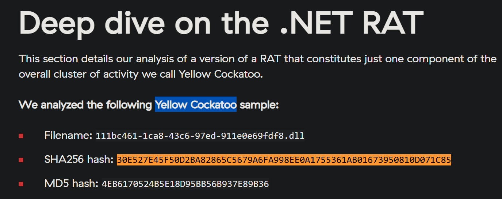
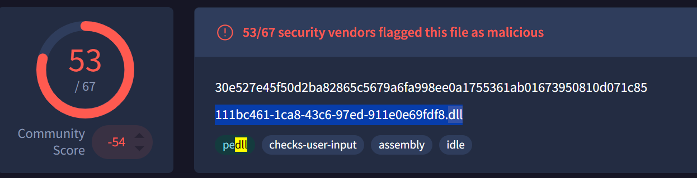
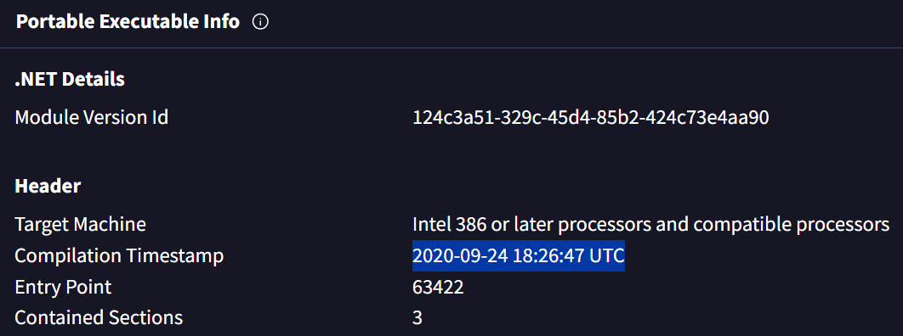
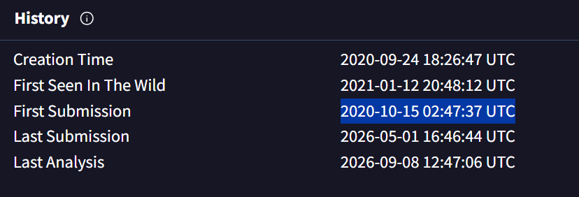
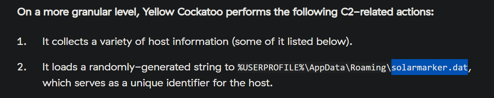
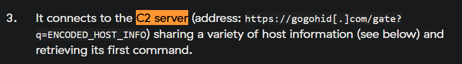

# Yellow RAT (CyberDefenders Threat Intelligence / Malware Analysis Lab)

_A hands-on investigation of a malicious .NET RAT using VirusTotal and public threat-intelligence research to identify malware artifacts, timestamps, a dropped file, and command-and-control infrastructure._

---

## Table of Contents

- [Project Summary](#project-summary)
- [Incident Overview](#incident-overview)
- [Skills Demonstrated](#skills-demonstrated)
- [Investigation Process](#investigation-process)
  - [Stage 1: Identify the Malware Family](#stage-1-identify-the-malware-family)
  - [Stage 2: Identify the Common Filename](#stage-2-identify-the-common-filename)
  - [Stage 3: Determine the Compilation Timestamp](#stage-3-determine-the-compilation-timestamp)
  - [Stage 4: Determine the First VirusTotal Submission](#stage-4-determine-the-first-virustotal-submission)
  - [Stage 5: Identify the Dropped .dat File](#stage-5-identify-the-dropped-dat-file)
  - [Stage 6: Identify the C2 Server](#stage-6-identify-the-c2-server)
- [Key Findings](#key-findings)
- [Indicators and Investigation Artifacts](#indicators-and-investigation-artifacts)
- [Lessons Learned](#lessons-learned)
- [What I Would Improve Next Time](#what-i-would-improve-next-time)
- [References](#references)

---

## Project Summary

> **What is this project?**
>
> I completed the CyberDefenders **Yellow RAT** lab, a threat-intelligence challenge about malware causing abnormal network traffic on employee workstations. The goal was to use a known file hash and public threat-intelligence sources to identify the malware and collect useful indicators.

For this lab, I mainly used **VirusTotal** and the **Red Canary Yellow Cockatoo report**. VirusTotal helped me inspect the file, its names, PE information, and submission history. Red Canary was useful when VirusTotal did not directly show some of the artifacts I needed, especially the `.dat` file and the command-and-control server.

One thing that confused me at first was that different security vendors used different names for the same or related malware activity. I had to compare the file hash and filename with the Red Canary report instead of trusting one family label by itself.


---

## Incident Overview

The scenario starts with abnormal network traffic being detected from several workstations. Some employees also had their search queries redirected to unfamiliar websites.

The investigation focused on a suspicious DLL with the following SHA-256 hash:

```text
30e527e45f50d2ba82865c5679a6fa998ee0a1755361ab01673950810d071c85
```

VirusTotal showed that many security vendors detected the file as malicious, but the family names were not consistent. By comparing the exact hash and filename with Red Canary's public research, I identified the malware as **Yellow Cockatoo RAT**.

The malware creates or uses a file named `solarmarker.dat` inside the user's AppData Roaming folder. Red Canary explains that the value stored there is used as a host identifier. The RAT also collects host information and communicates with the C2 domain `gogohid[.]com` over HTTPS.

The high-level flow I understood from the investigation was:

```text
Suspicious DLL is identified
        ↓
Hash is checked in VirusTotal
        ↓
File metadata and history are reviewed
        ↓
Exact hash/filename are matched with Red Canary research
        ↓
Yellow Cockatoo RAT is identified
        ↓
Host identifier is stored in solarmarker.dat
        ↓
Host information is collected
        ↓
HTTPS request is sent to gogohid[.]com
        ↓
C2 returns commands to the RAT
```

---

## Skills Demonstrated

- Using a SHA-256 hash to investigate a suspicious file
- Reviewing VirusTotal detection results and file metadata
- Looking at PE compilation information
- Checking VirusTotal submission history
- Comparing different antivirus family labels
- Using a public threat-intelligence report to add context
- Matching an exact hash and filename across different sources
- Identifying host-based and network-based IOCs
- Identifying a dropped file in the user's AppData folder
- Identifying command-and-control infrastructure
- Separating a C2 domain from a full C2 URL/path
- Building a simple malware behavior flow from the evidence
- Practicing defanged IOC notation such as `gogohid[.]com`

---

## Investigation Process

### Stage 1: Identify the Malware Family

- **Objective:** Determine the malware family responsible for the abnormal network traffic.
- **Actions:**
  - Searched the provided SHA-256 hash in VirusTotal.
  - Reviewed the family labels shown by different security vendors.
  - Noticed names such as `msil`, `fful`, `polazert`, and other generic detections.
  - Searched for public threat-intelligence research containing the exact sample hash.
  - Found Red Canary's Yellow Cockatoo report and matched both the SHA-256 hash and DLL filename.
- **Evidence:**

```text
SHA-256:
30e527e45f50d2ba82865c5679a6fa998ee0a1755361ab01673950810d071c85

Filename:
111bc461-1ca8-43c6-97ed-911e0e69fdf8.dll
```

The same hash and filename appear in Red Canary's analysis of the Yellow Cockatoo RAT. This helped me avoid relying only on the different family labels shown by antivirus vendors.

- **Result:**

```text
Yellow Cockatoo RAT
```

> 

---

### Stage 2: Identify the Common Filename

- **Objective:** Find the filename associated with the suspicious malware sample.
- **Actions:**
  - Looked directly below the SHA-256 hash on the VirusTotal file page.
  - Recorded the filename shown for the sample.
  - Compared it with the Red Canary report to make sure I was looking at the same file.
- **Evidence:**

```text
111bc461-1ca8-43c6-97ed-911e0e69fdf8.dll
```

The filename was useful as another IOC that could be searched for on other systems, although a filename by itself is weaker than a hash because files can be renamed.

- **Result:**

```text
111bc461-1ca8-43c6-97ed-911e0e69fdf8.dll
```

> 

---

### Stage 3: Determine the Compilation Timestamp

- **Objective:** Find the PE compilation timestamp of the malware sample.
- **Actions:**
  - Opened the **Details** section in VirusTotal.
  - Scrolled to the Portable Executable information.
  - Located the compilation timestamp in the PE header.
- **Evidence:**

```text
Compilation Timestamp:
2020-09-24 18:26:47 UTC
```

A compilation timestamp can help with timeline analysis, but I would not treat it as perfect proof of when malware was actually created because timestamps can be changed.

- **Result:**

```text
2020-09-24 18:26:47 UTC
```

> 

---

### Stage 4: Determine the First VirusTotal Submission

- **Objective:** Determine when this malware sample was first submitted to VirusTotal.
- **Actions:**
  - Stayed in the VirusTotal **Details** section.
  - Opened the file history information.
  - Compared the different dates shown for creation, first submission, first seen in the wild, and later analysis.
  - Used **First Submission**, because that is what the lab question asked for.
- **Evidence:**

```text
First Submission:
2020-10-15 02:47:37 UTC
```

This was different from the **First Seen In The Wild** value, so I made sure not to mix up the two fields.

- **Result:**

```text
2020-10-15 02:47:37 UTC
```

> 

---

### Stage 5: Identify the Dropped .dat File

- **Objective:** Find the `.dat` file associated with the malware in the user's AppData folder.
- **Actions:**
  - Looked through VirusTotal for a `.dat` artifact but could not find a clear answer.
  - Went back to the Red Canary Yellow Cockatoo technical report.
  - Read the section describing the RAT's C2-related behavior.
  - Found the AppData path used for the host identifier.
- **Evidence:**

```text
%USERPROFILE%\AppData\Roaming\solarmarker.dat
```

Red Canary explains that the malware stores a randomly generated value in this file and uses it as a unique identifier for the infected host.

This question was a good reminder that VirusTotal does not always contain every artifact in an easy-to-find place, so sometimes I need to pivot to another threat-intelligence source.

- **Result:**

```text
solarmarker.dat
```

> 

---

### Stage 6: Identify the C2 Server

- **Objective:** Identify the command-and-control server used by the malware.
- **Actions:**
  - Continued reading the Red Canary technical analysis.
  - Found the section describing the RAT's first C2 connection.
  - Separated the base server from the rest of the request path and query string.
- **Evidence:**

```text
Full C2 request pattern:
https://gogohid[.]com/gate?q=ENCODED_HOST_INFO

C2 server:
https://gogohid[.]com
```

The malware sends encoded host information to the `/gate` endpoint and retrieves a command from the C2 server.

- **Result:**

```text
https://gogohid[.]com
```

> 

---


## Key Findings

| Finding | Value |
|---|---|
| Malware family | Yellow Cockatoo RAT |
| SHA-256 | `30e527e45f50d2ba82865c5679a6fa998ee0a1755361ab01673950810d071c85` |
| Common filename | `111bc461-1ca8-43c6-97ed-911e0e69fdf8.dll` |
| Compilation timestamp | `2020-09-24 18:26:47 UTC` |
| First VirusTotal submission | `2020-10-15 02:47:37 UTC` |
| Dropped / host identifier file | `solarmarker.dat` |
| AppData location | `%USERPROFILE%\AppData\Roaming\solarmarker.dat` |
| C2 server | `https://gogohid[.]com` |
| Initial C2 path | `/gate` |

---

## Indicators and Investigation Artifacts

Public-safe artifacts from the lab:

```text
SHA-256:
30e527e45f50d2ba82865c5679a6fa998ee0a1755361ab01673950810d071c85

Filename:
111bc461-1ca8-43c6-97ed-911e0e69fdf8.dll

Dropped file:
solarmarker.dat

Path:
%USERPROFILE%\AppData\Roaming\solarmarker.dat

C2 domain:
gogohid[.]com

C2 URL:
hxxps://gogohid[.]com/gate
```

Files, network indicators, and metadata important to the investigation:

| Artifact | Relevance |
|---|---|
| SHA-256 hash | Identifies the exact malicious sample |
| DLL filename | Another file-based IOC for endpoint hunting |
| PE compilation timestamp | Helps build context around the sample timeline |
| VirusTotal first submission | Shows when the sample was first uploaded to VirusTotal |
| `solarmarker.dat` | Stores a host identifier used by the malware |
| `%USERPROFILE%\AppData\Roaming\` | Location of the `.dat` artifact |
| `gogohid[.]com` | Command-and-control domain |
| `/gate` | C2 endpoint used for initial communication and command retrieval |
| Red Canary report | Provided behavior details that were not easy to find in VirusTotal |

---


## Lessons Learned


- Different vendors can use different names for the same malware or related activity.
- Matching an exact hash and filename across sources helped me confirm that the Red Canary report was about the same sample.
- The PE **Compilation Timestamp** and VirusTotal **First Submission** fields mean different things.
- **First Submission** is also different from **First Seen In The Wild**.
- A C2 server can be written as a base domain, while the malware may communicate with a more specific path such as `/gate`.

---

## What I Would Improve Next Time

- Check VirusTotal **Details**, **Relations**, and **Behavior** in a consistent order before searching elsewhere.
- Compare hashes before assuming two reports are talking about the same malware.
- Pay closer attention to the difference between a malware family name, a vendor detection name, and an activity-cluster name.
- Use at least one good technical threat-intelligence report when VirusTotal labels are confusing.

---

## References

- [CyberDefenders Yellow RAT Lab](https://cyberdefenders.org/blueteam-ctf-challenges/yellow-rat/)
- [Red Canary - How to detect Yellow Cockatoo remote access trojan](https://redcanary.com/blog/threat-intelligence/yellow-cockatoo/)
- [VirusTotal](https://www.virustotal.com/)
- [MITRE ATT&CK - T1082 System Information Discovery](https://attack.mitre.org/techniques/T1082/)

