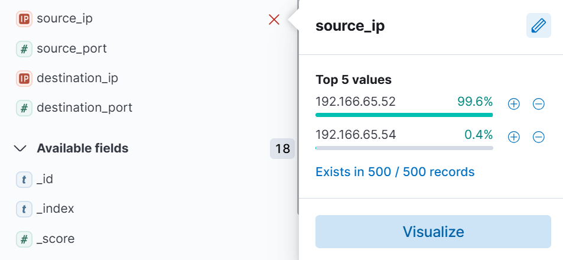
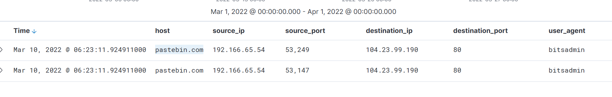
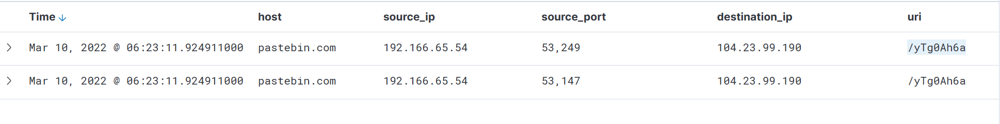
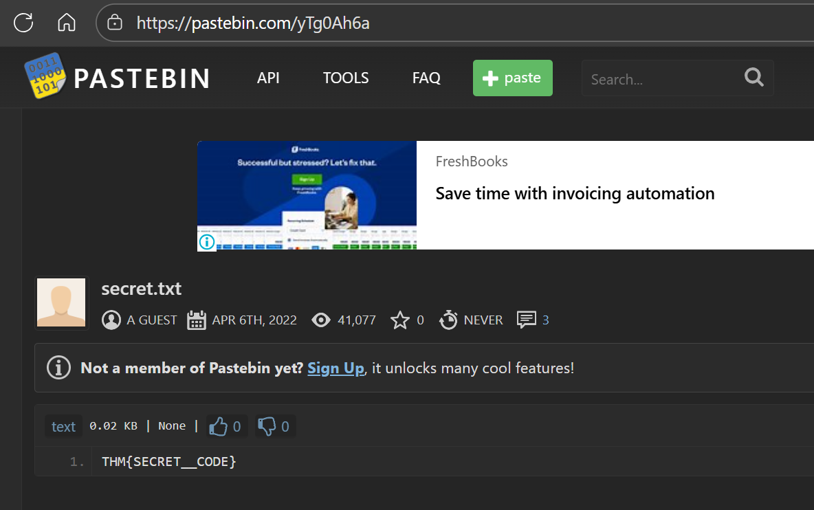

# ItsyBitsy — ELK / Kibana SOC Investigation

_A mini SOC investigation using ELK (Kibana) to investigate an IDS alert for possible C2 communication._

---

## Table of Contents

- [Project Summary](#project-summary)
- [Skills Demonstrated](#skills-demonstrated)
- [Investigation Process](#investigation-process)
  - [Scope & Credentials](#scope--credentials)
  - [Step 1 — Initial Triage & Time Filtering](#step-1---initial-triage--time-filtering)
  - [Step 2 — Identify Suspected Host (Source IP)](#step-2---identify-suspected-host-source-ip)
  - [Step 3 — Determine Download Mechanism (LOLBIN)](#step-3---determine-download-mechanism-lolbin)
  - [Step 4 — Identify C2 / Filesharing Host](#step-4---identify-c2--filesharing-host)
  - [Step 5 — Extract Full C2 URL & File](#step-5---extract-full-c2-url--file)
  - [Step 6 — Retrieve Flag / Confirm Payload Content](#step-6---retrieve-flag--confirm-payload-content)
- [Conclusions & Recommendations](#conclusions--recommendations)
- [What I Learned / Next Steps](#what-i-learned--next-steps)
- [References](#references--evidence)

---

## Project Summary

This case documents a TryHackMe "ItsyBitsy" challenge where an IDS alert indicated potential C2 activity. Using Kibana (Discover on the `connection_logs` index), I investigated March 2022 HTTP connection logs, identified the infected host, the download mechanism, the filesharing C2, and extracted the artifact containing the secret code (flag).

**Key outcome:** Confirmed C2 communication to Pastebin and recovered the flag `THM{SECRET_CODE}`.

---

## Skills Demonstrated

- SIEM log analysis (Kibana / ELK)
- KQL queries and time-range filtering
- Network-to-host correlation (source_ip ⇄ user/process fields)
- Identifying LOLBINs used for file retrieval (bitsadmin)
- Extracting remote resource URIs and validating payload content
- Clear documentation of findings for reporting

---

## Investigation Process

### Scope & Credentials
- **Index:** `connection_logs` (Kibana Discover)
- **Time range:** 2022-03-01 00:00 → 2022-04-01 00:00 (March 2022)
- **Credentials (room):** `Admin` / `elastic123`

### Step 1 - Initial Triage & Time Filtering
- Set the Kibana time picker to March 2022.
- Observed total **1,482** hits for the `connection_logs` index in that time range.

> KQL used (time-scoped in Discover):
```text
@timestamp >= "2022-03-01T00:00:00" and @timestamp < "2022-04-01T00:00:00"
```

### Step 2 - Identify Suspected Host (Source IP)

- Inspected `source_ip` field top values; two IPs appear: `192.166.65.52` (99.6%) and `192.166.65.54` (0.4%).
- Although `.52` had the majority of benign activity, the suspicious C2 activity correlated to **`192.166.65.54`** (the suspected user machine).

> KQL to focus on suspected host:
```text
source_ip:"192.166.65.54"
```

### Step 3 - Determine Download Mechanism (LOLBIN)

- With `source_ip:192.166.65.54` visible, added `user_agent` and `host` columns in Discover.
- Observed `user_agent` value **`bitsadmin`** on the suspicious GETs — indicating **bitsadmin.exe / BITS** was used to download the remote resource.

**Answer:** `bitsadmin.exe` (LOLBIN used to download payload)

### Step 4 - Identify C2 / Filesharing Host
- Filtering for `source_ip:192.166.65.54` and `method:GET` returned two records pointing at `pastebin.com`.
- Host discovered: **pastebin.com**

> KQL used to narrow results:
```text
source_ip:"192.166.65.54" and method:"GET" and status_code:200
```

### Step 5 - Extract Full C2 URL & File

- The `uri` column showed `/yTg0Ah6a` for both suspicious entries.
- The full URL used by the host to retrieve the payload was:
```
https://pastebin.com/yTg0Ah6a
```
- The Pastebin entry page lists the title `secret.txt` (the file name placed on Pastebin).

### Step 6 - Retrieve Flag / Confirm Payload Content

- Accessing the Pastebin entry (or its raw form `https://pastebin.com/raw/yTg0Ah6a`) shows the payload content.
- The Pastebin content contained the secret code:
```
THM{SECRET_CODE}
```

**Final answers (summary):**
- Events in March 2022: **1482**
- Suspected user IP: **192.166.65.54**
- Binary used to download file: **bitsadmin.exe**
- Filesharing (C2) site: **pastebin.com**
- Full C2 URL: **https://pastebin.com/yTg0Ah6a**
- File name on Pastebin: **secret.txt**
- Flag: **THM{SECRET_CODE}**

---

## Conclusions & Recommendations

**Conclusion:** The user machine `192.166.65.54` used Windows BITS (`bitsadmin`) to retrieve a file hosted on Pastebin. The file contained a secret code and functioned as a C2/payload delivery vector in this exercise.

**Recommendations (SOC playbook-level):**
- Block or monitor `bitsadmin` and other LOLBIN download activity via EDR and IOC rules.
- Alert on outbound connections to public paste sites combined with abnormal system processes.
- Hunt for similar `source_ip` activity across other time ranges and indices (DNS, proxy, endpoint telemetry).
- Add the Pastebin URL and related destination IP (104.23.99.190) to internal IOC lists (defanged when appropriate).

---

## What I Learned / Next Steps
- Practice correlating network logs to host-level processes in Kibana.
- Create saved searches / dashboards to detect LOLBIN-based downloads.
- Expand reporting to include timeline screenshots and MITRE ATT&CK technique mapping for delivery/exfiltration.

---

## References & Evidence
- [TryHackMe — ItsyBitsy Challenge](https://tryhackme.com/room/itsybitsy)  
- [Elastic Stack (ELK) — Official Documentation](https://www.elastic.co/what-is/elk-stack)  
- [MITRE ATT&CK: Exfiltration Over Web Service (T1567.002)](https://attack.mitre.org/techniques/T1567/002/)  

---

*Prepared as a SOC-style mini case study.*

