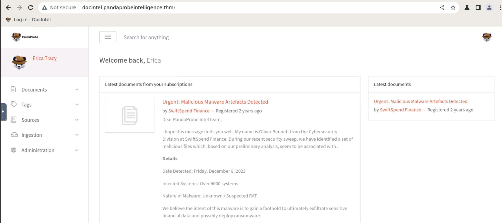
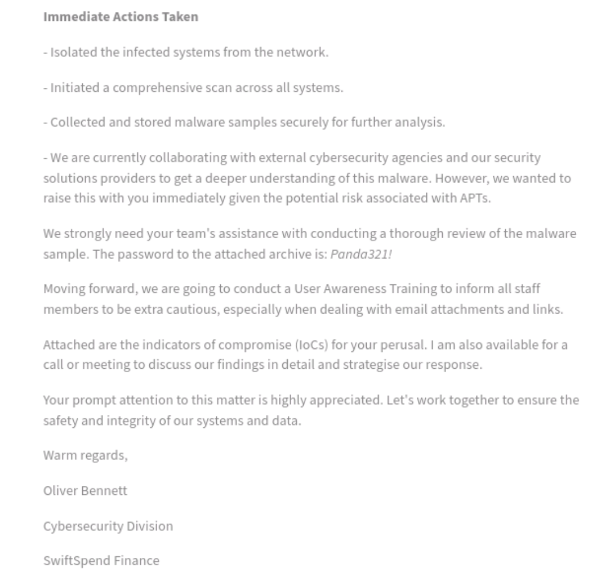
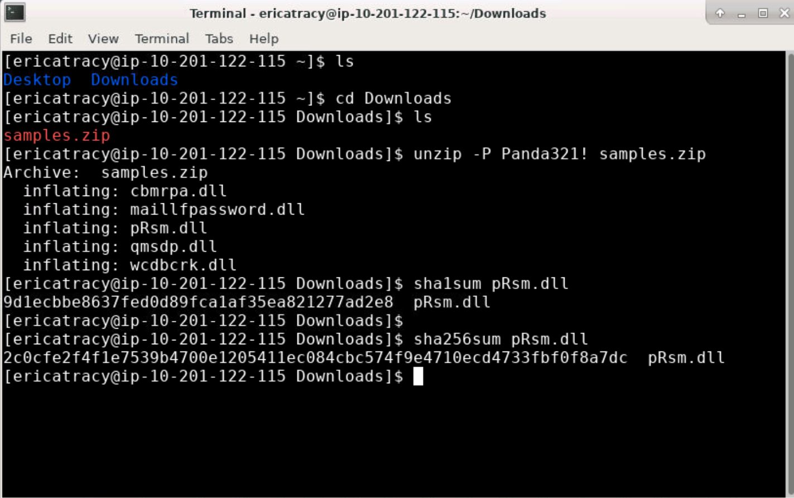
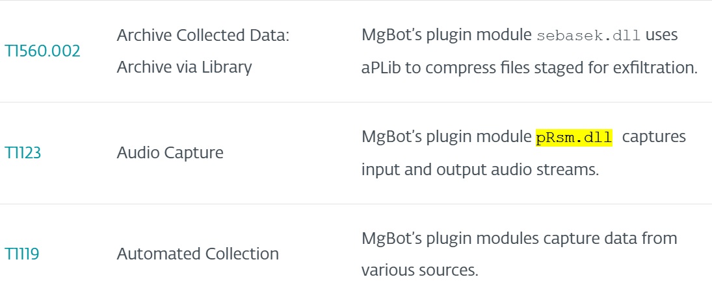
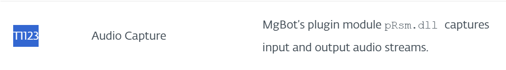
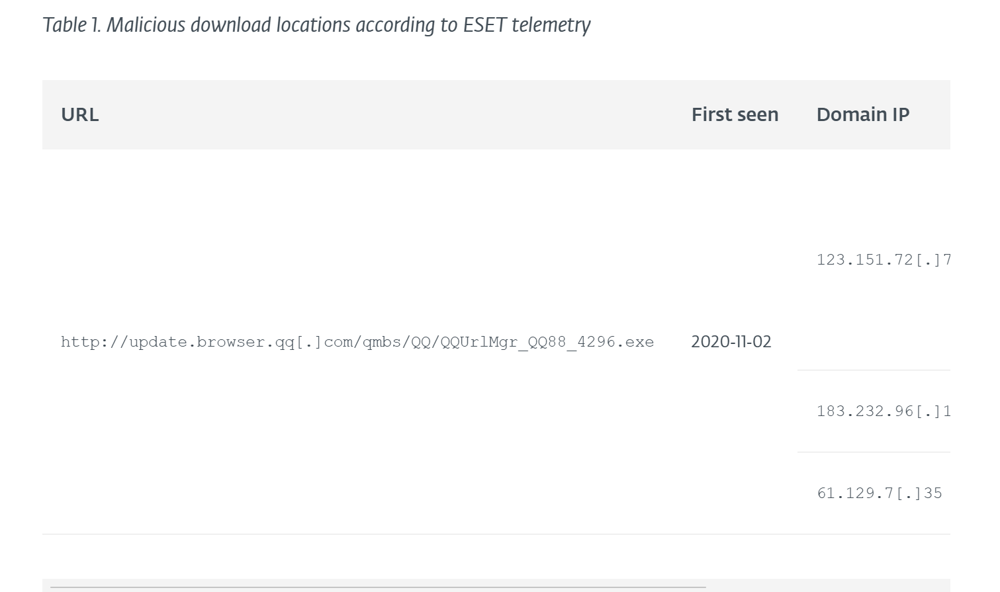
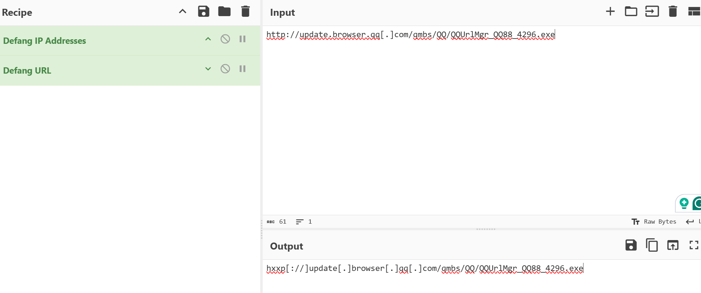
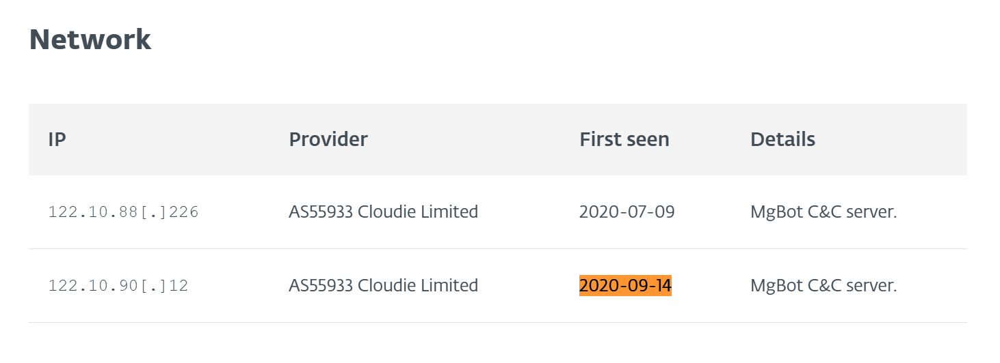
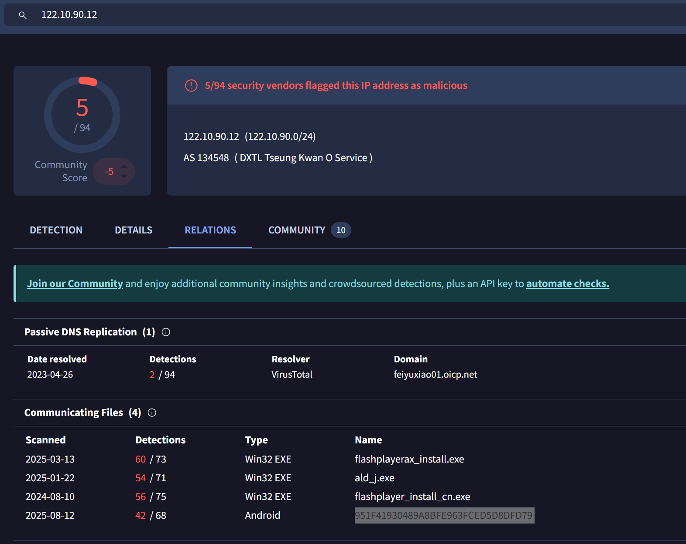

# Friday Overtime (TryHackMe Cyber Threat Intel Lab)

_A hands-on CTI project simulating IOC enrichment, malware framework identification, and MITRE ATT&CK mapping._  

---

## Table of Contents

- [Project Summary](#project-summary)  
- [Skills Demonstrated](#skills-demonstrated)  
- [Investigation Process](#investigation-process)  
  - [Stage 1: Incident Report Review](#stage-1-incident-report-review)  
  - [Stage 2: Hash Extraction](#stage-2-hash-extraction)  
  - [Stage 3: Malware Framework Attribution](#stage-3-malware-framework-attribution)  
  - [Stage 4: MITRE ATT&CK Technique Mapping](#stage-4-mitre-attck-technique-mapping)  
  - [Stage 5: Malicious URL Identification](#stage-5-malicious-url-identification)  
  - [Stage 6: C2 Infrastructure Analysis](#stage-6-c2-infrastructure-analysis)  
  - [Stage 7: Android Spyware Pivot](#stage-7-android-spyware-pivot)  
- [Lessons Learned](#lessons-learned)  
- [What I’d Improve Next Time](#what-id-improve-next-time)  
- [References](#references)  

---

## Project Summary

> **What is this project?**  
>  
> I completed the TryHackMe “Friday Overtime” lab, a SOC analyst scenario where I acted as a CTI investigator. I received suspicious DLL samples from a financial org (SwiftSpend Finance) and performed IOC enrichment, malware attribution, MITRE ATT&CK mapping, and infrastructure pivoting. The case revolved around the **Evasive Panda APT group** and its modular backdoor **MgBot**, with artifacts spanning DLL plugins, malicious URLs, C2 IPs, and related Android spyware.  

---

## Skills Demonstrated

- IOC enrichment (SHA1/SHA256/MD5 lookups, VirusTotal, Malpedia, ThreatMiner)  
- Malware framework attribution (DLL → MgBot → Evasive Panda)  
- Mapping malware functionality to MITRE ATT&CK techniques  
- Defanging IOCs with CyberChef for safe sharing/reporting  
- Pivoting across infrastructure (URL → IP → related malware families)  
- Professional CTI reporting and documentation  

---

## Investigation Process

### Stage 1: Incident Report Review

- **Problem:** Received suspicious samples from Oliver Bennett (SwiftSpend Finance cybersecurity).  
- **Action:** Reviewed DocIntel ticket and confirmed submission details, password-protected archive, and initial suspicion of RAT activity.  
- **Result:** Identified submitter (**Oliver Bennett**).  

  
  

---

### Stage 2: Hash Extraction

- **Problem:** Needed the SHA1 hash of `pRsm.dll` inside the archive.  
- **Action:**  
  - Extracted archive with `unzip -P Panda321! samples.zip`.  
  - Calculated hash:  
    ```bash
    sha1sum pRsm.dll
    ```  
- **Result:** Obtained hash `9d1ecbbe8637fed0d89fcalaf35ea821277ad2e8` (Q2 answer).  

  

---

### Stage 3: Malware Framework Attribution

- **Problem:** Determine which malware framework the DLLs belonged to.  
- **Investigation:**  
  - Hash searches in VirusTotal (SHA256 gave positive hits).  
  - Cross-referenced WeLiveSecurity APT research.  
- **Result:** Attributed DLL set to **MgBot**, the modular backdoor framework used by **Evasive Panda** (Q3 answer).  

  

---

### Stage 4: MITRE ATT&CK Technique Mapping

- **Problem:** Map `pRsm.dll` functionality to ATT&CK.  
- **Investigation:**  
  - ESET report indicated `pRsm.dll` was used for **audio capture** (microphone and output streams).  
- **Result:** Technique identified as **T1123: Audio Capture** (Q4 answer).  

  

---

### Stage 5: Malicious URL Identification

- **Problem:** Find malicious download URL first seen 2020-11-02.  
- **Action:**  
  - Located in ESET telemetry table.  
  - Defanged with CyberChef.  
- **Result:**  hxxp[://]update[.]browser[.]qq[.]com/qmbs/QQ/QQUrlMgr_Q088_4296.exe


  
  
---

### Stage 6: C2 Infrastructure Analysis

- **Problem:** Identify C2 IP first detected 2020-09-14.  
- **Action:**  
- Pivoted on IOC table from report.  
- Found C2 server IP, defanged with CyberChef.  
- **Result:**  122[.]10[.]90[.]12


  

---

### Stage 7: Android Spyware Pivot

- **Problem:** Identify MD5 hash of Android SpyAgent family spyware on the same IP (2025).  
- **Action:**  
- Pivoted VirusTotal relations for `122.10.90.12`.  
- Located Android sample linked to SpyAgent.  
- **Result:**  951f41930489a8bfe963fced58d8fd79

 

  

---

## Lessons Learned

- IOC enrichment requires multiple hash types (SHA1 vs SHA256 vs MD5).  
- Malware families often use **modular DLL structures** (MgBot).  
- MITRE ATT&CK mapping adds clarity to adversary TTPs.  
- Defanging is standard practice when handling URLs and IPs in reports.  
- Infrastructure reuse (same IP hosting different malware families) is common in APT operations.  
- Documentation makes small, “guided” labs much more valuable in a portfolio.  

---

## What I’d Improve Next Time

- Explore deeper dynamic analysis (sandboxing DLLs for behavior).  
- Create YARA rules for MgBot modules.  
- Automate IOC lookups across multiple intel feeds.  
- Add correlation with log sources (SIEM style triage) for realism.  

---

## References

- [TryHackMe Friday Overtime Room](https://tryhackme.com/room/fridayovertime)  
- [WeLiveSecurity: Evasive Panda APT Group](https://www.welivesecurity.com/2023/04/26/evasive-panda-apt-group-malware-updates-popular-chinese-software/)  
- [MITRE ATT&CK: T1123 – Audio Capture](https://attack.mitre.org/techniques/T1123/)  
- [VirusTotal](https://www.virustotal.com/)  
- [CyberChef](https://gchq.github.io/CyberChef/)  
