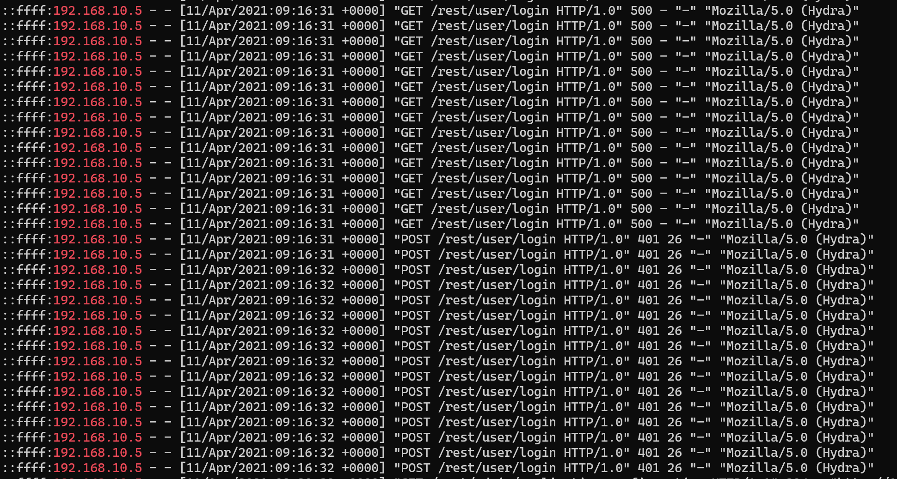
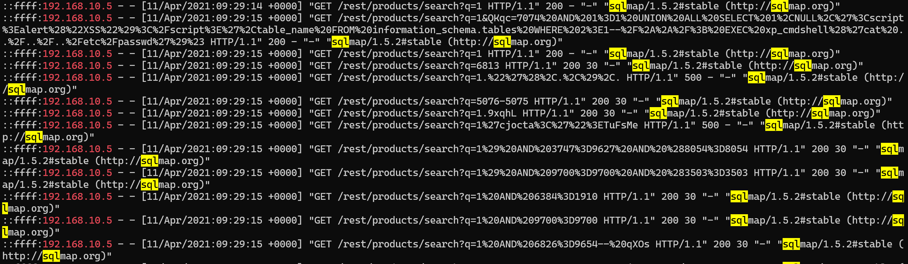
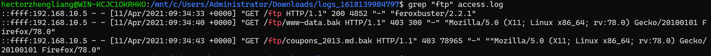
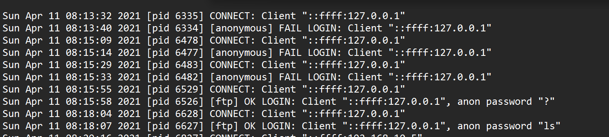

# Juicy Details (TryHackMe)

*A log-based incident investigation involving web server,
authentication, and FTP log analysis to reconstruct an attack timeline
and identify attacker activity.*

------------------------------------------------------------------------

## Table of Contents

-   [Project Summary](#project-summary)
-   [Skills Demonstrated](#skills-demonstrated)
-   [Investigation Process](#investigation-process)
    -   [Stage 1: Reconnaissance](#stage-1-reconnaissance)
    -   [Stage 2: Brute Force Attack](#stage-2-brute-force-attack)
    -   [Stage 3: SQL Injection](#stage-3-sql-injection)
    -   [Stage 4: Directory Enumeration and File
        Discovery](#stage-4-directory-enumeration-and-file-discovery)
    -   [Stage 5: File Retrieval and Shell
        Access](#stage-5-file-retrieval-and-shell-access)
-   [Attack Timeline](#attack-timeline)
-   [Indicators of Compromise (IOCs)](#indicators-of-compromise-iocs)
-   [MITRE ATT&CK Mapping](#mitre-attck-mapping)
-   [Lessons Learned](#lessons-learned)
-   [What I'd Improve Next Time](#what-id-improve-next-time)
-   [References](#references)

------------------------------------------------------------------------

## Project Summary

> **What is this project?**
>
> I completed the TryHackMe **Juicy Details** investigation, which
> simulates responding to a compromise of a vulnerable web application.
>
> The investigation required correlating three Linux log sources:
>
> -   Apache `access.log`
> -   Linux `auth.log`
> -   `vsftpd.log`
>
> Using these logs, I reconstructed the attack timeline, identified
> attacker tools, determined exploited services, and traced the theft of
> sensitive files.

------------------------------------------------------------------------

## Skills Demonstrated

-   Apache access log analysis
-   Linux authentication log analysis
-   FTP log analysis
-   Attack timeline reconstruction
-   Log correlation across multiple services
-   HTTP response code interpretation
-   Detection of brute-force attacks
-   Detection of SQL injection attempts
-   Identification of reconnaissance tools through User-Agent strings
-   SOC-style incident documentation

------------------------------------------------------------------------

## Investigation Process

### Stage 1: Reconnaissance

**Problem:** Determine how the attacker identified vulnerable services.

**Action:** - Filtered attacker activity by source IP
(`192.168.10.5`). - Reviewed HTTP requests chronologically. - Identified
reconnaissance based on User-Agent strings and request patterns.
```bash
  head access.log
  grep "192.168.10.5" access.log
  ```
**Findings:** - Nmap NSE used for service enumeration. - Hydra targeted
the login endpoint. - SQLMap targeted the search endpoint. - Feroxbuster
enumerated hidden directories.

**Reconnaissance tools identified:** - Nmap - Hydra - SQLMap - curl -
Feroxbuster

------------------------------------------------------------------------

### Stage 2: Brute Force Attack

**Problem:** Determine whether authentication was compromised.

**Action:** - Investigated repeated requests against
`/rest/user/login`. - Correlated HTTP responses with later authenticated
activity. - Reviewed SSH authentication attempts in `auth.log`.
  
**Findings:** - Hydra generated numerous failed login attempts. - The
attack eventually resulted in successful authentication. - The attacker
later obtained shell access through SSH using the `www-data` account.


------------------------------------------------------------------------

### Stage 3: SQL Injection

**Problem:** Identify the vulnerable endpoint and determine what
information was exposed.

**Action:** - Examined SQLMap-generated requests. - Identified SQL
injection payloads (`UNION SELECT`, `information_schema`, boolean-based
tests). - Determined the vulnerable parameter.
  
**Findings:** - Vulnerable endpoint: `/rest/products/search` -
Vulnerable parameter: `q` - Sensitive information retrieved: - Email
addresses - Passwords


------------------------------------------------------------------------

### Stage 4: Directory Enumeration and File Discovery

**Problem:** Determine how the attacker located sensitive files.

**Action:** - Reviewed Feroxbuster directory enumeration. - Identified
discovery of the `/ftp` endpoint. - Examined requests for backup files.

**Findings:** - Discovered endpoint: `/ftp` - Attempted downloads: -
`www-data.bak` - `coupons_2013.md.bak` - HTTP access returned **403
Forbidden**, indicating the files existed but were not directly
downloadable through the web application.

  
------------------------------------------------------------------------

### Stage 5: File Retrieval and Shell Access

**Problem:** Determine how the attacker successfully retrieved files and
gained interactive access.

**Action:** - Correlated `access.log`, `vsftpd.log`, and `auth.log`.

**Findings:** - Files were successfully downloaded via anonymous FTP. -
Service used: - FTP - Account: - anonymous - Shell access: - SSH -
User: - `www-data`

  
------------------------------------------------------------------------

## Attack Timeline

    Reconnaissance (Nmap)
            ↓
    Directory Enumeration (Feroxbuster)
            ↓
    Brute Force (Hydra)
            ↓
    SQL Injection (SQLMap)
            ↓
    Discovery of /ftp
            ↓
    Attempted HTTP download (403)
            ↓
    Anonymous FTP download
            ↓
    SSH login (www-data)

------------------------------------------------------------------------

## Indicators of Compromise (IOCs)

### IP Address

-   `192.168.10.5`

### Services Targeted

-   HTTP
-   FTP
-   SSH

### Endpoints

-   `/rest/user/login`
-   `/rest/products/search`
-   `/ftp`

### Files

-   `www-data.bak`
-   `coupons_2013.md.bak`

### Tools

-   Nmap
-   Hydra
-   SQLMap
-   curl
-   Feroxbuster

------------------------------------------------------------------------

## MITRE ATT&CK Mapping

-   **Reconnaissance -- Active Scanning**
-   **Credential Access -- Brute Force**
-   **Initial Access -- Exploit Public-Facing Application**
-   **Discovery -- File and Directory Discovery**
-   **Collection -- Data from Information Repositories**
-   **Exfiltration -- Transfer of Sensitive Files**
-   **Persistence/Access -- Valid Accounts**

------------------------------------------------------------------------

## Lessons Learned

-   Correlating multiple log sources provides far more context than
    analyzing a single log in isolation.
-   User-Agent strings can quickly identify automated offensive tools.
-   HTTP response codes help distinguish successful from unsuccessful
    attacker actions.
-   FTP logs can confirm successful data theft when HTTP access fails.
-   Authentication logs are essential for confirming interactive access
    after exploitation.

------------------------------------------------------------------------

## What I'd Improve Next Time

-   Create a timeline automatically using log parsing scripts.
-   Visualize the attack flow using a timeline or ATT&CK Navigator.

------------------------------------------------------------------------

## References

-   https://tryhackme.com/room/juicydetails
-   https://attack.mitre.org/
