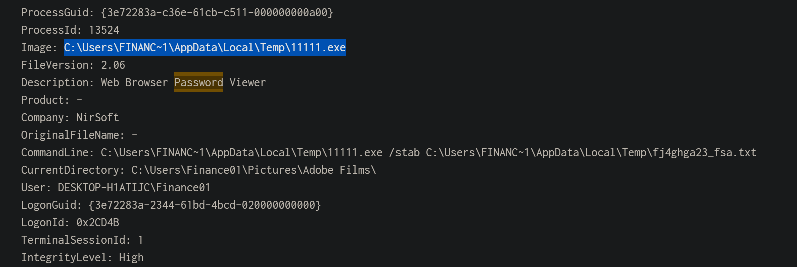
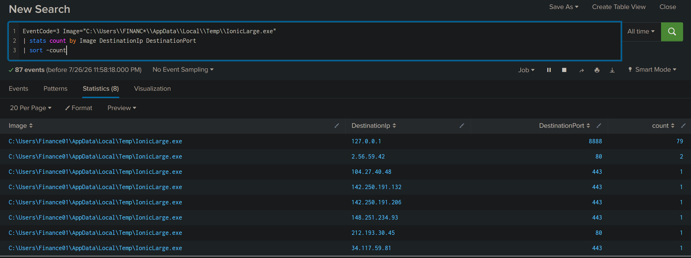
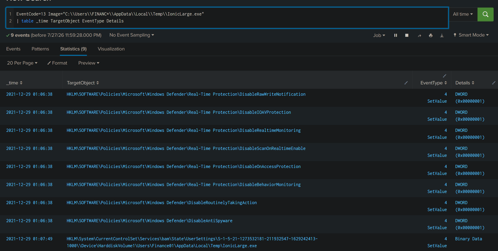
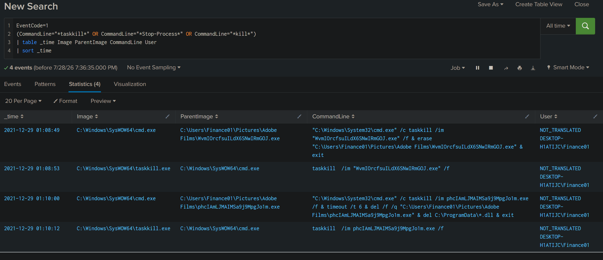
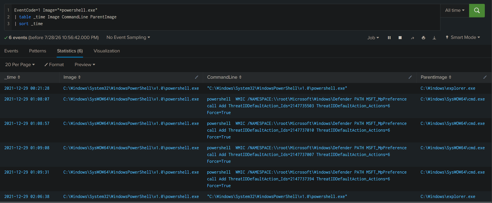

# New Hire Old Artifacts (TryHackMe)

*A Windows endpoint incident investigation using Splunk and Sysmon logs to reconstruct attacker activity, identify malicious processes, and analyze defense evasion techniques.*

---

## Table of Contents

- [Project Summary](#project-summary)
- [Skills Demonstrated](#skills-demonstrated)
- [Investigation Process](#investigation-process)
    - [Stage 1: Identifying the Initial Malicious Process](#stage-1-identifying-the-initial-malicious-process)
    - [Stage 2: Metadata and Binary Analysis](#stage-2-metadata-and-binary-analysis)
    - [Stage 3: Network Connections](#stage-3-network-connections)
    - [Stage 4: Registry Modifications](#stage-4-registry-modifications)
    - [Stage 5: Process Termination and Cleanup](#stage-5-process-termination-and-cleanup)
    - [Stage 6: Windows Defender Tampering](#stage-6-windows-defender-tampering)
    - [Stage 7: Secondary Payload Investigation](#stage-7-secondary-payload-investigation)
- [Attack Timeline](#attack-timeline)
- [Indicators of Compromise (IOCs)](#indicators-of-compromise-iocs)
- [MITRE ATT&CK Mapping](#mitre-attck-mapping)
- [Lessons Learned](#lessons-learned)
- [What I'd Improve Next Time](#what-id-improve-next-time)
- [References](#references)

---

# Project Summary

> **What is this project?**

I completed the TryHackMe **New Hire Old Artifacts** investigation, which simulates investigating historical endpoint activity after a Windows workstation was onboarded into a managed Splunk environment.

Using **Splunk Enterprise** and **Sysmon telemetry**, I reconstructed attacker activity by analyzing process creation, network connections, registry modifications, PowerShell execution, and DLL loading events.

The investigation focused on identifying credential theft tools, Windows Defender tampering, malicious network activity, and attacker cleanup operations.

---

# Skills Demonstrated

- Splunk SPL searching
- Windows Sysmon analysis
- Process creation investigation (Event ID 1)
- Network connection analysis (Event ID 3)
- Registry modification analysis (Event ID 13)
- DLL load investigation (Event ID 7)
- Windows Defender tampering detection
- Process metadata analysis
- Command-line analysis
- Endpoint attack timeline reconstruction
- IOC extraction
- SOC-style incident documentation

---

# Investigation Process

## Stage 1: Identifying the Initial Malicious Process

**Problem**

Identify the credential theft utility executed on the compromised workstation.

**Action**

- Investigated Sysmon Process Creation events.
- Reviewed process metadata.
- Examined executable descriptions and command-line arguments.

**Findings**

- Identified a renamed NirSoft executable.
- Description:
    - Web Browser Password Viewer
- Binary:
    - `11111.exe`
- Company:
    - NirSoft


---

## Stage 2: Metadata and Binary Analysis

**Problem**

Determine additional suspicious binaries executed from the same directory.

**Action**

- Pivoted on the executable directory.
- Compared OriginalFileName, Company, Description, and execution paths.

**Findings**

- Identified:
    - IonicLarge.exe
- Original filename:
    - PalitExplorer.exe

---

## Stage 3: Network Connections

**Problem**

Determine external communications performed by the suspicious executable.

**Action**

- Investigated Sysmon Network Connection events (Event ID 3).
- Correlated outbound connections with the suspicious process.

**Findings**

- Binary established outbound communication with:

```
2[.]56[.]59[.]42
```

- Multiple outbound connections were observed.


---

## Stage 4: Registry Modifications

**Problem**

Determine whether the malware modified Windows security settings.

**Action**

- Investigated Sysmon Registry Set events (Event ID 13).

**Findings**

Modified registry path:

```
HKLM\SOFTWARE\Policies\Microsoft\Windows Defender
```

Observed registry values disabling multiple Windows Defender protections including:

- DisableRealtimeMonitoring
- DisableBehaviorMonitoring
- DisableAntiSpyware


---

## Stage 5: Process Termination and Cleanup

**Problem**

Determine whether the attacker attempted to remove evidence.

**Action**

- Investigated taskkill execution.
- Reviewed process command lines.

**Findings**

The attacker terminated and deleted:

- WvmIOrcfsuILdX6SNwIRmGOJ.exe
- phcIAmLJMAIMSa9j9MpgJo1m.exe

This behavior is consistent with attacker cleanup and indicator removal.


---

## Stage 6: Windows Defender Tampering

**Problem**

Investigate PowerShell activity targeting Windows Defender.

**Action**

- Reviewed PowerShell command execution.
- Identified WMIC Defender preference modifications.

**Findings**

Observed repeated execution of:

```powershell
powershell WMIC /NAMESPACE:\\root\Microsoft\Windows\Defender PATH MSFT_MpPreference call Add ThreatIDDefaultAction_Ids=2147737394 ThreatIDDefaultAction_Actions=6 Force=True
```

Four Threat IDs were modified:

- 2147735503
- 2147737010
- 2147737007
- 2147737394


---

## Stage 7: Secondary Payload Investigation

**Problem**

Investigate additional binaries executed from the AppData directory.

**Action**

- Enumerated executables under AppData.
- Reviewed DLL loading events (Event ID 7).

**Findings**

Investigated:

```
C:\Users\Finance01\AppData\Roaming\EasyCalc\EasyCalc.exe
```

Loaded DLLs:

- ffmpeg.dll
- nw.dll
- nw_elf.dll

---

# Attack Timeline

Credential Theft Utility Executed
↓
Additional Suspicious Binary Executed
↓
Outbound Network Connections
↓
Windows Defender Registry Modifications
↓
PowerShell Defender Configuration Changes
↓
Processes Terminated
↓
Malware Deleted
↓
Secondary Payload Executed

---

# Indicators of Compromise (IOCs)

## Executables

- 11111.exe
- IonicLarge.exe
- EasyCalc.exe

## Malicious IP

- 2[.]56[.]59[.]42

## Registry

```
HKLM\SOFTWARE\Policies\Microsoft\Windows Defender
```

## DLLs

- ffmpeg.dll
- nw.dll
- nw_elf.dll

---

# MITRE ATT&CK Mapping

- Credential Access — Credentials from Password Stores
- Defense Evasion — Impair Defenses
- Defense Evasion — Indicator Removal on Host
- Command and Scripting Interpreter — PowerShell
- Discovery — System Information Discovery
- Command and Control — Application Layer Protocol

---

# Lessons Learned

- Registry modifications provide stronger evidence of attacker intent than Windows-generated artifacts.
- PowerShell and WMIC activity can be used to weaken Windows Defender without directly editing registry keys.
- Investigating process lineage and network activity provides valuable context during endpoint triage.
- Evidence-based conclusions are more reliable than relying solely on suspicious filenames.

---

# What I'd Improve Next Time

- Correlate Sysmon ProcessGuid values across multiple event types.
- Build a complete attack timeline using Splunk dashboards.
- Validate suspicious IP addresses using external threat intelligence sources.
- Map findings to additional MITRE ATT&CK techniques.

---

# References

- https://tryhackme.com/room/newhireoldartifacts
- https://attack.mitre.org/
- https://learn.microsoft.com/sysinternals/downloads/sysmon