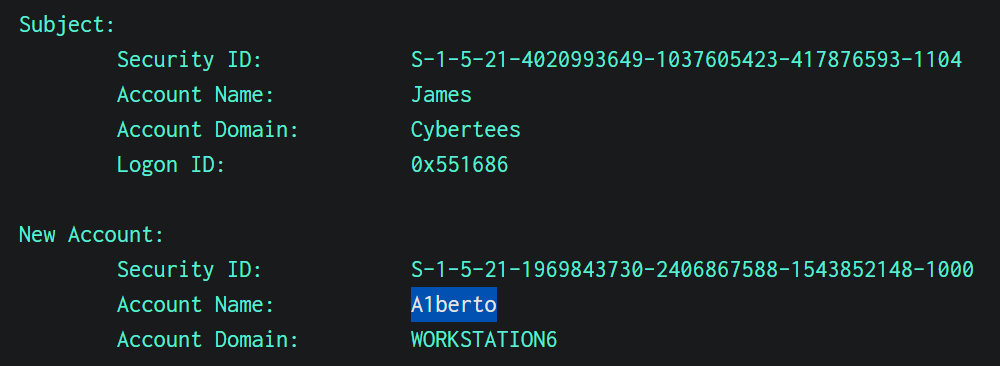
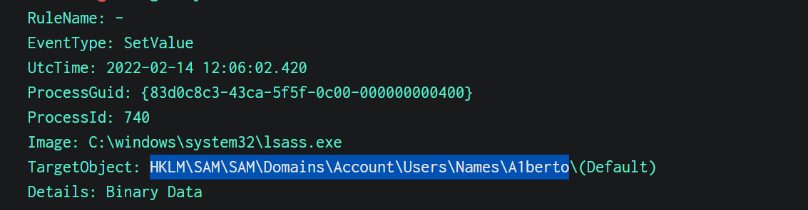
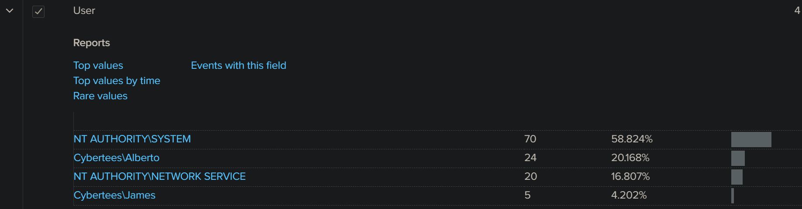
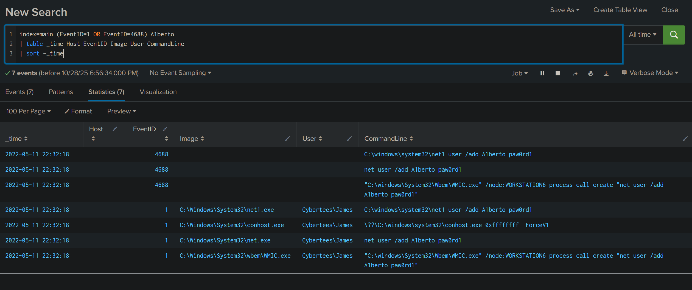
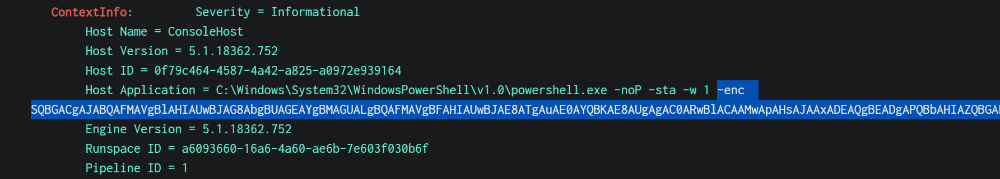

# Investigating with Splunk — Incident Report (TryHackMe Room)

_A hands-on SOC investigation using Splunk, Sysmon, and Windows event logs to track a backdoor user, registry modifications, remote execution, and an encoded PowerShell payload._

---

## Table of Contents

- [Project Summary](#project-summary)  
- [Skills Demonstrated](#skills-demonstrated)  
- [Investigation Process](#investigation-process)  
  - [Stage 1: Overview & Data Access](#stage-1-overview--data-access)  
  - [Stage 2: Event Count / Index Verification](#stage-2-event-count--index-verification)  
  - [Stage 3: Backdoor Account Creation](#stage-3-backdoor-account-creation)  
  - [Stage 4: Registry Evidence (SAM Hive)](#stage-4-registry-evidence-sam-hive)  
  - [Stage 5: Impersonation & Remote Execution](#stage-5-impersonation--remote-execution)  
  - [Stage 6: PowerShell Activity & Event Counts](#stage-6-powershell-activity--event-counts)  
  - [Stage 7: Decode Encoded PowerShell & Extract URL](#stage-7-decode-encoded-powershell--extract-url)  
- [IOCs (defanged)](#iocs-defanged)  
- [Lessons Learned](#lessons-learned)  
- [References](#references)

---

## Project Summary

**What is this project?**  
This is an investigation of the TryHackMe room **“Investigating with Splunk”**. Using Splunk searches over `index=main` (which contained Windows Security, Sysmon, and PowerShell logs), I traced a complete attack chain: remote creation of a backdoor user, SAM (Security Account Manager) registry modifications, PowerShell execution, and the payload contacting a web endpoint.

**Result in one line:** Confirmed creation of user `A1berto`, registry change under the SAM hive, WMIC remote execution used to create the user, PowerShell script activity (79 events), and an encoded PowerShell payload that contacted `http://10.10.10.5/news.php`.

---

## Skills Demonstrated

- Windows event triage (Security, Sysmon, PowerShell logs)  
- Splunk search and field extraction (`stats`, `rex`, `table`)  
- Identifying persistence (SAM modifications) and remote execution (WMIC)  
- Decoding PowerShell `-EncodedCommand` (UTF-16LE base64) and extracting URLs  
- Producing obfuscated IOCs for safe reporting

---

## Investigation Process

### Stage 1: Overview & Data Access
- Deployed the room machine and opened Splunk at `http://MACHINE_IP:8000`.  
- Verified the main index (`index=main`) contained relevant logs (Security, Sysmon, PowerShell).

---

### Stage 2: Event Count / Index Verification
**Goal:** Confirm how many events were ingested into `main`.  
**Query:**
```spl
index=main 
```
**Result:** `12256` events ingested.

---

### Stage 3: Backdoor Account Creation
**Goal:** Find evidence of a newly created account.  
- Searched for user-creation events (Windows Security `EventID=4720`) and related fields.  
**Key evidence:**
 
- `EventID=4720` showing account created: `A1berto`  
**Result:** New user: `A1berto`

---

### Stage 4: Registry Evidence (SAM Hive)
**Goal:** Locate registry writes confirming low-level account persistence.  
- The dataset included **Sysmon** logs; Sysmon uses `EventID=12` (registry create) and `EventID=13` (registry value modified).  
**Query:**
```spl
index=main (EventID=12 OR EventID=13) A1berto
```
**Result (full registry path):**
 
```
HKLM\SAM\SAM\Domains\Account\Users\Names\A1berto
```
This proves the SAM hive was modified for that account (lsass.exe was observed writing).

---

### Stage 5: Impersonation & Remote Execution
**Goal:** Determine if the adversary impersonated a legitimate user and how the account was created remotely. 
  
- Review of log `User`/`AccountName` fields revealed both `Cybertees\Alberto` (legitimate) and `Cybertees\A1berto` (backdoor). The adversary was attempting to impersonate **Alberto** (swap `l` → `1`).
 
- Investigated process creation / CommandLine fields (Sysmon `EventID=1` / WinSecurity `4688`).

**Key remote execution evidence (WMIC):**
```
"C:\windows\System32\wbem\WMIC.exe" /node:WORKSTATION6 process call create "net user /add A1berto paw0rd1"
```
This WMIC call confirms **remote execution** on `WORKSTATION6` that created the account.

---

### Stage 6: PowerShell Activity & Event Counts
**Goal:** Identify which host ran suspicious PowerShell and count related events.  
- Determined infected host: **James.browne** (found by filtering CommandLine that matched the WMIC string and by isolating PowerShell activity tied to that host).  
- Count of PowerShell operational events (EventID 4103 in this dataset) = **79** (the room counts 4103 events as the malicious PowerShell executions).

**Query used to count:**
```spl
index=main EventID=4103
```
**Result:** `79` events.

---

### Stage 7: Decode Encoded PowerShell & Extract URL
**Goal:** Decode `-EncodedCommand` to reveal payload and URL used by malware. 
  
- Found the PowerShell command used `-enc` / `-EncodedCommand` with a long base64 string.  
- Decoded base64 **as UTF-16LE** (PowerShell `-EncodedCommand` uses UTF-16LE), then searched the decoded script for `http`/`https`.


**Decoded script snippet** revealed a call to `/news.php`. In the room context the full resolved URL was:
```
http://10.10.10.5/news.php
```
TryHackMe expects IOCs in defanged form (see IOCs below).

---

## IOCs (defanged)

> _Defanged values for public sharing and portfolio inclusion._

- Domain / URL: `hxxp[://]10[.]10[.]10[.]5/news[.]php`  
- Backdoor username: `A1berto`  
- Legitimate user impersonated: `Cybertees[\\]Alberto`  
- Infected host: `James.browne`  
- Registry path: `HKLM[SAM]SAM[\\]Domains[\\]Account[\\]Users[\\]Names[\\]A1berto`  
- Remote command (evidence): `WMICall: "C:\\Windows\\System32\\wbem\\WMIC.exe" /node:WORKSTATION6 process call create "net user /add A1berto paw0rd1"`

> Note: Use the obfuscated IOC format when posting publicly. To translate back for internal tool use: replace `hxxp`→`http`, `[.]`→`.`, etc.

---


## Lessons Learned

- **Sysmon is invaluable.** When Windows native auditing lacks detail (e.g., missing registry audit 4657), Sysmon’s 12/13/1 events provide the missing forensic artifacts.  
- **Encoded PowerShell requires correct decoding.** `-EncodedCommand` uses UTF-16LE base64 — decoding as UTF-8 will fail.  
- **Adversaries use living-off-the-land tools (WMIC, net user)** for remote, stealthy execution; detection must watch for their abuse.  
- **Defanging IOCs** is necessary for safe sharing in public portfolios or reports.

---

## References

- [TryHackMe — Investigating with Splunk](https://tryhackme.com/room/investigatingwithsplunk)  
- [PowerShell Documentation — About Execution Policy & EncodedCommand](https://learn.microsoft.com/en-us/powershell/module/microsoft.powershell.core/about/about_execution_policies)  
