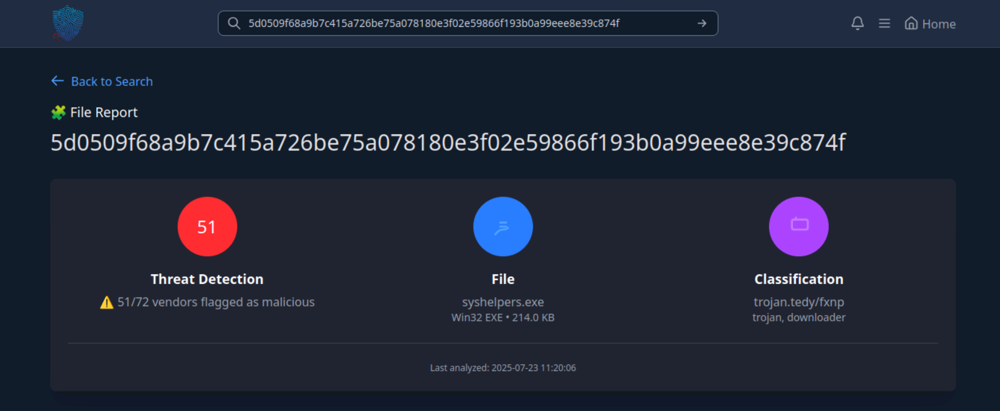
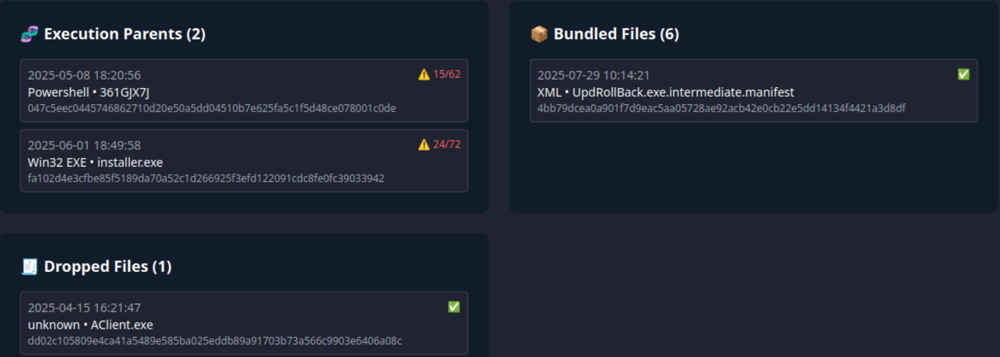
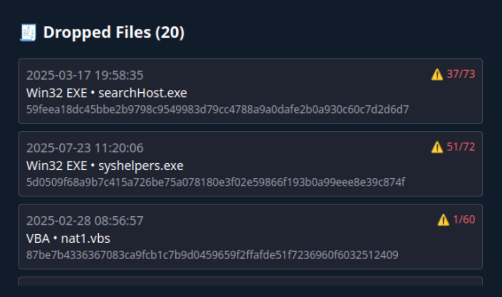

# Invite Only (TryHackMe Threat Intelligence Lab)

_A SOC-focused malware investigation simulating IOC enrichment, execution-chain analysis, and campaign attribution involving an AsyncRAT delivery chain._

---

## Table of Contents

- [Project Summary](#project-summary)
- [Skills Demonstrated](#skills-demonstrated)
- [Investigation Process](#investigation-process)
  - [Stage 1: Initial IOC Review](#stage-1-initial-ioc-review)
  - [Stage 2: Malicious File Analysis](#stage-2-malicious-file-analysis)
  - [Stage 3: Execution Chain Analysis](#stage-3-execution-chain-analysis)
  - [Stage 4: Dropped File Investigation](#stage-4-dropped-file-investigation)
  - [Stage 5: Installer Pivot & Payload Staging](#stage-5-installer-pivot--payload-staging)
  - [Stage 6: Malware Family Attribution](#stage-6-malware-family-attribution)
  - [Stage 7: OSINT & Campaign Correlation](#stage-7-osint--campaign-correlation)
- [Lessons Learned](#lessons-learned)
- [What I’d Improve Next Time](#what-id-improve-next-time)
- [References](#references)

---

## Project Summary

> **What is this project?**
>
> I completed the TryHackMe **Invite Only** lab, a threat intelligence investigation where I acted as a SOC analyst supporting an incident response escalation. The task involved analyzing a flagged IP address and SHA256 hash to identify malware behavior, execution flow, dropped payloads, and the broader threat campaign. Through IOC enrichment and external OSINT validation, the investigation was ultimately attributed to an **AsyncRAT** malware campaign delivered via hijacked Discord invites.

---

## Skills Demonstrated

- SHA256 hash analysis and malware identification
- Execution parent (process lineage) analysis
- Dropped file and payload staging investigation
- Installer pivoting and multi-stage infection analysis
- Malware family attribution (AsyncRAT)
- OSINT validation using VirusTotal and vendor research
- Identifying phishing techniques and abuse of legitimate platforms

---

## Investigation Process

### Stage 1: Initial IOC Review

- **Problem:** An L1 analyst escalated two suspicious indicators during incident response activities.
- **Indicators Provided:**
  - Flagged IP address: `101.99.76.120`
  - Flagged SHA256 hash
- **Objective:** Enrich the indicators and determine whether they were part of a known malware campaign.

---

### Stage 2: Malicious File Analysis
 
- **Action:** Performed a SHA256 hash lookup using the provided threat intelligence tool.
- **Findings:**
  - File name: `syshelpers.exe`
  - File type: Win32 executable
  - Detection rate: 51/72 vendors flagged the file as malicious
  - Classification: Trojan / Downloader

This confirmed the file was malicious and warranted deeper behavioral analysis.

---

### Stage 3: Execution Chain Analysis
 
- **Objective:** Identify how the malware was executed on the host.
- **Analysis:** Reviewed the execution parent tree associated with `syshelpers.exe`.
- **Results:**
  - Execution parents (chronological):
    - `361GJX7J` (PowerShell script artifact)
    - `installer.exe`

This indicated a PowerShell-based launcher followed by a malicious installer, consistent with staged malware delivery.

---

### Stage 4: Dropped File Investigation

- **Objective:** Identify files dropped by the malware during execution.
- **Findings:**
  - Dropped payload: `AClient.exe`

The presence of a secondary executable suggested post-compromise persistence or remote access capability.

---

### Stage 5: Installer Pivot & Payload Staging
 
- **Action:** Pivoted to analyze `installer.exe`, identified as the second execution parent.
- **Findings:** The installer dropped multiple malicious payloads in sequence:

```
searchhost.exe, syshelpers.exe, nat.vbs, runsys.vbs
```

This confirmed a **multi-stage infection chain** involving executables and VBScript components.

---

### Stage 6: Malware Family Attribution

- **Objective:** Identify the malware family linking the files and infrastructure.
- **Analysis:** Correlated dropped files, behavior, and associated IP infrastructure.
- **Result:** Attributed the activity to the **AsyncRAT** malware family.

The use of PowerShell, staged payloads, and RAT-style tooling aligned with known AsyncRAT campaigns.

---

### Stage 7: OSINT & Campaign Correlation

- **Challenge:** The internal lab tool lacked sufficient campaign-level attribution.
- **Action:** Pivoted to external OSINT sources, including VirusTotal community intelligence and vendor research.
- **Key Findings:**
  - Cookie theft tool used: **ChromeKatz**
  - Phishing technique: **ClickFix** social engineering
  - Platform abused for redirection: **Discord**

- **Campaign Confirmation:** Indicators matched a Check Point Research report titled:

> **From Trust to Threat: Hijacked Discord Invites Used for Multi-Stage Malware Delivery**

This validated that the lab indicators were part of a documented AsyncRAT campaign abusing hijacked Discord invite links.

---

## Lessons Learned

- Execution-chain analysis is critical for understanding malware delivery paths.
- Installers often act as staging mechanisms for multiple payloads.
- Internal tools may lack full attribution; external OSINT is essential for validation.
- AsyncRAT campaigns commonly combine PowerShell, EXEs, and scripts.
- Abuse of legitimate platforms (e.g., Discord) is a common social engineering tactic.

---

## What I’d Improve Next Time

- Perform deeper dynamic analysis of dropped payloads in a sandbox.
- Expand MITRE ATT&CK technique mapping for the full infection chain.

---

## References

- [TryHackMe: Invite Only Room](https://tryhackme.com/room/invite-only)
- [VirusTotal Community Intelligence](https://www.virustotal.com/)
- [Check Point Research: *From Trust to Threat: Hijacked Discord Invites Used for Multi-Stage Malware Delivery*](https://research.checkpoint.com/2025/from-trust-to-threat-hijacked-discord-invites-used-for-multi-stage-malware-delivery/)
- [MITRE ATT&CK Framework](https://attack.mitre.org/)

