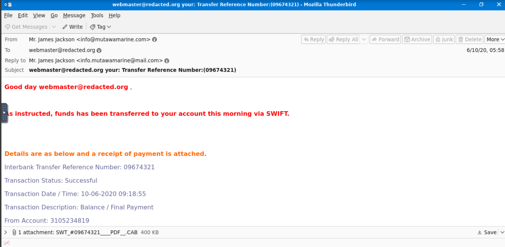
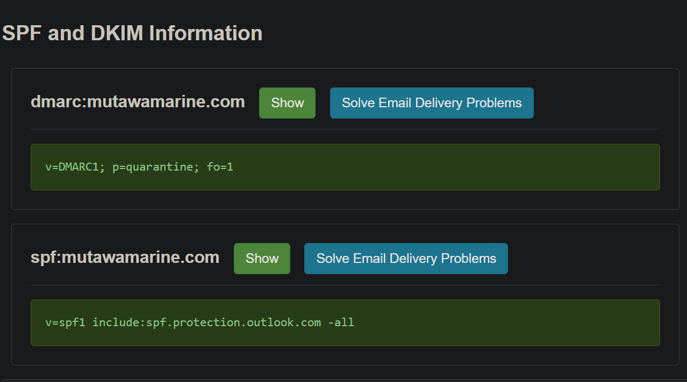
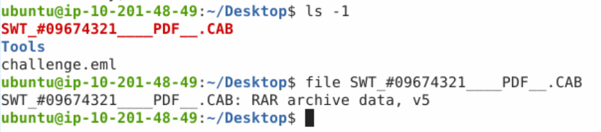
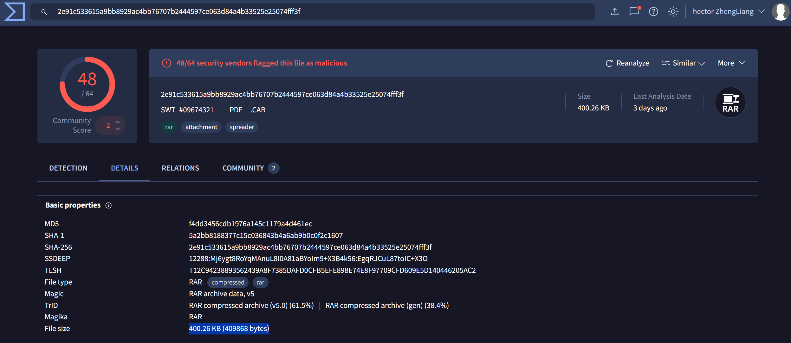

# **Greenholt Phish (TryHackMe Email Analysis Lab)**

*A hands-on phishing investigation simulating real SOC workflows,
including email header analysis, attachment triage, malware
identification, and threat intel enrichment.*

------------------------------------------------------------------------

## **Table of Contents**

-   [Project Summary](#project-summary)
-   [Skills Demonstrated](#skills-demonstrated)
-   [Investigation Process](#investigation-process)
    -   [Stage 1: Email Review](#stage-1-email-review)
    -   [Stage 2: Header Analysis](#stage-2-header-analysis)
    -   [Stage 3: Sender & Domain
        Authentication](#stage-3-sender--domain-authentication)
    -   [Stage 4: Attachment
        Inspection](#stage-4-attachment-inspection)
    -   [Stage 5: File Type
        Identification](#stage-5-file-type-identification)
    -   [Stage 6: Hashing & Malware
        Verification](#stage-6-hashing--malware-verification)
-   [Lessons Learned](#lessons-learned)
-   [What I'd Improve Next Time](#what-id-improve-next-time)
-   [References](#references)

------------------------------------------------------------------------

## **Project Summary**

> **What is this project?**
>
> I completed the TryHackMe *Greenholt Phish* lab, a SOC-level phishing
> analysis scenario. I acted as an email analyst tasked with reviewing a
> suspicious SWIFT payment notification received by a victim.
>
> The engagement required reviewing email headers, validating
> anti-spoofing controls (SPF, DMARC), extracting the sending
> infrastructure, and analyzing a disguised malicious attachment posing
> as a `.CAB` file but revealed to be a **RAR archive containing
> malware**.
>
> The case replicated a real-world BEC (Business Email Compromise) or
> financial-themed phishing lure, often used to deliver remote access
> trojans (RATs) or steal corporate banking credentials.

------------------------------------------------------------------------

## **Skills Demonstrated**

-   Email header analysis (Received chain, Return-Path, Reply-To)
-   Sender authenticity verification (SPF alignment, DMARC policies)
-   Identification of spoofed domains & mismatched routing
-   File type analysis using Linux command-line tools (`file`,
    `sha256sum`)
-   Recognizing disguised malware (fake extensions → real file type)
-   VirusTotal enrichment and malware classification\


------------------------------------------------------------------------

## Investigation Process

------------------------------------------------------------------------

### **Stage 1: Email Review**

-   **Problem:** The organization received an email claiming to contain
    a SWIFT transfer confirmation.
-   **Action:** Loaded the `.eml` file using Thunderbird inside the
    isolated VM.
-   **Key Findings:**
    -   Sender name: **Mr. James Jackson**
    -   Displayed sender address: **info@mutawamarine.com**
    -   Subject contained a supposed transfer reference number:
        **09674321**
    -   Message body included vague financial instructions and an
        attachment, typical for phishing lures.
    -   **Reply-To was mismatched**, redirecting to
        **info.mutawamarine@mail.com**, a common phishing trick.

------------------------------------------------------------------------

### **Stage 2: Header Analysis**

-   **Problem:** Determine the true origin of the email.

-   **Action:** Viewed message source via `Ctrl + U` in Thunderbird.

-   **Findings:**

        Received: from fmsrv-733738.hostwindsdns.com (192.119.71.157)

    -   Originating IP: **192.119.71.157**
    -   WHOIS lookup (via external TI platform): **Hostwinds LLC**

The Received header chain showed clear signs of spoofing and mismatched
routing compared to the claimed sender.

------------------------------------------------------------------------

### **Stage 3: Sender & Domain Authentication**

-   **Problem:** Validate domain security controls.
-   **Investigation:**
    -   SPF result in header: **fail**

    -   Independent lookup (mxtoolbox):

            v=spf1 include:spf.protection.outlook.com -all

        -   DMARC record:

        ```{=html}
        <!-- -->
        ```
            v=DMARC1; p=quarantine; fo=1
-   **Conclusion:**\
    The sender domain did **not** permit the sending IP, indicating
    spoofing.
    DMARC policy existed, but alignment failed → email should have been
    quarantined.

------------------------------------------------------------------------

### **Stage 4: Attachment Inspection**

-   **Problem:** Identify contents of the suspicious attachment.\
-   **Action:**
    -   Saved attachment:\
        **`SWT_#09674321___PDF__.CAB`**\
    -   Reviewed attachment metadata via Right-click → Properties.\
    -   File size obtained directly from the VM.
-   **Result:**\
    Attachment name attempts to mimic SWIFT/PDF naming conventions ---
    common in phishing.

------------------------------------------------------------------------

### **Stage 5: File Type Identification**

-   **Problem:** The `.CAB` extension could be fake.\

-   **Action:** Ran Linux `file` command:

        file SWT_#09674321___PDF__.CAB

-   **Result:**

        RAR archive data, v5

    Despite the `.CAB` extension, the file was actually a **RAR
    archive**, a typical malware delivery technique.

------------------------------------------------------------------------

### **Stage 6: Hashing & Malware Verification**

-   **Problem:** Confirm if the sample is malicious.

-   **Action:**
    Ran SHA256 hash:

        sha256sum SWT_#09674321___PDF__.CAB

-   **Result:**
    A full 64-character SHA256 hash was generated.

-   **Follow-up:** Submitted hash to VirusTotal (outside the VM as the
    VM had no internet).

-   **Outcome:**
    The file was flagged as **malware** by multiple AV vendors,
    validating the attachment as a malicious payload masquerading as a
    financial document.

------------------------------------------------------------------------

## **Lessons Learned**

-   Phishing attachments often misuse trusted extensions (PDF, DOC, CAB)
    to mask malicious executables or archives.\
-   Email header analysis is essential for validating sender
    authenticity.\
-   SPF and DMARC misalignment are strong indicators of spoofing.\
-   Even simple cases demonstrate real-world TTPs used in financial
    fraud campaigns.\
-   Proper triage workflows don't require internet access --- only
    methodical analysis.\

------------------------------------------------------------------------

## **What I'd Improve Next Time**

-   Perform dynamic analysis of the extracted malware (sandboxing,
    behavioral logging).
-   Build YARA rules targeting common phishing attachment patterns.
------------------------------------------------------------------------

## **References**

-   [TryHackMe -- Greenholt
    Phish](https://tryhackme.com/room/phishingemails5fgjlzxc)
-   [VirusTotal](https://www.virustotal.com/)
-   [MXToolbox SPF & DMARC Check](https://mxtoolbox.com/Public/Tools/EmailHeaders.aspx?huid=b328a130-018f-49e8-a64a-dce09067d5c5)

