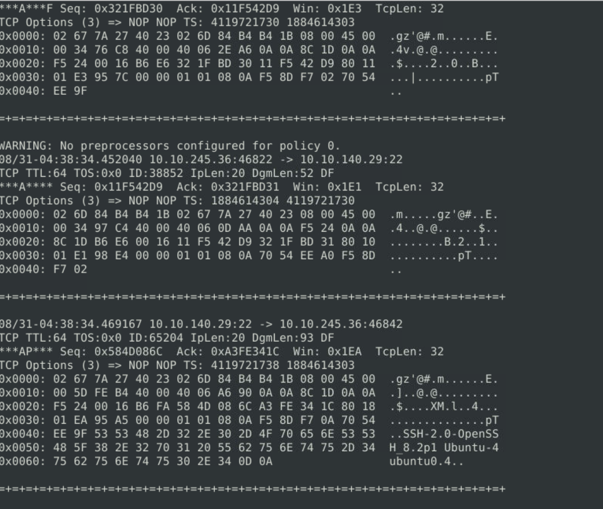
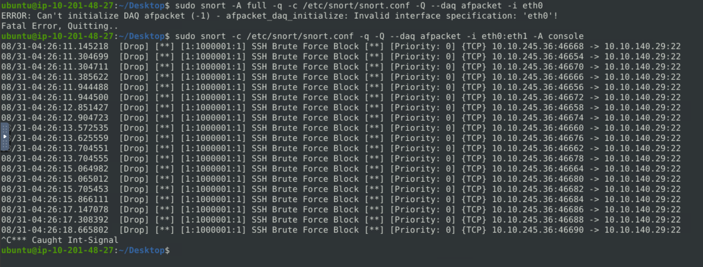
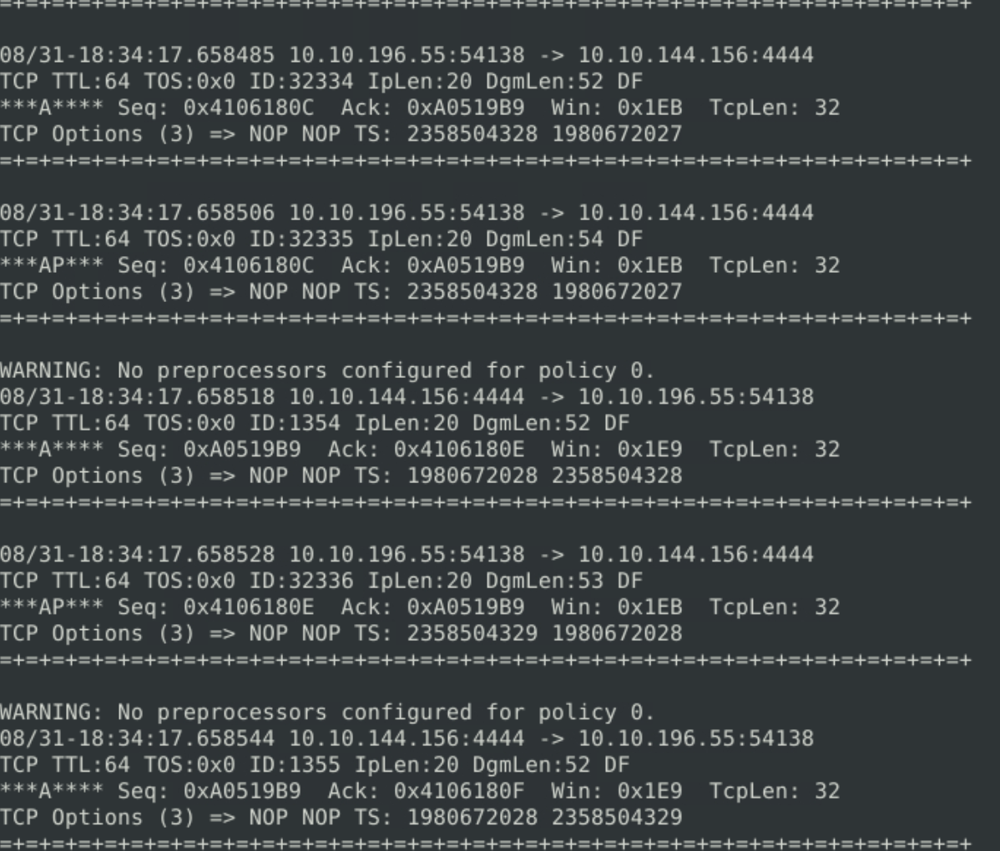
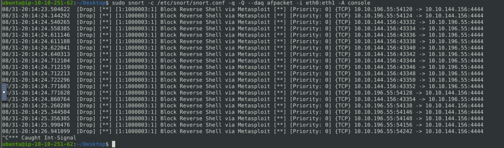

# Snort Challenge – Live Attacks (TryHackMe)

_A hands-on SOC project simulating real-time detection and prevention of brute-force and reverse shell attacks using Snort IDS/IPS._

---

## Table of Contents

- [Project Summary](#project-summary)  
- [Skills Demonstrated](#skills-demonstrated)  
- [Investigation Process](#investigation-process)  
  - [Stage 1: Detecting Inbound Brute-Force Attack](#stage-1-detecting-inbound-brute-force-attack)  
  - [Stage 2: Blocking Inbound Brute-Force Attack](#stage-2-blocking-inbound-brute-force-attack)  
  - [Stage 3: Detecting Outbound Reverse Shell](#stage-3-detecting-outbound-reverse-shell)  
  - [Stage 4: Blocking Outbound Reverse Shell](#stage-4-blocking-outbound-reverse-shell)  
- [Lessons Learned](#lessons-learned)  
- [What I’d Improve Next Time](#what-id-improve-next-time)  
- [Supplemental Files](#supplemental-files)  
- [References](#references)  

---

## Project Summary

> **What is this project?**  
> I completed the TryHackMe “Snort Challenge – Live Attacks” room. The lab simulated a company under active attack. My objective was to use **Snort IDS/IPS** to detect and block malicious network traffic:
> - **Stage 1:** Observe and detect an SSH brute-force attack.  
> - **Stage 2:** Write a custom Snort rule to block the attack.  
> - **Stage 3:** Investigate outbound traffic and identify a reverse shell connection.  
> - **Stage 4:** Write and deploy a rule to stop the reverse shell.  

---

## Skills Demonstrated

- Network traffic monitoring with Snort  
- Writing and tuning Snort rules (IDS → IPS)  
- Detecting brute-force login attempts  
- Identifying reverse shell (C2) traffic  
- Incident response workflow: detect → analyze → block → verify  
- MITRE ATT&CK mapping (Initial Access, Command & Control)  
- Documentation of detection and prevention  

---

## Investigation Process

### Stage 1: Detecting Inbound Brute-Force Attack
- **Problem:** Persistent inbound login attempts against the VM.  
- **Action:**  
  - Ran Snort in sniffer mode:  
    
   
  - Observed repeated packets targeting **TCP port 22 (SSH)**.  
- **Result:** Identified SSH brute-force attempt from attacker IP `10.10.245.36`.

---

### Stage 2: Blocking Inbound Brute-Force Attack
- **Action:**  
  - Created a local Snort rule in `/etc/snort/rules/local.rules`:  
    ```snort
    drop tcp any any -> any 22 (msg:"SSH Brute Force Block"; sid:1000001; rev:1;)
    ```
  - Ran Snort in IPS mode:  
    ```bash
    sudo snort -c /etc/snort/snort.conf -q -Q --daq afpacket -i eth0:eth1 -A console
    ```
- **Result:** Snort actively blocked inbound brute-force traffic.  


---

### Stage 3: Detecting Outbound Reverse Shell
- **Problem:** Suspicious outbound traffic suggested a reverse shell.  
- **Action:**  
  - Used Snort to inspect outbound packets. 
   
  - Identified repeated outbound connections to destination port **4444/TCP**.  
  - This is a known **Metasploit default reverse shell port**.  
- **Result:** Determined the attacker established a reverse shell from inside the network.

---

### Stage 4: Blocking Outbound Reverse Shell
- **Action:**  
  - Created rule in `local.rules`:  
    ```snort
    drop tcp any any -> any 4444 (msg:"Block Reverse Shell via Metasploit"; sid:1000002; rev:1;)
    ```
  - Deployed in IPS mode again.  
- **Result:** Snort successfully blocked reverse shell traffic to port `tcp/4444`.  


---

## Lessons Learned
- **Inbound vs Outbound** → It’s not enough to only monitor inbound threats; compromised hosts may exfiltrate or beacon out.  
- **Rule precision** → Specific rules (blocking attacker IP or known malicious port) reduce collateral damage compared to broad “drop all SSH.”  
- **Snort workflow** → Sniffer → Rule writing → IPS inline is the standard SOC workflow for intrusion detection/prevention.  
- **Protocol knowledge matters** → Knowing that `tcp/22` = SSH and `tcp/4444` = Metasploit saved time in identifying attacks.  

---

## What I’d Improve Next Time
- Write detection rules before blocking, for better visibility.  
- Add logging integration (e.g., feeding Snort alerts into Splunk/ELK).  
- Expand ruleset to detect scans, web exploitation, and exfiltration attempts.  
- Automate with scripts for faster rule deployment.  

---

## Supplemental Files

- [local.rules](supplemental/local.rules) — Custom rules written during the lab  


---

## References
- [TryHackMe: Snort Challenge – Live Attacks](https://tryhackme.com/room/snortchallenges2)  
- [Snort Documentation](https://www.snort.org/documents)  
- [MITRE ATT&CK: Command & Control (TA0011)](https://attack.mitre.org/tactics/TA0011/)  
- [MITRE ATT&CK: Initial Access (TA0001)](https://attack.mitre.org/tactics/TA0001/)  
