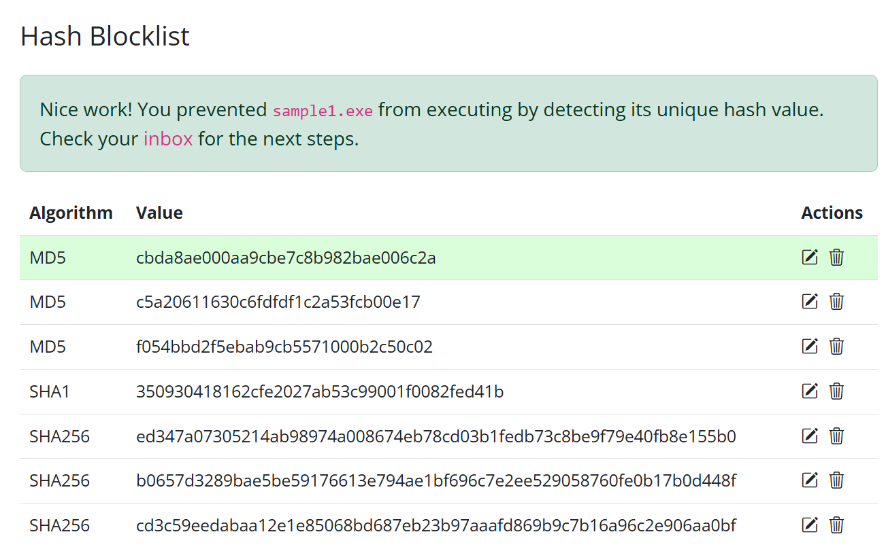
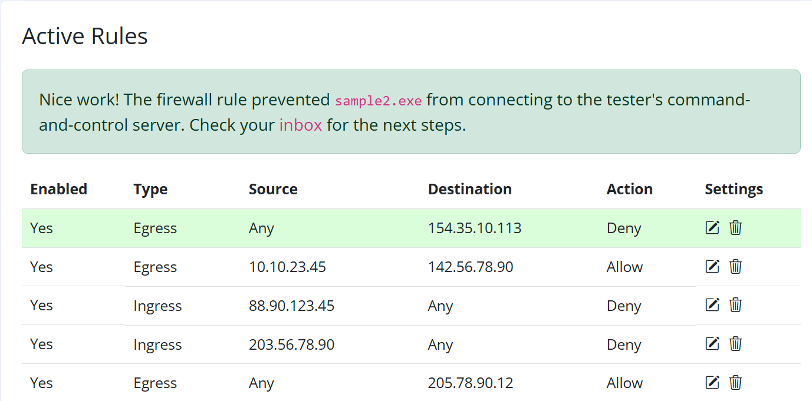
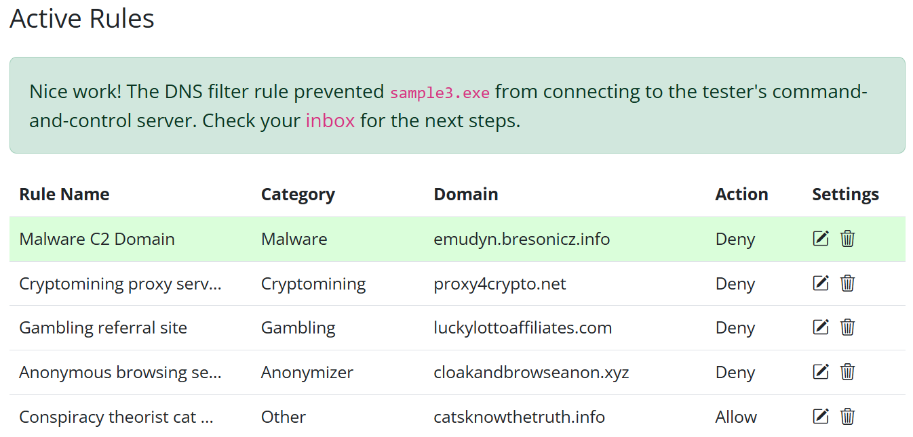
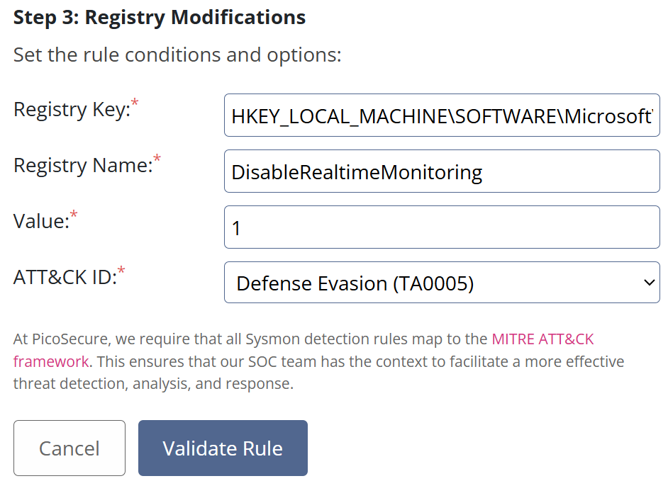

# Summit (TryHackMe Pyramid of Pain Lab)

_A hands-on blue team project simulating adversary adaptation and detection escalation._

---

## Table of Contents

- [Project Summary](#project-summary)
- [Skills Demonstrated](#skills-demonstrated)
- [Investigation Process](#investigation-process)
    - [Stage 1: Hash-Based Detection](#stage-1-hash-based-detection)
    - [Stage 2: Network Indicator Detection (IP)](#stage-2-network-indicator-detection-ip)
    - [Stage 3: Domain-Based Detection](#stage-3-domain-based-detection)
    - [Stage 4: Artifact/Registry Detection (Host-Based IOC)](#stage-4-artifactregistry-detection-host-based-ioc)
    - [Stage 5: Beaconing / Behavioral Detection](#stage-5-beaconing--behavioral-detection)
    - [Stage 6: Collection & Exfiltration (Host-Based IOC)](#stage-6-collection--exfiltration-host-based-ioc)
- [Lessons Learned](#lessons-learned)
- [What I’d Improve Next Time](#what-id-improve-next-time)
- [Supplemental Files](#supplemental-files)
- [References](#references)

---

## Project Summary

> **What is this project?**
>
> I completed the TryHackMe “Summit” blue team lab (Pyramid of Pain). The challenge simulated a real adversary that evolved their techniques over several rounds. My goal was to adapt my detection strategies—from basic hash-blocking, to network, to behavioral, to host artifact and exfil detection—forcing the adversary to keep escalating and finally give up.

---

## Skills Demonstrated

- Detection engineering (Sigma rules, firewall, DNS, registry, etc.)
- Log analysis (Sysmon, network, file, process logs)
- IOC hunting and analysis
- Adapting to adversary TTPs (tactics, techniques, procedures)
- Documentation & communication of technical work

---

## Investigation Process

### Stage 1: Hash-Based Detection

- **Problem:** Attacker drops `sample1.exe`. Traditional detection by file hash.
- **Action:**  
    - Used malware sandbox to extract MD5 hash:  
      `cbda8ae000aa9cbe7c8b982bae006c2a`
    - Created a hash-based detection rule.

 

- **Result:** Blocked the initial sample. Attacker adapted by changing the file hash.

---

### Stage 2: Network Indicator Detection (IP)

- **Problem:** New sample (`sample2.exe`) changed hash, but contacted the same C2 IP.
- **Action:**  
    - Scanned network connections, found IP: `154.35.10.113` on port `4444`
    - Created a firewall egress rule to deny all outbound to that IP and port.



- **Result:** Blocked further C2 traffic. Attacker switched to new domains and IPs.

---

### Stage 3: Domain-Based Detection

- **Problem:** Attacker switched to using a new domain to evade IP-based blocking.
- **Action:**  
    - Identified repeated DNS requests to the suspicious domain: `emudyn.bresonicz.info`
    - Created a DNS filtering rule to deny all requests to that domain.



- **Result:** Successfully blocked malware communications to the C2 server using its domain, forcing the attacker to try new techniques.

---

### Stage 4: Artifact/Registry Detection (Host-Based IOC)

- **Problem:**  
    The attacker evolved beyond network-based IOCs (hash, IP, domain) and started modifying system settings to evade detection. The new malware variant attempted to **disable Windows Defender’s Real-Time Protection** by changing a specific registry key/value.

- **Investigation:**  
    - Analyzed the malware’s behavior in the sandbox and observed repeated registry modifications.
    - Key modified:  
      `HKEY_LOCAL_MACHINE\SOFTWARE\Microsoft\Windows Defender\Real-Time Protection`
    - Value set:  
      `DisableRealtimeMonitoring = 1`
    - This is a **high-confidence indicator** of malicious intent, as legitimate tools almost never disable Defender this way except in rare admin workflows.

- **Detection Engineering:**  
  
    - Developed a Sigma rule to alert on any registry write event that sets `DisableRealtimeMonitoring` to `1` in the above registry path.
    - This rule leverages Sysmon logs for registry modifications.
    
#### Sigma Rule Example

```yaml
title: Modification of Windows Defender Real-Time Protection
id: windows_registry_defender_disable_realtime
description: |
  Detects modifications or creations of the Windows Defender Real-Time Protection DisableRealtimeMonitoring registry value.
references:
  - https://attack.mitre.org/tactics/TA0005/
tags:
  - attack.ta0005
  - sysmon
detection:
  selection:
    EventID: 4663
    ObjectType: Key
    ObjectName: 'HKEY_LOCAL_MACHINE\SOFTWARE\Microsoft\Windows Defender\Real-Time Protection'
    NewValue: 'DisableRealtimeMonitoring=1'
  condition: selection
falsepositives:
  - Legitimate changes to Windows Defender settings.
level: high
```
### Stage 5: Beaconing / Behavioral Detection

- **Problem:**  
    After blocking the attacker with hash, IP, domain, and registry rules, the adversary evolved again. The new malware (sample5.exe) began “beaconing”—making repeated outbound connections to command & control (C2) infrastructure using different IPs, but always with the same frequency and packet size.

- **Investigation:**  
    - Analyzed [outgoing_connections.log](supplemental/outgoing_connections.log) and identified a strong pattern:
        - Connections made every **1800 seconds (30 minutes)**
        - **Packet size always exactly 97 bytes**
        - Destination IP and port changed regularly, but the behavioral pattern did not
    - This “phone home” behavior is a classic C2 beaconing indicator.

- **Detection Engineering:**  
    - Developed a Sigma rule to detect any outbound network connections with **97-byte packet size**, recurring every **1800 seconds**, regardless of IP/port.
    - This behavioral rule is difficult for attackers to evade without rewriting their malware logic.
#### Sigma Rule Validation
```yaml
title: Alert on Suspicious Beacon Network Connections
id: network_connections_criteria_sysmon
description: |
  Detects network connections with specific criteria in Sysmon logs: packet size and frequency.
references:
  - https://attack.mitre.org/tactics/TA0011/
tags:
  - attack.ta0011
  - sysmon
detection:
  selection:
    EventID: 3
    RemoteIP: '*'
    RemotePort: '*'
    Size: 97
    Frequency: 1800 seconds
  condition: selection
falsepositives:
  - Rare: Legitimate software making regular, tiny network connections on a timer.
level: high
```
### Stage 6: Collection & Exfiltration (Host-Based IOC)

**Problem:**  
After detecting beaconing traffic, the attacker evolved again. Instead of only relying on network traffic or artifacts, you had to detect **what the attacker does after gaining access**—in this case, **data collection and exfiltration** using living-off-the-land commands and suspicious file creation.

**Investigation:**

- Analyzed the [commands.log](supplemental/commands.log) and the **sandbox analysis** of `sample6.exe`.
- Observed a sequence of commands (e.g., `dir`, `systeminfo`, `ipconfig /all`, `netstat`, `net start`) executed by `cmd.exe`, all dumping their output into the **same file**:  
  - **File:** `exfiltr8.log`  
  - **Path:** `%temp%\exfiltr8.log` (environment variable used for stealth)
- This file is dropped on disk by `cmd.exe`, indicating a likely **collection for exfiltration**.

**Detection Logic (Summary):**
- Look for creation/modification of a file named **`exfiltr8.log`** (or similar) in the **`%temp%` directory**,
- Especially when the **process is `cmd.exe`**,
- Map this to MITRE ATT&CK “Collection (TA0009)”.

#### Sigma Rule 
```yaml
title: Alert on Potential Exfiltration through File Creation or Modification
id: sysmon_file_creation_modification_temp
description: |
  Detects file creation or modification events with specific criteria: file path and file name.

references:
  - https://attack.mitre.org/techniques/TA0010/

tags:
  - attack.ta0010
  - attack.exfiltration
  - attack.file_creation
  - attack.file_modification
  - sysmon

detection:
  selection:
    - EventID: 2
      TargetFilename: '*\\exfiltr8.log'
      TargetPath: '*\\AppData\\Local\\Temp\\*'

  condition: selection

falsepositives:
  - Legitimate use of file creation and modification in a user's temp folder.

level: high
```
## Lessons Learned
- Attackers adapt—blue team must always escalate detection methods.
- IOC-based detections are weak; behavioral/artifact-based rules are stronger.
- Documentation is key: keeping step-by-step notes made rule tuning and reporting much easier.

## What I’d Improve Next Time
- Automate detection rule deployment.
- Try YARA rules for deeper host-based detection.
- Test detection logic against live malware samples (in safe VM!).
- Write more thorough post-mortem report.

## Supplemental Files
- [commands.log](supplemental/commands.log) — All commands run by attacker in Stage 6 (collection/exfil)
- [outgoing_connections.log](supplemental/outgoing_connections.log) — Outbound network connections for Stage 5 (beaconing analysis)
- [sample1analyzed.pdf](supplemental/sample1analyzed.pdf) — Full sandbox report: sample1.exe
- [sample2analyzed.pdf](supplemental/sample2analyzed.pdf) — Full sandbox report: sample2.exe
- [sample3analyzed.pdf](supplemental/sample3analyzed.pdf) — Full sandbox report: sample3.exe
- [sample4analyzed.pdf](supplemental/sample4analyzed.pdf) — Full sandbox report: sample4.exe
- [sample5analyzed.pdf](supplemental/sample5analyzed.pdf) — Full sandbox report: sample5.exe
- [sample6analyzed.pdf](supplemental/sample6analyzed.pdf) — Full sandbox report: sample6.exe

## References
- [TryHackMe Summit Room](https://tryhackme.com/room/summit)
- [TryHackMe: MITRE ATT&CK](https://tryhackme.com/room/mitre)
- [TryHackMe: Pyramid of Pain Lab](https://tryhackme.com/room/pyramidofpainax)
- [MITRE ATT&CK: Defense Evasion (TA0005)](https://attack.mitre.org/tactics/TA0005/)
