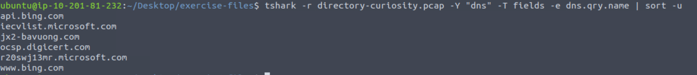
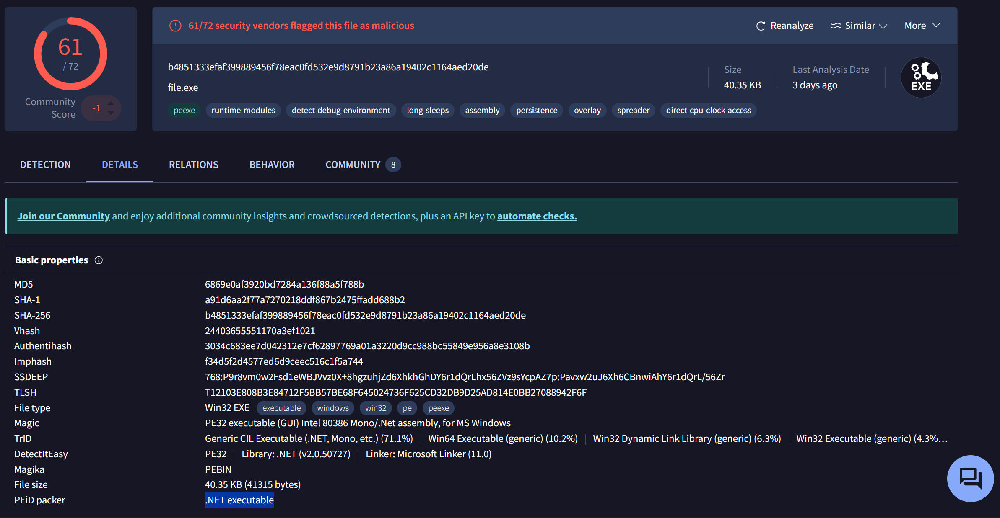
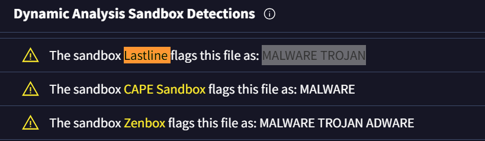

# TShark Challenge II: Directory Curiosity

_A hands-on packet analysis and malware investigation lab using TShark and Wireshark._

---

## Table of Contents

- [Project Summary](#project-summary)
- [Skills Demonstrated](#skills-demonstrated)
- [Investigation Process](#investigation-process)
  - [Stage 1: DNS Analysis](#stage-1-dns-analysis)
  - [Stage 2: HTTP Requests](#stage-2-http-requests)
  - [Stage 3: IP Resolution](#stage-3-ip-resolution)
  - [Stage 4: Server Fingerprinting](#stage-4-server-fingerprinting)
  - [Stage 5: Directory Enumeration](#stage-5-directory-enumeration)
  - [Stage 6: File Extraction](#stage-6-file-extraction)
  - [Stage 7: Malware Hashing & Sandbox Analysis](#stage-7-malware-hashing--sandbox-analysis)
- [Lessons Learned](#lessons-learned)
- [What I’d Improve Next Time](#what-id-improve-next-time)
- [References](#references)

---

## Project Summary

> **What is this project?**  
> I completed the TryHackMe “TShark Challenge II: Directory Curiosity.”  
> The challenge focused on analyzing a PCAP file with TShark to identify malicious activity: from suspicious DNS queries, to HTTP communications, to extracting malware artifacts. The investigation simulated a real-world SOC workflow of turning raw network traffic into actionable intelligence.

---

## Skills Demonstrated

- Packet capture analysis with TShark  
- DNS & HTTP traffic investigation  
- IOC extraction (domain, IP, server banner, file names, hashes)  
- Malware triage with VirusTotal & sandboxing  
- Technical documentation of analysis workflow  

---

## Investigation Process

### Stage 1: DNS Analysis

- **Problem:** Identify which domain in the DNS traffic was malicious.  
- **Action:**  
  ```bash
  tshark -r directory-curiosity.pcap -Y "dns.qry.name" -T fields -e dns.qry.name | sort -u
  ```
  
  - Found several domains (Microsoft, Bing, Digicert).  
  - One stood out: **`jx2-bavuong[.]com`**, flagged as malicious on VirusTotal.  
- **Result:** Confirmed IOC domain.  

---

### Stage 2: HTTP Requests

- **Problem:** Count how many HTTP requests were sent to the malicious host.  
- **Action:**  
  ```bash
  tshark -r directory-curiosity.pcap -Y "http.host == jx2-bavuong.com" | wc -l
  ```
- **Result:** **14 HTTP requests** observed.  

---

### Stage 3: IP Resolution

- **Problem:** Identify the IP address associated with the domain.  
- **Action:**  
  ```bash
  tshark -r directory-curiosity.pcap -Y "dns.a && dns.qry.name == jx2-bavuong.com"     -T fields -e dns.qry.name -e dns.a
  ```
- **Result:**  
  ```
  141[.]164[.]41[.]174
  ```

---

### Stage 4: Server Fingerprinting

- **Problem:** Determine the server info from HTTP responses.  
- **Action:**  
  ```bash
  tshark -r directory-curiosity.pcap     -Y "http.response && ip.addr == 141.164.41.174 && http.server"     -T fields -e http.server | sort -u
  ```
- **Result:**  
  ```
  Apache/2.2.11 (Win32) DAV/2 mod_ssl/2.2.11 OpenSSL/0.9.8i PHP/5.2.9
  ```

---

### Stage 5: Directory Enumeration

- **Problem:** Identify files listed in the directory index.  
- **Action:** Followed the first TCP stream in ASCII.  
  ```bash
  tshark -r directory-curiosity.pcap -q -z follow,tcp,ascii,0
  ```
- **Result:**  
  - 3 files listed:  
    - `123[.]php`  
    - `vlauto[.]exe`  
    - `vlauto[.]php`  
  - First file: `123[.]php`.  

---

### Stage 6: File Extraction

- **Problem:** Export the suspicious executable from HTTP traffic.  
- **Action:**  
  ```bash
  tshark -r directory-curiosity.pcap --export-objects http,./http_objects
  ```
- **Result:** Extracted malicious binary:  
  ```
  vlauto[.]exe
  ```

---

### Stage 7: Malware Hashing & Sandbox Analysis

- **Problem:** Generate a hash and analyze the malware sample.  
- **Action:**  
  ```bash
  sha256sum http_objects/vlauto.exe
  ```
  - SHA256:  
    ```
    b4851333efaf399889456f78eac0fd532e9d8791b23a86a19402c1164aed20de
    ```
- VirusTotal results:  
    - **PEiD packer:** `.NET executable`  
      
    

  - **Lastline Sandbox verdict:** `MALWARE TROJAN`
     
---

## Lessons Learned

- Even simple PCAPs can reveal a full kill chain: from C2 infrastructure to malware delivery.  
- TShark is powerful for CLI-driven packet analysis and scripting.  
- Always defang IOCs when documenting to avoid accidental clicks.  
- Sandbox results (like Lastline) provide valuable context beyond static analysis.  

---

## What I’d Improve Next Time

- Automate TShark extraction with custom scripts.  
- Enrich IOCs using multiple threat intel feeds, not just VirusTotal.  
- Try carving binaries directly from TCP streams with `dd` or `binwalk`.  
- Build a Sigma/Suricata rule set from the extracted IOCs.  

---

## References

- [TryHackMe TShark Challenge II: Directory](https://tryhackme.com/)  
- [TShark User’s Guide](https://www.wireshark.org/docs/man-pages/tshark.html)  
- [VirusTotal](https://www.virustotal.com/)  
- [Apache Server Banner Info](https://httpd.apache.org/)  
