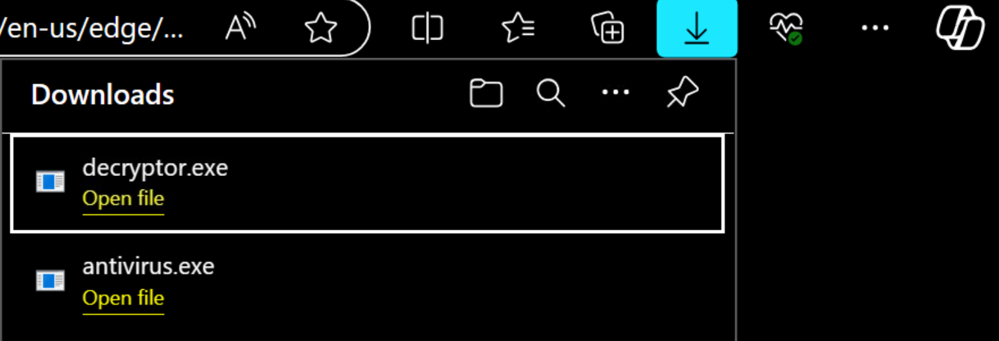
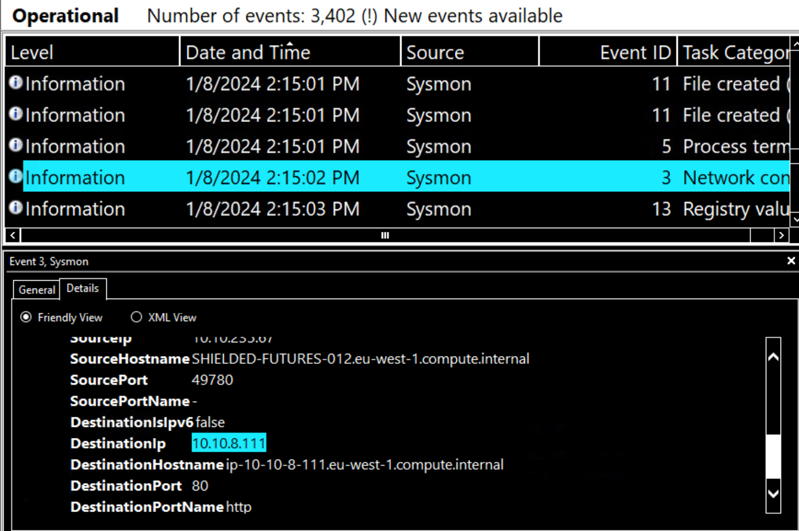
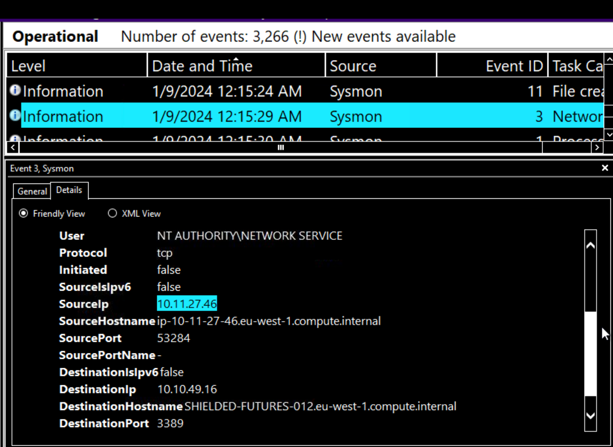
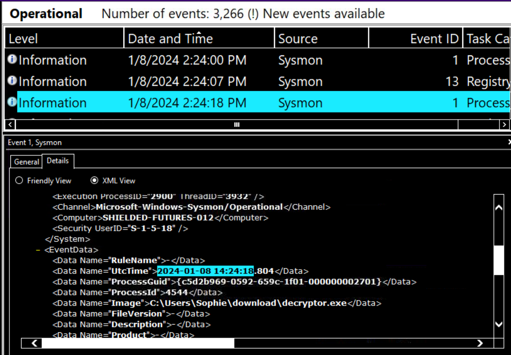

# Retracted — Incident Investigation (TryHackMe room)

_A compact, professional write-up of the “Retracted” TryHackMe endpoint forensics room — packaged as a portfolio-friendly case study._

---

## Table of Contents

- [Project Summary](#project-summary)  
- [Skills Demonstrated](#skills-demonstrated)  
- [Investigation Process](#investigation-process)  
  - [Initial triage (Task 1)](#initial-triage-task-1)  
  - [The Message (Task 2)](#the-message-task-2)  
  - [Something Wrong (Task 3)](#something-wrong-task-3)  
  - [Back to Normal (Task 4)](#back-to-normal-task-4)  
  - [Timeline reconstruction (Task 5)](#timeline-reconstruction-task-5)  
  - [Conclusion (Task 6)](#conclusion-task-6)  
- [Key Evidence / IOCs](#key-evidence--iocs)   
- [Lessons Learned](#lessons-learned)  
- [What I’d Improve / Next Steps](#what-id-improve--next-steps)  
- [References](#references)

---

## Project Summary

**Role:** SOC analyst (incident triage / endpoint forensics)  
**Scenario:** A user (`Sophie`) reports a desktop with a ransom note, then the system appears “fixed” later. The task is to determine what happened: which binary was executed, what files were affected, network IOCs, whether a third party accessed the machine, and the timeline of events.

**Outcome:** Confirmed a malicious installer was executed, it encrypted files by appending `.dmp`, contacted an external host, a remote actor accessed the machine via RDP, and later executed a `decryptor.exe` which restored files. Reconstructed a full timeline and produced IOCs for follow-up.

---

## Skills Demonstrated

- Endpoint log triage (Sysmon / Event Viewer / Security logs)  
- PowerShell-based evidence extraction and filtering (`Get-WinEvent`, `Get-Item`, `Get-ChildItem`)  
- IOC identification: filenames, file extensions, IPs, timestamps  
- Correlation across process create, file-create and network events (Sysmon Event IDs 1, 11, 3)  
- Incident timeline reconstruction and concise reporting

---

## Investigation Process

### Initial triage (Task 1)
- Opened the desktop environment and visually inspected for obvious artifacts. Located a file named `SOPHIE` on the Desktop (text document).
- Confirmed file type and `Opens with` using file properties (Notepad).
- Basic steps: check `C:\Users\Sophie\Desktop` and user folders for anomalous files and shortcuts.

**Finding:** Desktop contained `SOPHIE` (text file). Verified it was a text doc and that Notepad was the default opener.

---

### The Message (Task 2)
**Goal:** Find the path of the text file with the message; determine which program created it and when the creating process ran (UTC).

- File path: `C:\Users\Sophie\Desktop\SOPHIE.txt` (extensions may be hidden in UI).
- “Opens with”: `notepad.exe` (file properties -> Opens with).
- File metadata vs. event log nuance: NTFS file metadata (CreationTimeUtc) and Sysmon / Event log timestamps can differ (formatting, milliseconds, and which source the challenge expects). The lab expects the Sysmon/event-timestamp precision.

**Evidence & note about timestamps:**
- `Get-Item "C:\Users\Sophie\Desktop\SOPHIE.txt").CreationTimeUtc` produced a creation time (rounded to seconds depending on view).
- Sysmon / Event logs show millisecond precision. Lab expected the Sysmon event timestamp (e.g. `2024-01-08 14:25:30.749`) rather than NTFS `CreationTimeUtc` in some cases — I included both observations in the report to explain the discrepancy.

---

### Something Wrong (Task 3)
**Goal:** Identify the “installer” filename, its download location, the file extension added by the malware to encrypted files, and the external IP contacted.

**Findings:**

- **Installer filename:** `antivirus.exe` (observed in browser Downloads history and in Sysmon event `Image` field).
- **Download location (path):** `C:\Users\Sophie\Downloads\antivirus.exe` (Sysmon Event ID 1 shows `Image` path).
- **File extension appended by the malware:** `.dmp` (Sysmon Event ID 11 `TargetFilename` entries showed names like `VolunteerContacts.xlsx.dmp`, `Newsletter_DEC2023 - Copy.pptx.dmp`).
- **C2 / contacted IP (installer outbound):** `10.10.8.111` (Sysmon Event ID 3 network connection records showed `DestinationIp = 10.10.8.111`).

**Analysis:** The malware appended `.dmp` to victim files rather than replacing extensions. The installer cleaned up the `Downloads` folder after execution (common technique to reduce visible traces). Browser history preserved the download record (Edge history showed `antivirus.exe` and `decryptor.exe`).

---

### Back to Normal (Task 4)
**Goal:** Identify RDP source IP used by the intruder after the infection, and the time (UTC) when the `decryptor.exe` was executed.

**Findings:**

- **RDP source IP:** `10.11.27.46` — Sysmon Event ID 3 / network connection logs and correlation with RDP destination port 3389 show the attacker’s source.

- **`decryptor.exe` execution time (UTC):** `2024-01-08 14:24:18.804` — Sysmon Event ID 1 (process create) shows `Image = C:\Users\Sophie\download\decryptor.exe` and `UtcTime = 2024-01-08 14:24:18.804`.

**Analysis:** The attacker accessed the machine remotely via RDP, executed a decryption tool which reversed the `.dmp` changes (or restored files), then left a desktop note telling the victim to check Bitcoin (likely to obscure intent and leave a trail). 

---

### Timeline reconstruction (Task 5)
Using the Sysmon and Security logs, correlated the events into a 7-step timeline (numbers correspond to sequence):

1. Sophie downloaded and executed `antivirus.exe`.  
2. The malware encrypted files, appending `.dmp`, and presented a ransom note.  
3. Sophie ran out and reached out to a responder (the user).  
4. While Sophie was away, an intruder logged in via RDP (source IP `10.11.27.46`) and explored the machine.  
5. The intruder realized the target was a charity, downloaded `decryptor.exe` and ran it (`2024-01-08 14:24:18.804` UTC).  
6. After restoring the files, the intruder left a desktop message instructing Sophie to check the Bitcoin account.  
7. The analyst arrived to investigate; the intruder had already left.

---

### Conclusion (Task 6)
- The case is not a simple stand-alone ransomware: the attacker chose to reverse the damage after realizing the target type (charity). The flow demonstrates a typical compromise → lateral/remote access → manual remediation by the attacker (or staged reversal) model.
- From an operations perspective, the host should be treated as compromised: credentials and remote-access traces exist; a full containment and credential reset + hunt for persistence is recommended as follow-up.

---

## Key Evidence / IOCs

- **Malicious installer (downloaded & executed):** `antivirus.exe`  
  - Path: `C:\Users\Sophie\Downloads\antivirus.exe`  
- **Fake decryptor:** `decryptor.exe`  
  - Path: `C:\Users\Sophie\download\decryptor.exe`  
  - Execution UTC: `2024-01-08 14:24:18.804` (Sysmon Event ID 1)  
- **File extension used by malware:** `.dmp` (e.g., `Newsletter_DEC2023 - Copy.pptx.dmp`)  
- **C2 / outbound contact from malware:** `10.10.8.111` (Sysmon Event ID 3: DestinationIp)  
- **Attacker RDP source IP:** `10.11.27.46` (Sysmon / network logs show SourceIp with DestinationPort 3389)  
- **Text message file:** `C:\Users\Sophie\Desktop\SOPHIE.txt` — created/opened with `notepad.exe` (file properties + Sysmon references)

> Note: In this lab environment NTFS timestamps and event-log timestamps can differ; I used Sysmon event timestamps where millisecond precision was required by the challenge.

---

## Lessons Learned

- **Sysmon event types are critical.**  Event ID 1 (process create), 3 (network connect) and 11 (file create) map cleanly to process → network → file artifacts.  
- **Browser history is evidence.** Even when `Downloads` is cleaned, browser history can show filenames and confirm user actions.  
- **Manual actor activity changes the story.** The attacker’s RDP access and manual running of `decryptor.exe` made this incident different from fully automated ransomware — treat as interactive intrusion.

---

## What I’d Improve / Next Steps

- Perform a **full host containment** and credential reset (local & domain if applicable).  
- Hunt for **persistence mechanisms** (scheduled tasks, registry run keys, services).  
- Collect and analyze memory images to identify in-memory artifacts and extract possible C2 session details.  

---
## References

- [TryHackMe — Retracted Room](https://tryhackme.com/room/retracted)  
- [Microsoft Sysmon Documentation (Sysinternals)](https://learn.microsoft.com/en-us/sysinternals/downloads/sysmon)  
- [PowerShell `Get-WinEvent` Cmdlet Reference](https://learn.microsoft.com/en-us/powershell/module/microsoft.powershell.diagnostics/get-winevent)  
- [MITRE ATT&CK — Ransomware Technique (T1486)](https://attack.mitre.org/techniques/T1486/)  
