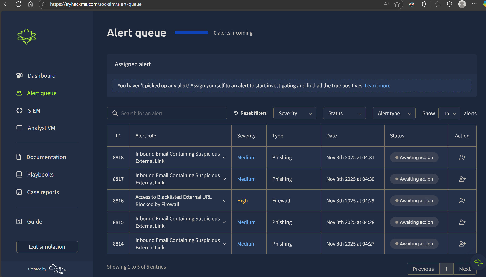
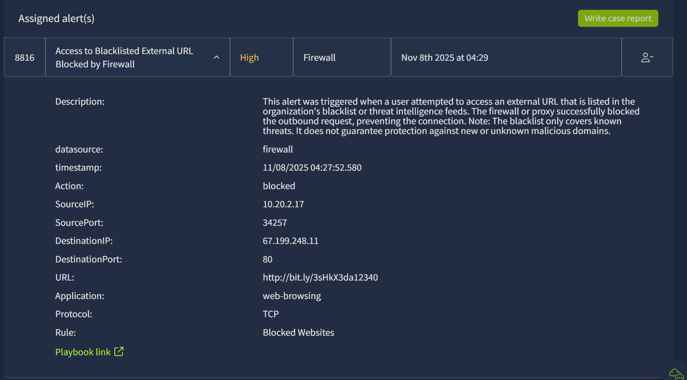
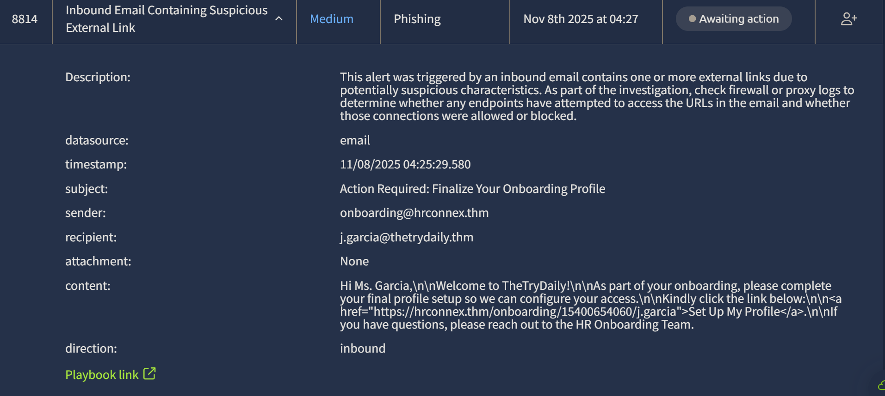
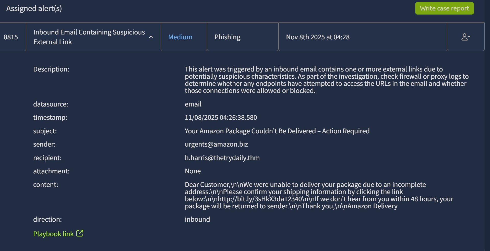
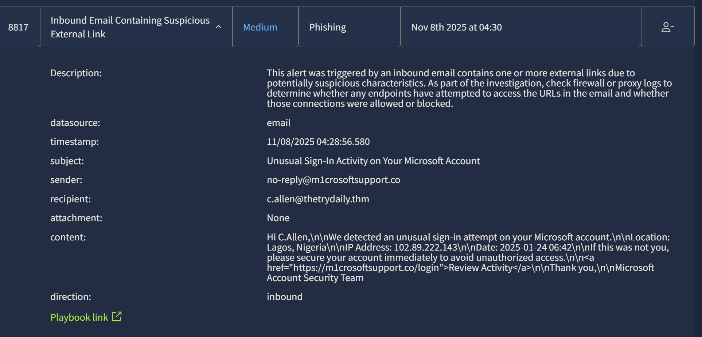

# SOC Simulator (TryHackMe SOC Analyst Simulation)

_A hands-on SOC analyst project simulating real-time alert triage, phishing analysis, and incident reporting._

---

## Table of Contents
- [Project Summary](#project-summary)
- [Skills Demonstrated](#skills-demonstrated)
- [Investigation Process](#investigation-process)
  - [Stage 1: Environment Overview](#stage-1-environment-overview)
  - [Stage 2: High-Severity Alert Investigation](#stage-2-high-severity-alert-investigation)
  - [Stage 3: False Positive Identification](#stage-3-false-positive-identification)
  - [Stage 4: Phishing Campaign Detection (Amazon Impersonation)](#stage-4-phishing-campaign-detection-amazon-impersonation)
  - [Stage 5: Phishing Attempt via Typosquatting (Microsoft Impersonation)](#stage-5-phishing-attempt-via-typosquatting-microsoft-impersonation)
- [Example Incident Report (Five Ws Format)](#example-incident-report-five-ws-format)
- [Lessons Learned](#lessons-learned)
- [What I’d Improve Next Time](#what-id-improve-next-time)
- [References](#references)

---

## Project Summary

> **What is this project?**
>
> I completed the TryHackMe **SOC Simulator**, an interactive lab replicating a Security Operations Center environment. I acted as a Tier 1 SOC Analyst, triaging real-time alerts in a simulated SIEM dashboard. Each alert contained log data, email artifacts, and playbooks to investigate phishing campaigns, suspicious URLs, and user activity.  
>
> The goal was to distinguish **True Positives** from **False Positives**, perform indicator validation, and write professional incident reports following the **Five Ws** and escalation workflows.

---

## Skills Demonstrated

- SOC alert triage and prioritization  
- Phishing detection and impersonation analysis  
- URL and domain reputation checks (VirusTotal)  
- Correlating multiple alerts for campaign-level detection  
- Writing concise, professional incident reports  
- Applying Five Ws methodology (Who, What, When, Where, Why)  
- SIEM query formulation and evidence validation  
- Decision-making on escalation vs closure

---

## Investigation Process

### Stage 1: Environment Overview
- **Problem:** Understand the SOC Simulator interface and queue system.  
- **Action:** Reviewed incoming alerts and identified five security events with varying severities.  
- **Result:** Prioritized alerts by severity and timestamp, starting with High severity alerts for investigation.  

---

### Stage 2: High-Severity Alert Investigation
- **Problem:** Firewall alert showing outbound connection to a **blacklisted external URL**.  
- **Action:** Checked alert details and validated the destination link in VirusTotal.  
- **Result:** The URL (`bit.ly/3sHkX3da12340`) was confirmed malicious. Classified as **True Positive**.  

**Short Case Report:**  
> User attempted to access a blacklisted bit.ly link flagged by the firewall. VirusTotal confirmed the URL as malicious. Firewall successfully blocked the connection. No further compromise observed.  

**Indicators of Compromise:**  
- URL: `http://bit.ly/3sHkX3da12340`  
- Destination IP: `67.199.248.11`  

 
---

### Stage 3: False Positive Identification
- **Problem:** Email alert flagged a legitimate onboarding message as suspicious.  
- **Action:** Analyzed sender, headers, and link destination. Verified domain (`hrconnex.thm`) as internal.  
- **Result:** Classified as **False Positive** — legitimate HR onboarding communication.  

**Short Case Report:**  
> Email originated from trusted internal domain `hrconnex.thm`. Contained legitimate onboarding link. No malicious indicators detected.  

 

---

### Stage 4: Phishing Campaign Detection (Amazon Impersonation)
- **Problem:** Email impersonating **Amazon**, urging the recipient to confirm shipping details within 48 hours.  
- **Action:** Verified sender (`urgents@amazon.biz`) and inspected embedded URL. Domain found malicious.  
- **Result:** Classified as **True Positive**. Confirmed phishing attempt using urgency and a shortened malicious link.  

**Short Case Report:**  
> Email impersonated Amazon using domain `amazon.biz`. Contained malicious URL (`bit.ly/3sHkX3da12340`). VirusTotal confirmed the link as malicious.  

**Indicators of Compromise:**  
- Sender: `urgents@amazon.biz`  
- URL: `http://bit.ly/3sHkX3da12340`  

 
---

## Example Incident Report (Five Ws Format)

> **Alert:** Phishing Email – Amazon Impersonation  
> **Alert ID:** 8815  
> **Classification:** True Positive  

---

### Who
- **User/Recipient:** h.harris@thetrydaily.thm  
- **Sender:** urgents@amazon.biz  

### What
- Received an email impersonating Amazon’s delivery service, instructing the user to “confirm delivery details within 48 hours.”  
- Contained a shortened URL (`http://bit.ly/3sHkX3da12340`) redirecting to a known malicious site.

### When
- **Detection Time:** 11/08/2025 04:26 UTC  
- **Alert Generated By:** Email Security Gateway → SIEM  

### Where
- **Host:** 10.10.173.136  
- **Network Zone:** Corporate LAN (Workstation Segment)  
- **Destination IP:** 67.199.248.11 (External)  

### Why
- Domain `amazon.biz` is **not** an official Amazon domain.  
- Email used **urgency and fear** tactics typical of phishing campaigns.  
- The embedded link was confirmed **malicious on VirusTotal**.  

---

### Verdict
✅ **True Positive** – Confirmed phishing email designed to harvest user credentials.

### Actions Taken
1. Blocked sender domain and URL on mail gateway.  
2. Queried SIEM for other recipients – no additional hits.  
3. Added IOCs to threat intel feed.  
4. Notified user to delete email and avoid clicking links.

### Indicators of Compromise (IOCs)
| Type | Indicator | Description |
|:--|:--|:--|
| URL | `http://bit.ly/3sHkX3da12340` | Malicious shortened URL (credential harvesting site) |
| Domain | `amazon.biz` | Fake domain impersonating Amazon |
| IP Address | `67.199.248.11` | Destination IP from blocked connection |

---

### Escalation Decision
- **Yes – Escalated to Tier 2** for campaign correlation and blocklist validation.

### Analyst Notes
> The email leveraged social-engineering rather than attachments, bypassing signature-based filters.  
> This highlights the importance of behavioral detection and user awareness in phishing defense.

---

### Stage 5: Phishing Attempt via Typosquatting (Microsoft Impersonation)
- **Problem:** Email claiming to be from Microsoft Security about “Unusual Sign-In Activity.”  
- **Action:** Inspected sender domain and link. Found typosquatted domain (`m1crosoftsupport.co`).  
- **Result:** Classified as **True Positive** — impersonation phishing via typosquatting.  

**Short Case Report:**  
> Email impersonated Microsoft using `m1crosoftsupport.co`. Although the link appeared clean in VirusTotal, the typosquatted domain and urgency indicate credential phishing.  

**Indicators of Compromise:**  
- Sender: `no-reply@m1crosoftsupport.co`  
- URL: `https://m1crosoftsupport.co/login`  

 
---

## Lessons Learned
- Not all malicious activity is confirmed by reputation engines — analysts must rely on domain patterns and behavioral indicators.  
- SOC triage requires consistent application of the Five Ws to justify conclusions.  
- Urgency and impersonation are strong indicators of phishing attempts.  
- Documenting concise, evidence-backed reports is key for escalation efficiency.  

---

## What I’d Improve Next Time
- Use more SIEM queries to correlate events between users and hosts.  
- Automate URL reputation checks with API tools (VirusTotal, URLScan).  
- Build a personal report template to standardize SOC ticket documentation.  
- Explore the Tier 2 escalation process in future simulations.  

---

## References
- [TryHackMe SOC Simulator](https://tryhackme.com/soc-sim)  
- [VirusTotal](https://www.virustotal.com/)  
- [MITRE ATT&CK – T1566: Phishing](https://attack.mitre.org/techniques/T1566/)  

